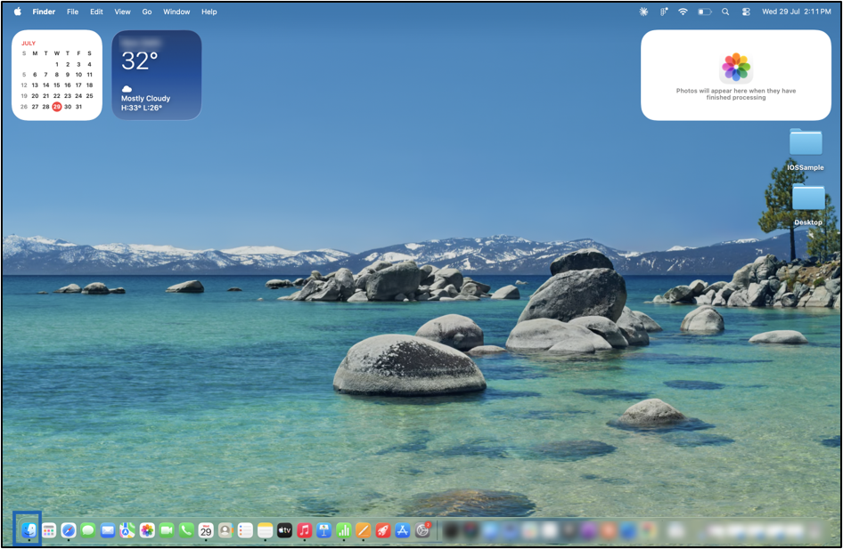
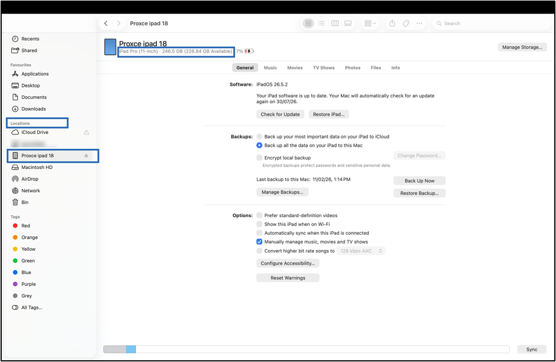
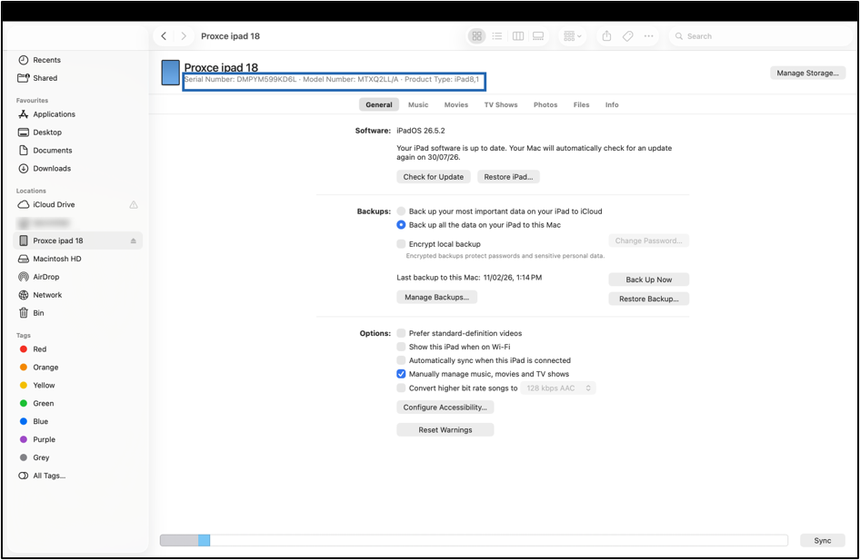
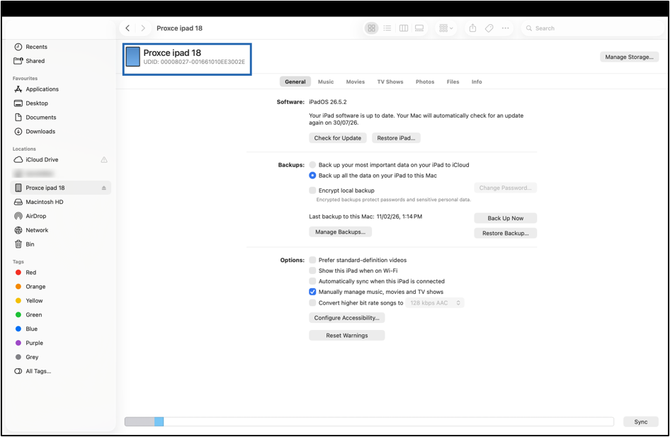

{/* Source: Intercom article 16118858 - https://oloid.help/en/articles/16118858-how-to-find-the-udid-of-ios-device */}
{/* Generated by intercom_to_mintlify.py - re-running overwrites this file. */}

## Introduction

This document explains how to find the UDID (Unique Device Identifier) of an iOS device, including iPhone and iPad.

## Prerequisites

- You must have a Mac.
- You must have an iPhone or iPad.
- You must have a USB cable to connect the iOS device to the Mac.
- Ensure the iPhone or iPad is unlocked before connecting it to the Mac.

## Steps to Find the UDID of an iOS Device(iPad/iPhone)

1. Connect the iOS Device(iPad/iPhone) to your Mac using a USB cable.

   <Note>
     **Note:** Ensure the iPad or iPhone is unlocked before connecting it to your Mac.
   </Note>

2. Once the iOS Device(iPad/iPhone) is connected to the Mac, open **Finder**.

   

3. Select your device from the left sidebar under **Locations**.
   The iOS device information page is displayed.
4. Click on the device information under device name.

   

click on the **Serial Number**.

The UDID is displayed.

