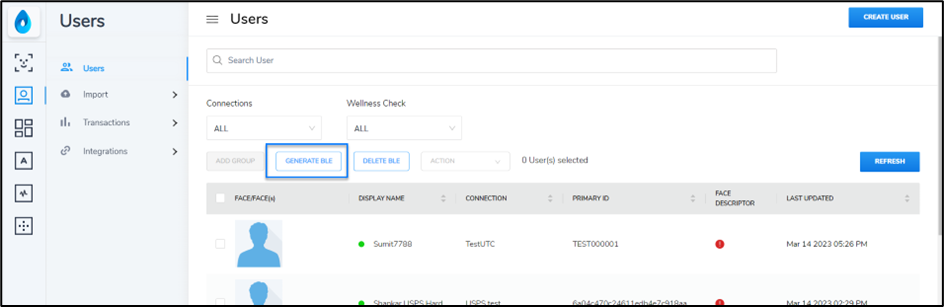
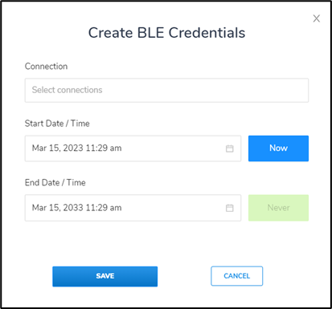

{/* Source: Intercom article 7129885 - https://oloid.help/en/articles/7129885-how-to-generate-ble-token-in-bulk */}
{/* Generated by intercom_to_mintlify.py - re-running overwrites this file. */}

1. Login to the Tenant Admin Portal.

2. On the Home page of the portal, click **Users** on the left panel menu.

The **Users** page is displayed.

3. Click **Generate BLE.**

The **Create BLE Connections** pop-up box is displayed.

5. Select **Connections**.

<Note>
  **Note:** The BLE token will be created for all the users if no connection is selected.
</Note>

6. Enter **Start Date**. Click **Now** to enter the current date.

By default, the start date is set to current date and time.

7. Enter **End Date**.

By default the end date is set to 10 years from start date.

8. Click **Save.**

The BLE token is generated for all the users in the connection.
