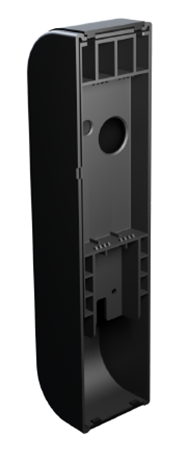
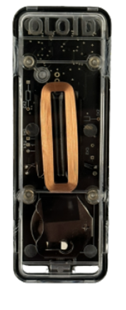
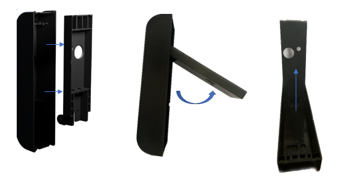
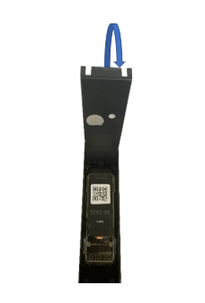
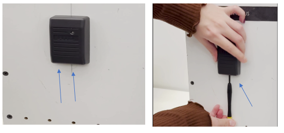
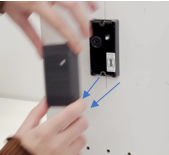
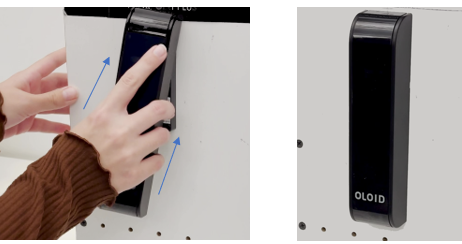

{/* Source: Intercom article 6839169 - https://oloid.help/en/articles/6839169-how-to-install-m-tag */}
{/* Generated by intercom_to_mintlify.py - re-running overwrites this file. */}

Installation process of M-tag involves attaching the M-Tag on top of the existing badge reader.

Oloid M-Tag comprises the following:

- M-Tag Reader Cover
- M-Tag

|  |  |  |
| --- | --- | --- |
| M-Tag Reader Cover | Rear Side Reader Cover | M-Tag |

To attach the M-Tag on top of the existing badge reader,

1. Open the M-Tag Reader Cover. No screws are needed for Reader Cover.

2. Place the M-Tag inside the reader cover and close the back cover.

3. Unscrew the cover of the existing Badge Reader.

4. Remove the existing badge cover.

5. Place the M-tag Reader over the existing Badge Reader and press to fit it.

The installation is complete and M-Tag is ready to use.
