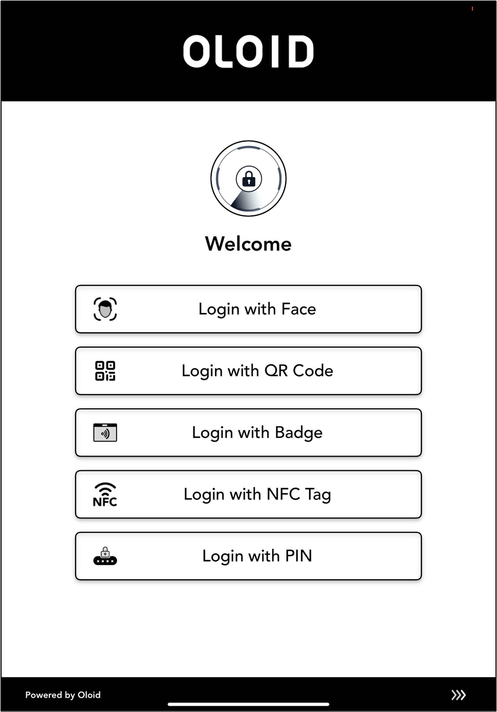
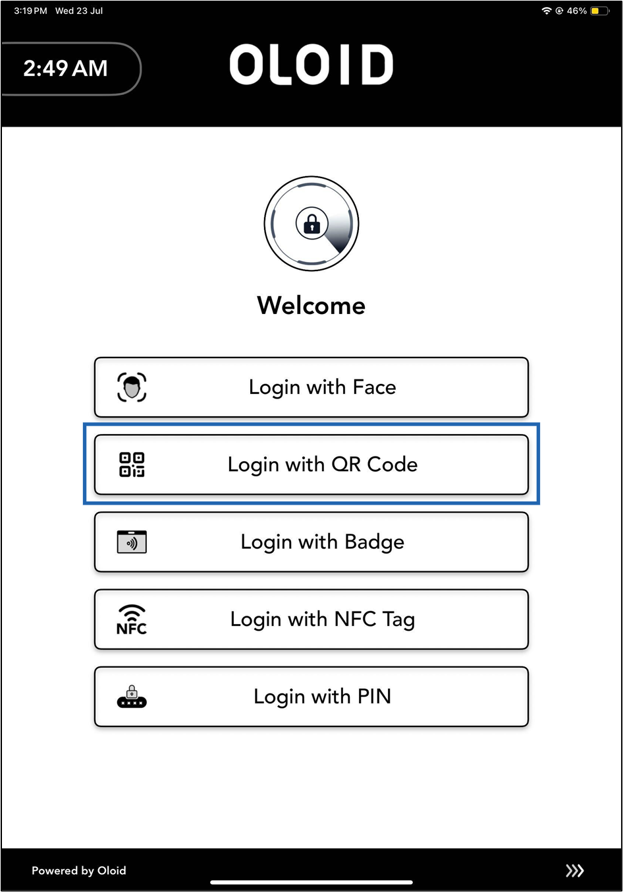
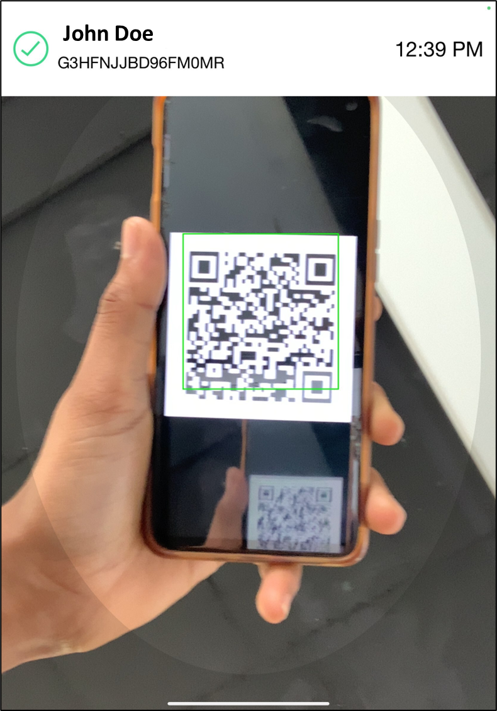
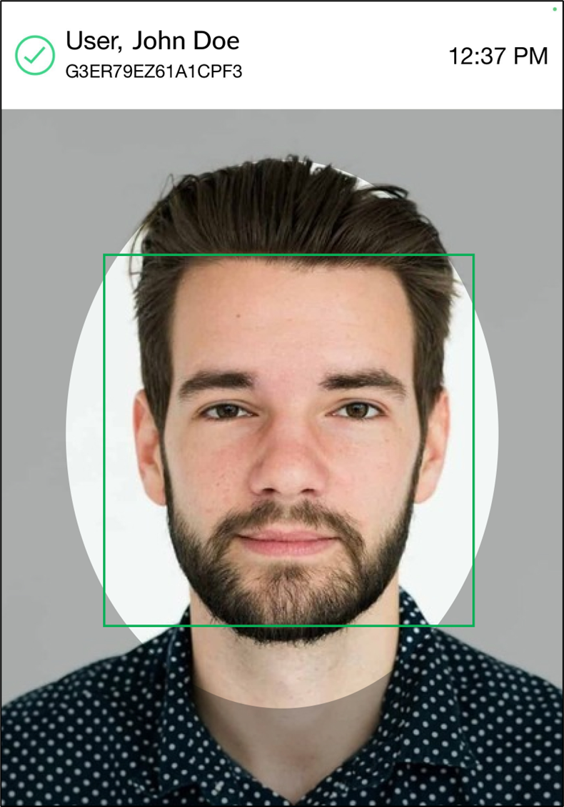
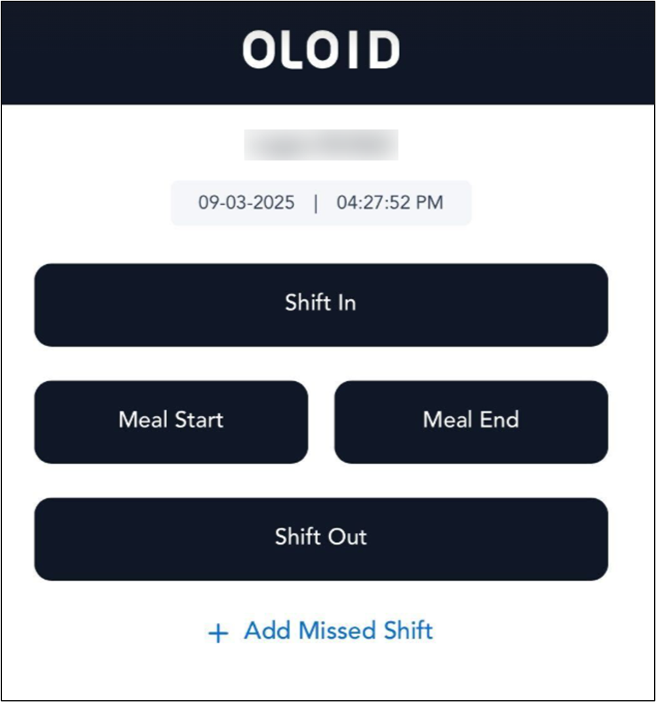

{/* Source: Intercom article 12145833 -  */}
{/* Generated by intercom_to_mintlify.py - re-running overwrites this file. */}

## Prerequisite

- In the Tenant Admin Portal, admin must do the following:
  - Assign QR Code to the user. For more details, refer [How to create QR code as credential for User.](/platform/tenant-admin-portal/tenant-admin-portal-how-to-create-and-share-qr-code-credential-with)
  - Assign a face credential to the user. For more details, refer [Face Onboarding](/more/passwordless-authenticator/face-onboarding)
  - Enable QR option under the Oloid Connect application in Authentication tab. For more details, refer [How to create and configure Oloid Connect Application in Tenant Admin Portal](/platforms/ios/time-clock/oloid-connect/oloid-connect-how-to-create-and-configure-application-in-tenant-admin)

## Steps to log in using QR and Face

1. Launch the **Oloid Connect App**.

   <Note>
     **Note:** Since the endpoint is already paired, the App will launch in the Auth selection screen of the App. For more, refer to [How to pair an Oloid Connect endpoint](/platforms/ios/time-clock/oloid-connect/oloid-connect-how-to-pair-an-endpoint).
   </Note>

   

   The Auth selection screen is displayed.
2. Tap **Login with QR Code.**

   

   The Camera opens to scan the **QR Code**.
3. Scan **QR Code**.

   

   After successful authentication, the Camera opens to capture the user's face.

Place your Face inside the ovel shape in the screen.

After successful authentication user details are appeared on the top of the screen.

On Face authentication, you are logged in to the **HRIS** platform successfully.

### Sample Screen

4. 
