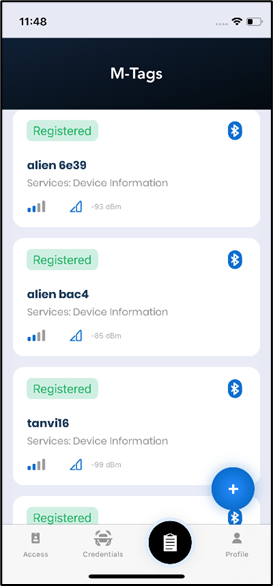
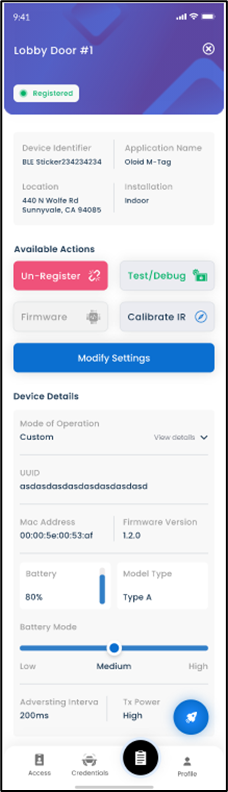
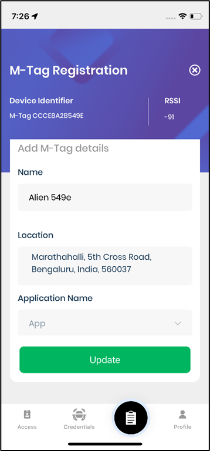

{/* Source: Intercom article 6984528 - https://oloid.help/en/articles/6984528-how-to-modify-m-tag-settings */}
{/* Generated by intercom_to_mintlify.py - re-running overwrites this file. */}

1. Launch the **M-Tag Admin** App.
2. Log in to the App.
   The M-Tag screen is displayed with the list of MAC Ids of the available M-Tags.

   

3. Select the registered **M- Tag** to edit settings.
   The M-tag detail screen is displayed.

   

4. Click **Modify Settings**.
5. Edit the fields as required. Follow the screen instructions to complete the steps.

   

6. Click **Update**.
   The M-Tag settings are updated.
