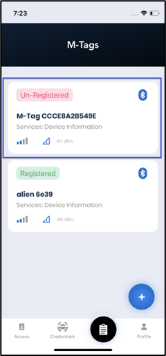
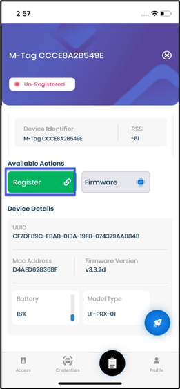
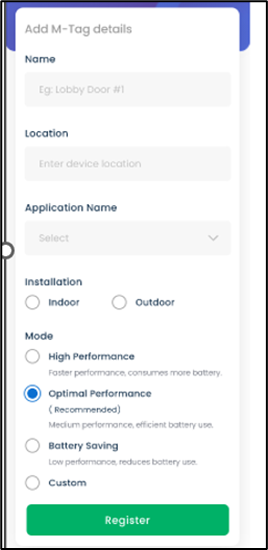
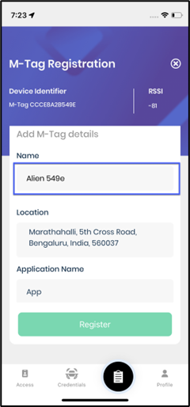
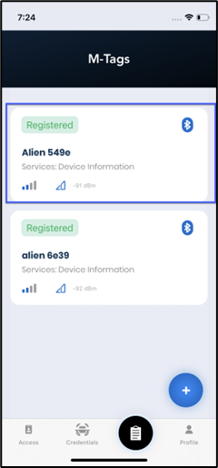

{/* Source: Intercom article 6972238 - https://oloid.help/en/articles/6972238-how-to-register-m-tag */}
{/* Generated by intercom_to_mintlify.py - re-running overwrites this file. */}

**Prerequisite**:

- Your device's Bluetooth is turned on.
- You are near the M-Tag to be registered so that M-Tag Admin app can detect the device's MAC Id.
1. Launch the **M-Tag Admin** App.
2. Log in to the App.
   The M-Tag screen is displayed with the list of MAC Ids of the available M-Tags.
3. Select the **M-Tag** to register.

   

   The **M-Tag** detail screen is displayed.
4. Click **Register**.

   

   The M-Tag registration screen is displayed.
5. Do the following on the registration screen:
   a. Enter **Name** of the M-tag.
   b. Select **Application Name**.
   c. Select Installation- **Indoor** or **Outdoor**.
   d. Select **Mode**. It is recommended to choose **Optimal Performance**.

   <Note>
     **Note:** Location field is auto-populated.
   </Note>

   

   

6. Click **Register**.
   The M-Tag is listed as registered on successful registration.

