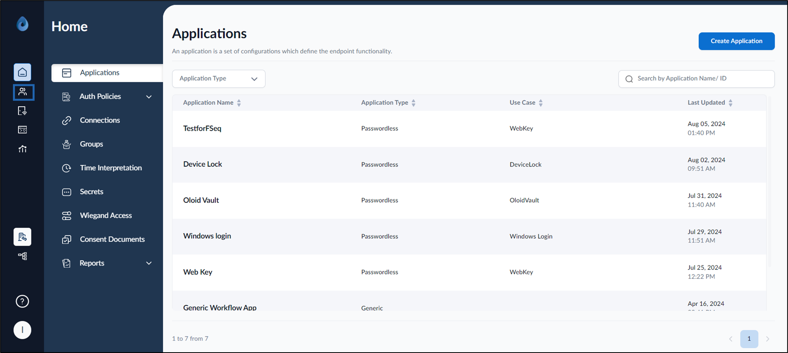
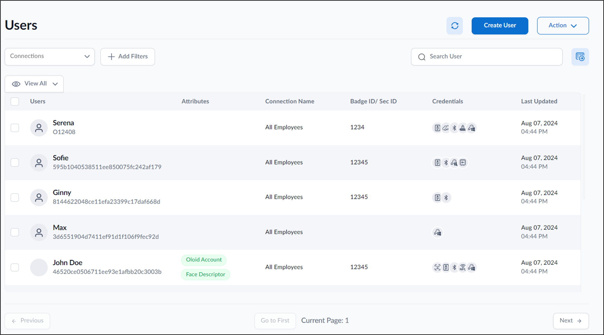
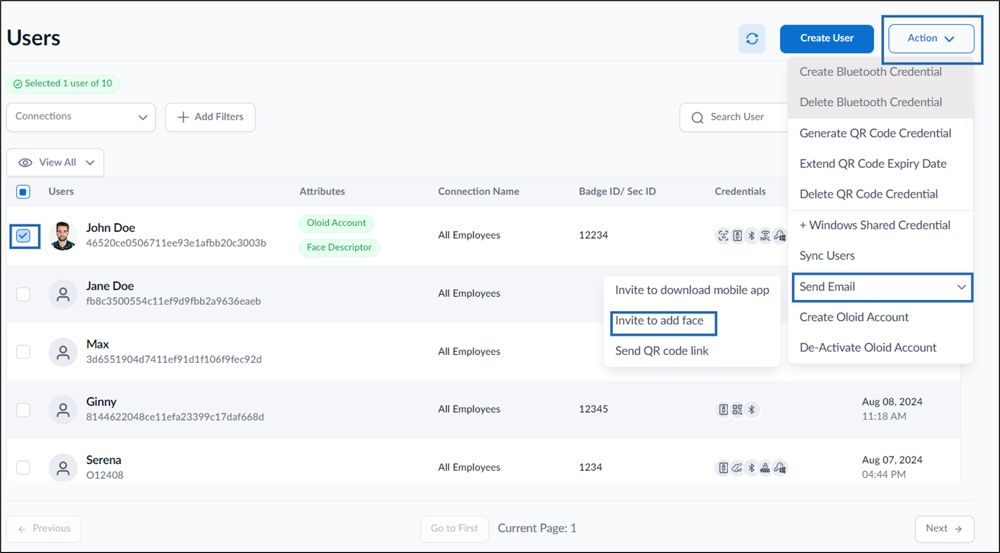
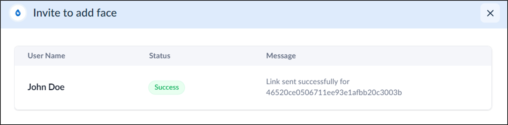

{/* Source: Intercom article 9716564 -  */}
{/* Generated by intercom_to_mintlify.py - re-running overwrites this file. */}

Steps to invite to add face:

1. Log in to **Oloid Portal.**
2. On the homepage, click **Directory** from the left menu panel.

   

   The **Users** page is displayed.

   

3. Select user(s).
4. Click **Action** > **Send Email** > **Invite to add face.**

   

   The Invite to add face is sent successfully.

   
