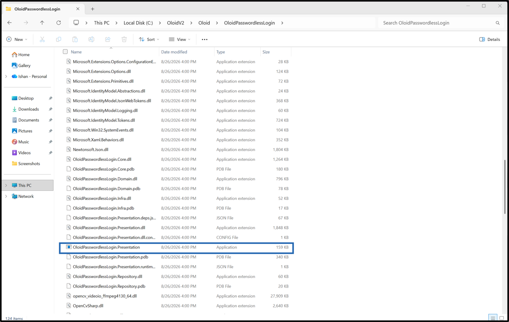
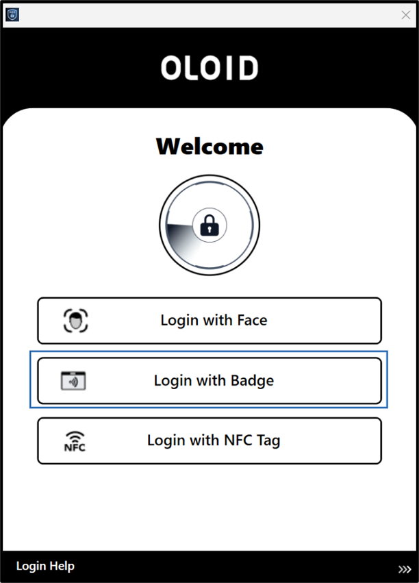
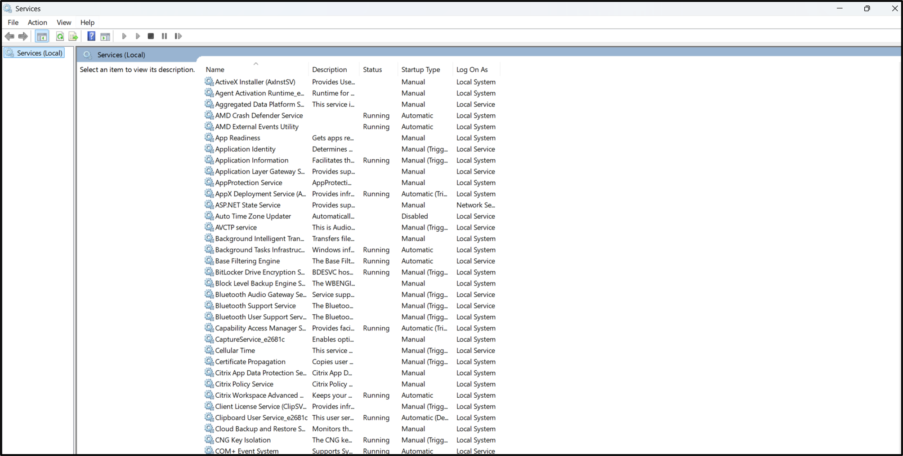
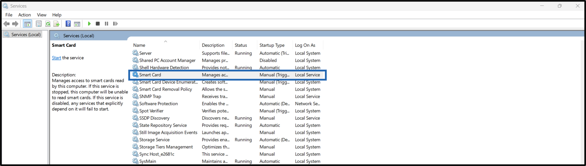
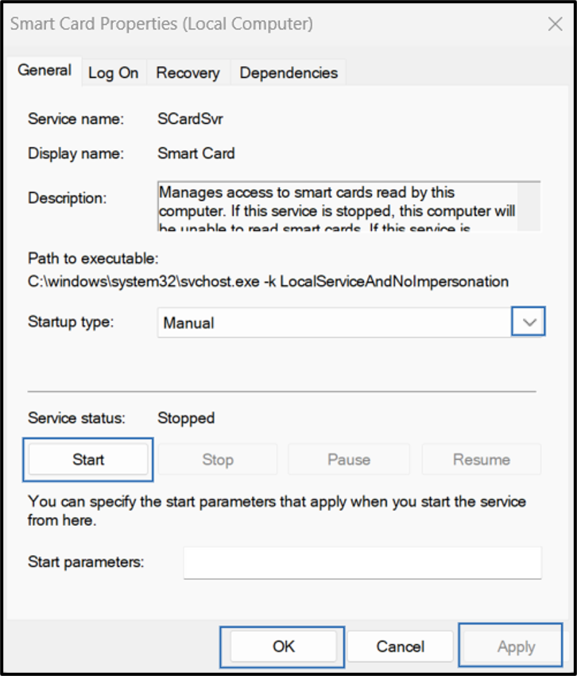

{/* Source: Intercom article 17242591 - https://oloid.help/en/articles/17242591-how-to-setup-the-card-reader-for-vdi-oloid-launcher */}
{/* Generated by intercom_to_mintlify.py - re-running overwrites this file. */}

## Introduction

This document explains how to configure and verify RFID and HID card readers for badge login on Oloid Launcher in a VDI environment.

RFID card readers work with Oloid Launcher without additional configuration. HID card readers require the Windows **Smart Card** service to be configured and running.

```
Note: Currently Oloid supports RFID, HID SEOS RP and HID Proxc. cards.
```

## Prerequisites

- Ensure the user has valid badge credentials.
- Ensure Oloid Launcher is installed and the VDI endpoint is successfully paired.
- Ensure the card reader is connected to the VDI system.
- For HID card readers, ensure you have administrator access to configure Windows services.

## Set Up the RFID Card Reader

RFID card readers work with Oloid Launcher without additional configuration.

1. Go to **C:\OloidV2\Oloid\OloidPasswordlessLogin** and open **OloidPasswordlessLogin.Presentation**.

   

   The Oloid login screen is displayed.
2. Click **Login with Badge**.

   

3. Tap the RFID badge on the card reader.
   The user is logged in successfully.

## Set Up the HID Card Reader

For HID card readers, ensure that the Windows **Smart Card** service is configured to start automatically and is running.

1. Press **Windows + R**, type **services.msc**, and press **Enter**. The Services window is displayed.

   

2. Find the **Smart Card** service and double-click it.

   

   The Smart Card Properties window is displayed.
3. Do the following:
   1. If **Startup type** is set to **Manual**, select **Automatic**.
   2. If **Service status** is **Stopped**, click **Start**.
   3. Click **Apply** > **OK**.

      

      The Card Properties is configured successfully.
4. Log in with the HID badge using the steps described in **Verify RFID Card Reader Login**.
   The user is logged in successfully.

#### Related Article

[Windows Login v2.0 - Install, Pair and Configure Oloid Launcher on Citrix Virtual Desktop (VDI)](/platforms/windows/windows-login/v2/windows-login-v2-0-install-pair-and-configure-oloid-launcher-on)
