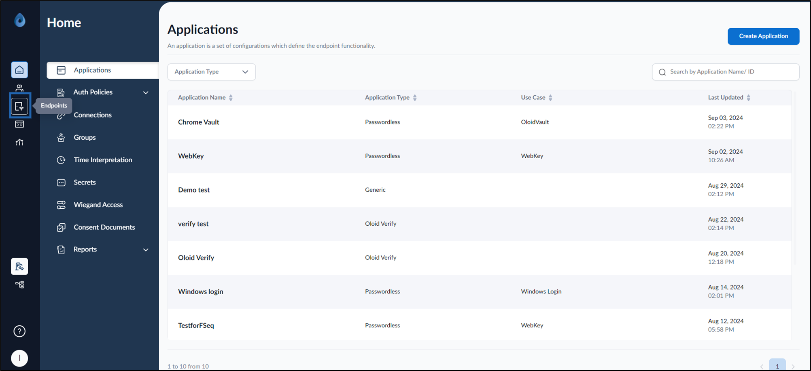
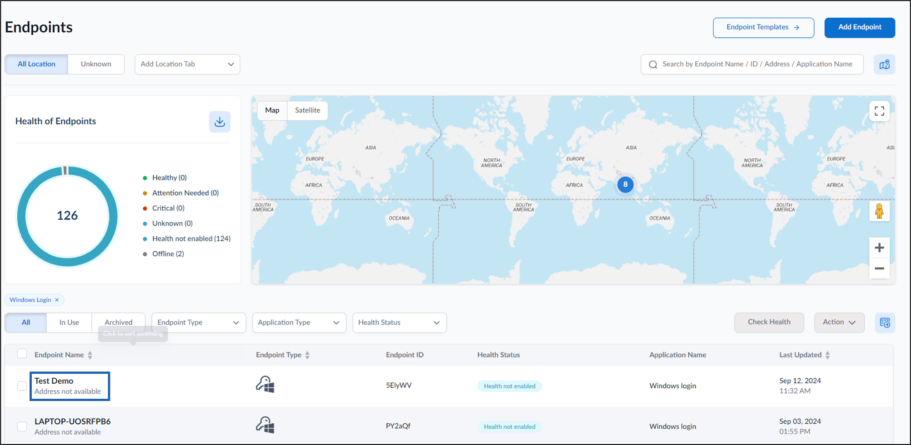
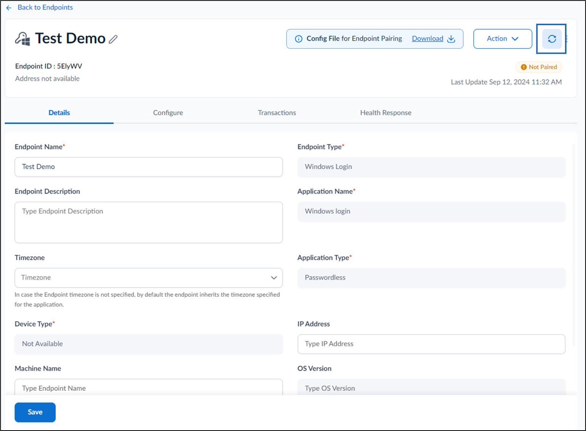
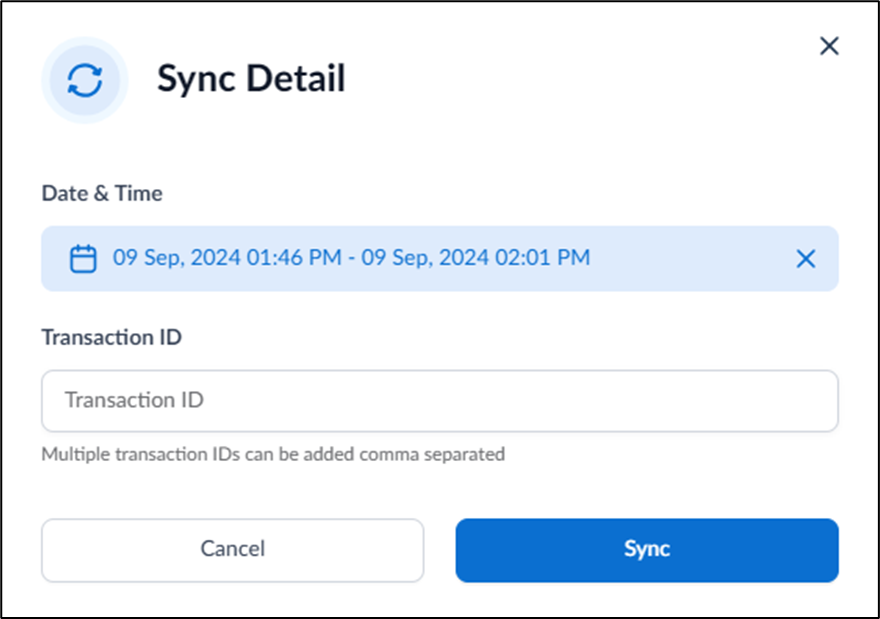
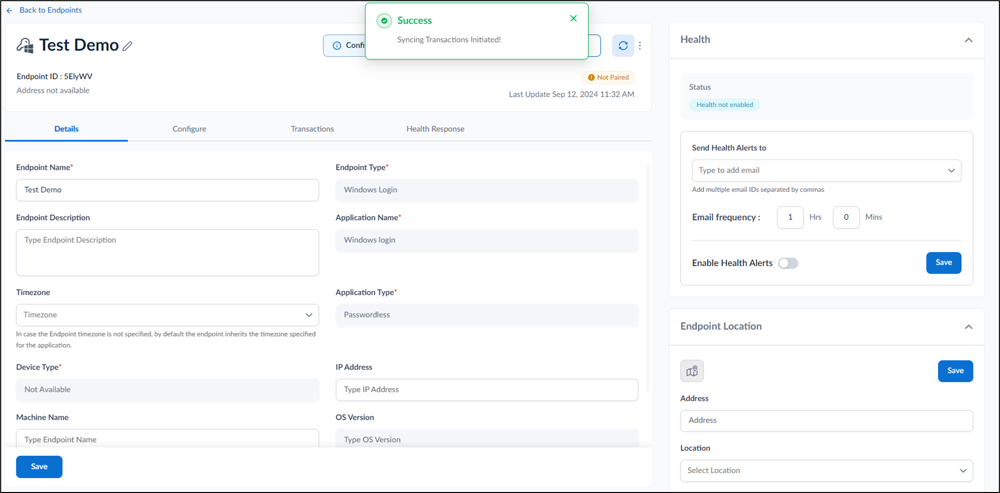

{/* Source: Intercom article 9841412 -  */}
{/* Generated by intercom_to_mintlify.py - re-running overwrites this file. */}

Steps to sync transactions:

1. Login to the **Oloid Portal**.
2. On the homepage, click **Endpoints** from the left menu panel.

   

   The **Endpoints** page is displayed.
3. Click **Endpoint name** to edit.

   

   The **Endpoint details** page is displayed.
4. Click **Sync Transaction** on the top right corner.

   

   The **Sync Detail** pop-up box is displayed.

   

5. On the pop-up box, do the following:
   1. Select **Date & Time** from the calendar.
   2. Enter **Transaction ID**.
   3. Click **Syn**c.
      The syncing transaction is initiated successfully.

      
