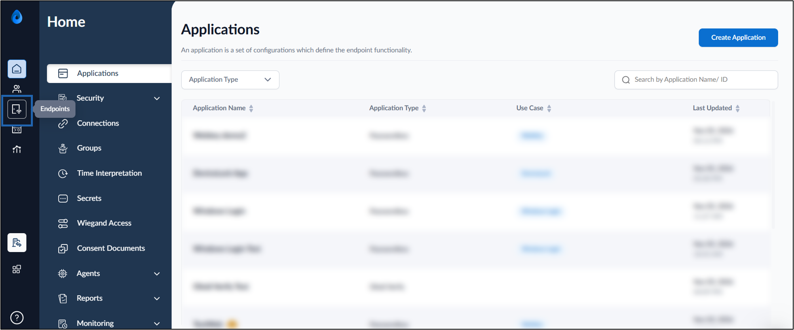
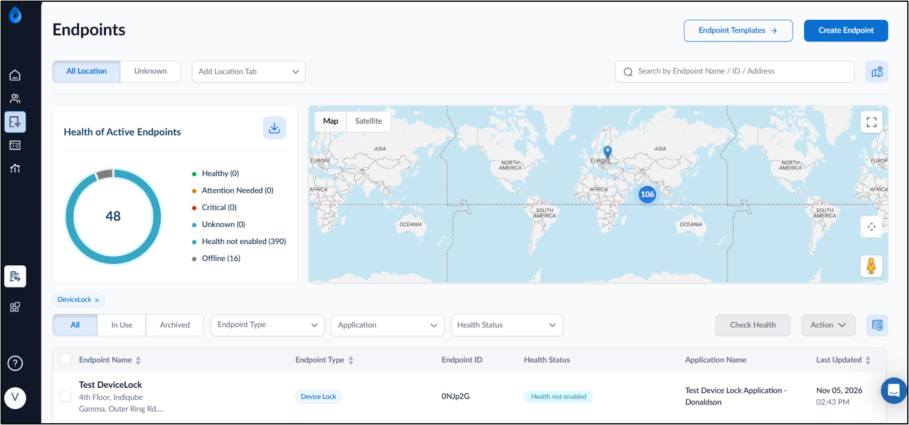
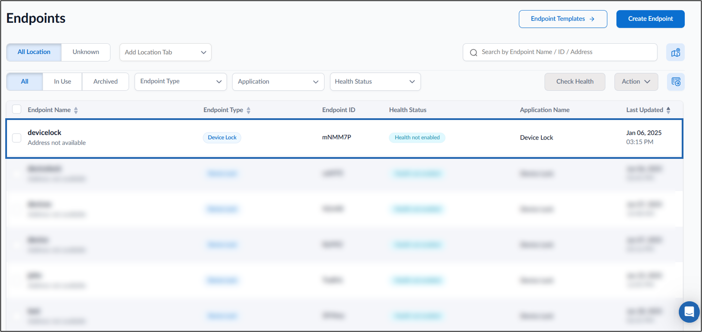
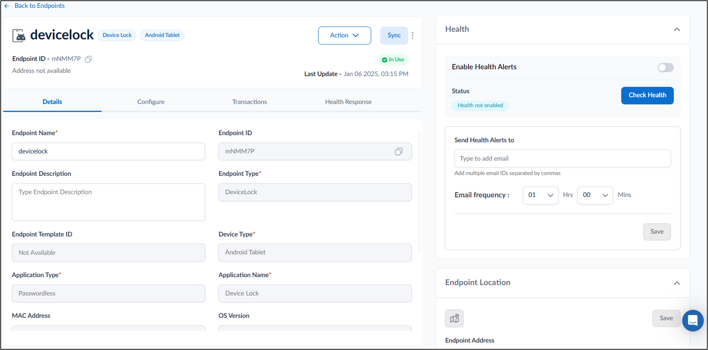
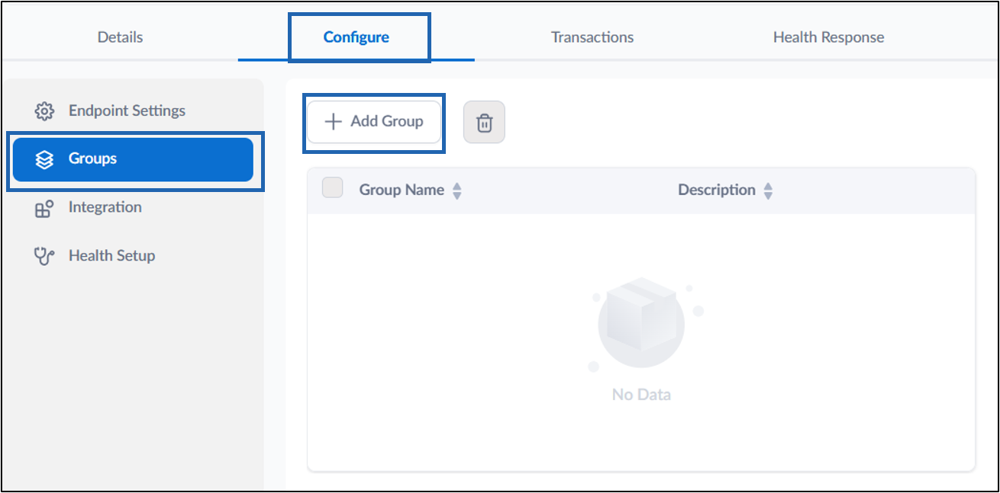
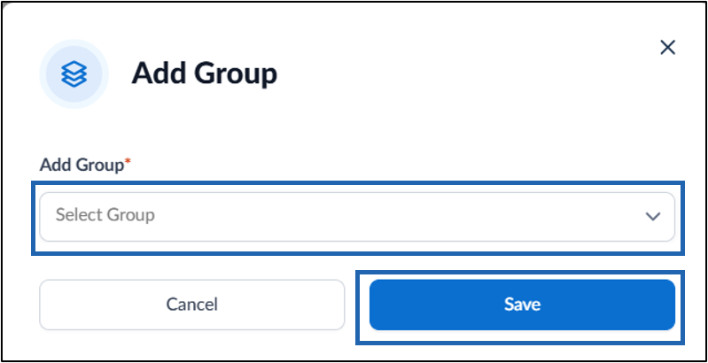
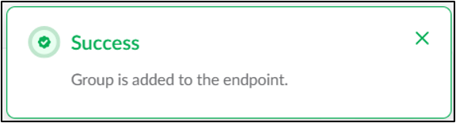

{/* Source: Intercom article 18243717 -  */}
{/* Generated by intercom_to_mintlify.py - re-running overwrites this file. */}

This section helps you link the group directly to a single endpoint.

1. In the Tenant Admin Portal, click **Endpoints** on the left menu panel.

   

   The **Endpoints** page is displayed.

   

2. Select the **Endpoint** that the DeviceLock device is paired with.

   

   The Endpoint details page is displayed.

   

3. Go to **Configure** > **Groups > Add Group**.

   

   The Add Group pop-up box is displayed.
4. Do the following:
   1. Add the group created in the Add Users to a Group section.
   2. Click **Save**.

      

      The group is added to the endpoint successfully.

      
