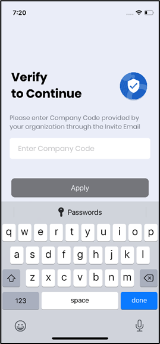
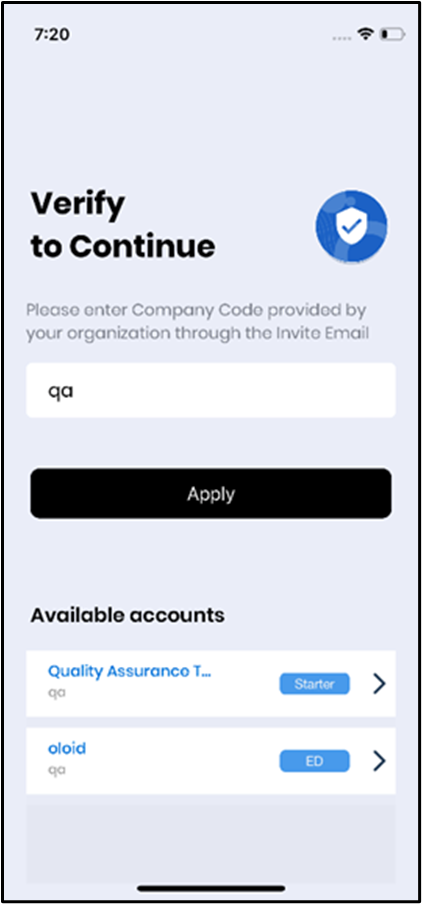
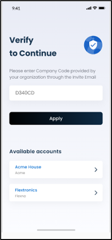
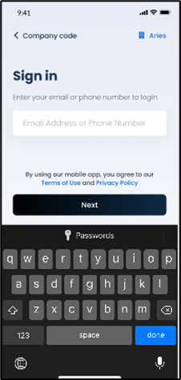
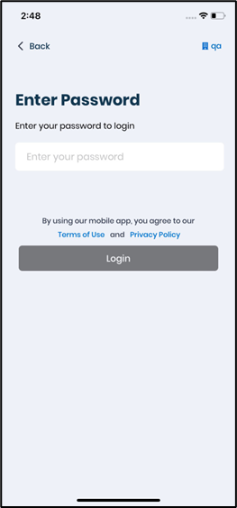
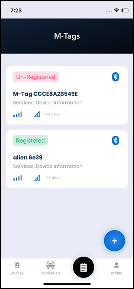

{/* Source: Intercom article 6969506 - https://oloid.help/en/articles/6969506-m-tag-admin-app-installation-and-login */}
{/* Generated by intercom_to_mintlify.py - re-running overwrites this file. */}

**Pre-Requisite:**

- You should have a valid **Company Code**.
- Your device **Bluetooth** should be turned on.
- You should have the **User name** and **Password** to sign in to the app.

<Note>
  **Note:**

  **User name** and **Password** are the same as your **Tenant Admin Portal**.
</Note>

1. Go to **App Store** and download **M-Tag Admin** App.

2. Install the application and upon successful installation, open the app.

3. Enter **Company Code** in the **Verify to Continue** screen to log in to the app and tap **Apply**.

The tenant is listed in the screen under **Available Accounts**.

4. Tap the **Tenant** then tap **Apply.**

The **Sign in** page is displayed.

5. Enter your registered **email id** and tap **Next**.

6. Enter **Password** and tap **Login**.

The welcome screen pops up followed by the M-Tag list screen. The M-tag screen displays the MAC Ids of the available M-Tags.

