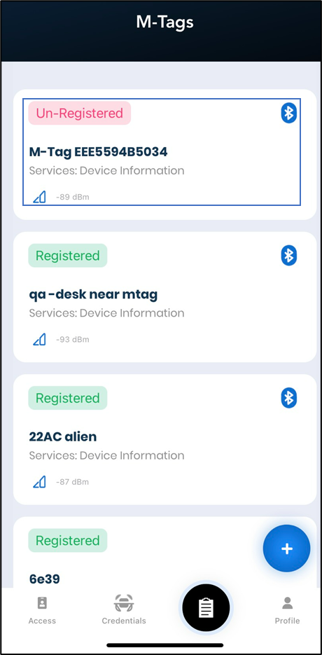
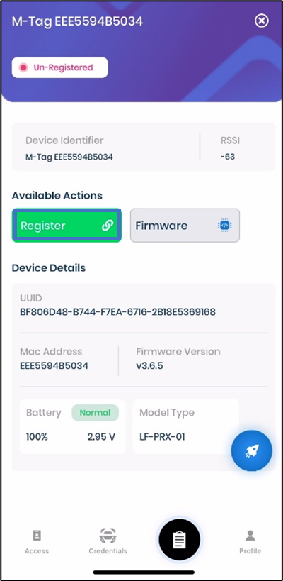
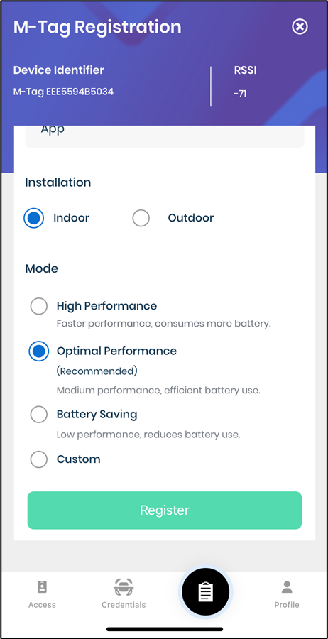
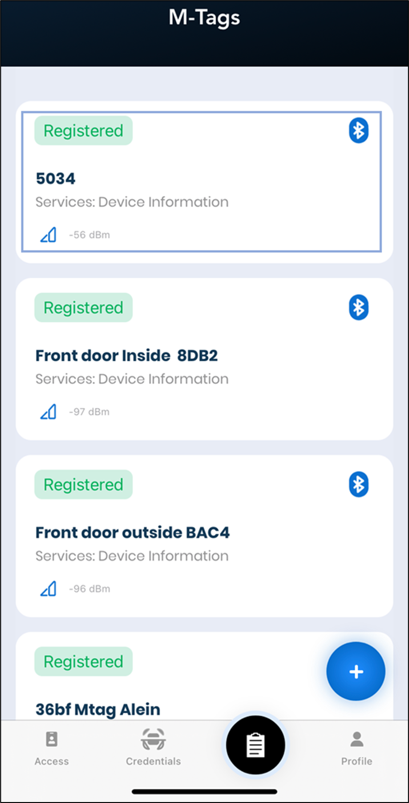

{/* Source: Intercom article 7262034 -  */}
{/* Generated by intercom_to_mintlify.py - re-running overwrites this file. */}

Steps to register M-Tag:

1. Launch the M-Tag Admin app.
2. Log in to the app.
   The details screen displays a list of MAC Ids of the available M-Tags.
3. Select the M-Tag to register.

   

   The M-Tag detail screen is displayed.
4. Tap **Register**.

   

5. Do the following, in the M-Tag Registration screen:
   1. Enter **Name** of the M-tag
   2. Select **Application Name**.
   3. Select Installation- **Indoor** or **Outdoor.**
   4. Select **Mode**.

      <Note>
        **Note:** It is recommended to choose **Optimal Performance**.
      </Note>

6. Tap on **Register**.

   

7. The M-Tag is successfully registered and is listed on the details screen.

   
