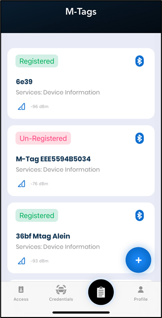
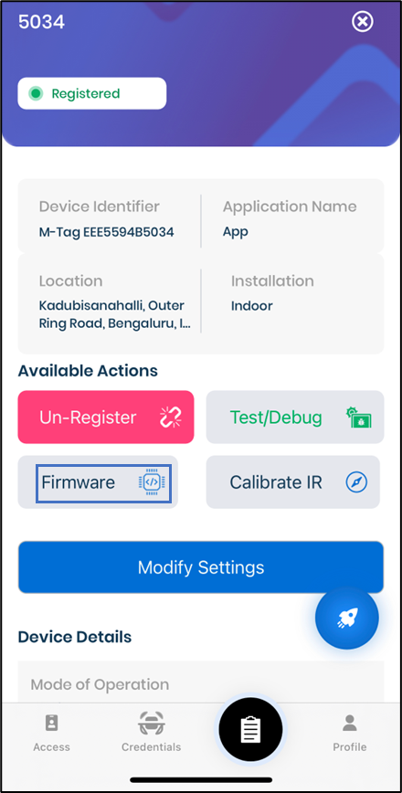
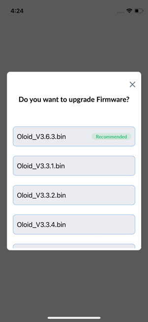

{/* Source: Intercom article 7262008 -  */}
{/* Generated by intercom_to_mintlify.py - re-running overwrites this file. */}

To upgrade firmware,

1. Launch the M-Tag admin app.
2. Sign in to the app.
   The details screen displays a list of MAC Ids of the available M-Tags.
3. Select a registered or unregistered M-Tag.

   

   The registered screen is displayed.
4. Tap on **Firmware**.

   

5. Select any of the firmware versions to upgrade.

   <Note>
     **Note:** It is recommended to select the recent version of the firmware.
   </Note>

   
