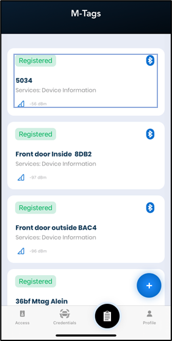
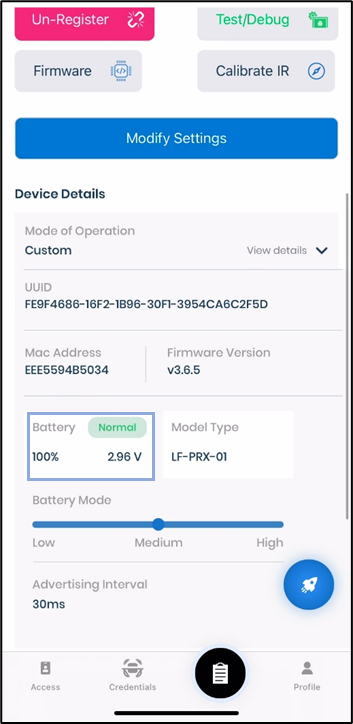
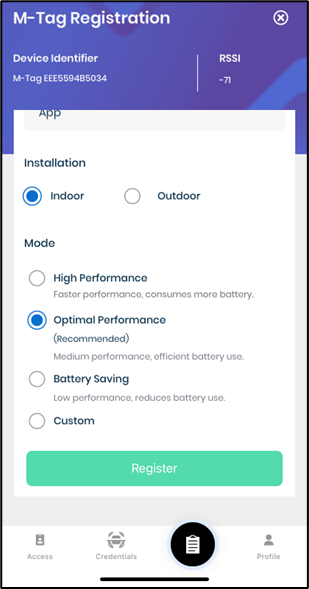
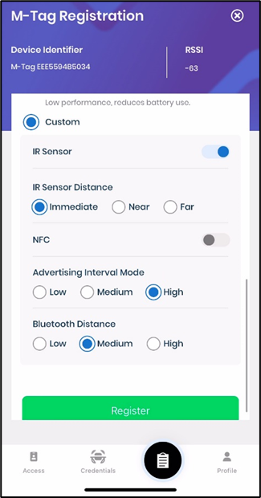
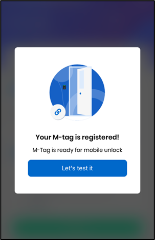
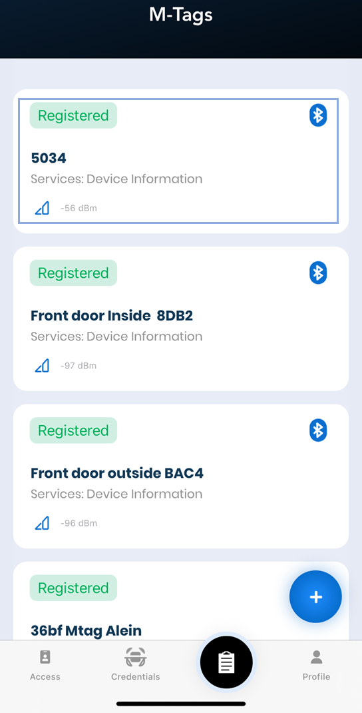

{/* Source: Intercom article 7261927 -  */}
{/* Generated by intercom_to_mintlify.py - re-running overwrites this file. */}

Configure Battery and Performance Modes

To configure battery,

1. Launch the **M-Tag admin** app.
2. Sign in to the app.
   The details screen displays a list of MAC Ids of the available M-Tags.
3. Select a registered M-Tag.

   

4. In device details screen, **Battery settings** is at the bottom of the page.
5. Battery Setting:
   1. Displays Normal, when battery is 100 percent
   2. Displays Low, when battery is less than 20 percent
   3. Voltage remains constant 2.92V

To configure performance modes,

1. Launch the M-Tag admin app.
2. Sign in to the app.
   The details screen displays a list of MAC Ids of the available M-Tags.
3. Select an unregistered M-Tag.
4. Do the following, in the M-Tag Registration screen:
   1. Enter name of the M-Tag
   2. Select one from the following performance modes at the bottom of the screen:
      - High Performance
      - Optimal Performance
      - Battery Saving
      - Custom

        <Note>
          **Note:** High Performance, Optimal Performance, and Battery Saving mode the setting is pre-defined.
        </Note>

        

5. Select Custom to configure performance mode on your own.
   1. Toggle on **IR Sensor** to hold to unlock

      <Note>
        **Note:** For push notification, background, and foreground unlock modes IR Sensor is not required.
      </Note>

   2. Select **IR Sensor Distance** to change the distance of the hand gesture:
      - Immediate
      - Near
      - Far
   3. Select **Advertising Interval Mode** to change the signal strength:
      - Low
      - Medium
      - High
   4. Select **Bluetooth Distance** to change the distance from the app to M-Tag:
      - Low
      - Medium
      - High

        

        The performance mode screen is customized.
6. Tap on **Register** to successfully register and update the M-Tag.

   

   
