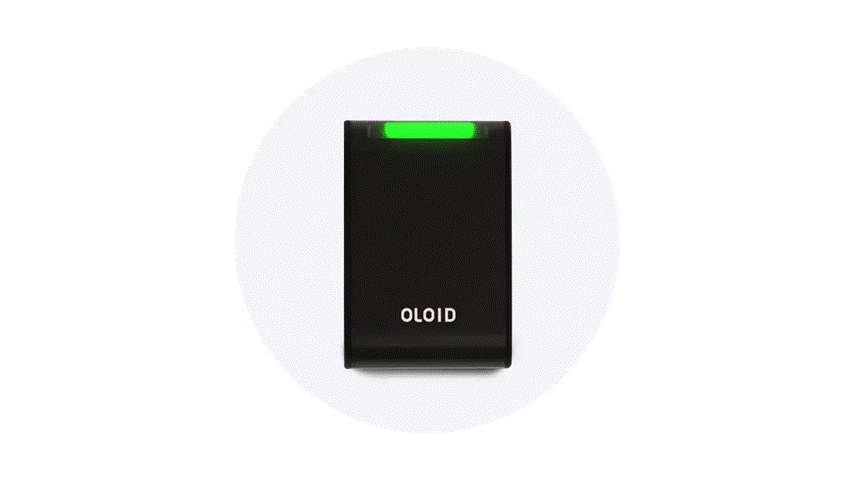

{/* Source: Intercom article 6899644 - https://oloid.help/en/articles/6899644-m-tag-features */}
{/* Generated by intercom_to_mintlify.py - re-running overwrites this file. */}

- The OLOID M-Tag is a sleek and sophisticated overlay that operates on a battery and uses Bluetooth Low Energy (BLE) technology to communicate with your door access control system.
- The BLE-powered device slides on top of your existing RFID card reader without impairing its existing functionality.
- Easy and quick self-installation without the need for re-wiring or replacing existing hardware.
- OLOID M-Tag is BLE-powered to transform any smartphone into a smart key. With a variety of intuitive unlock modes, your employees, contractors, and visitors will not want to carry a badge anymore.
- Intuitive remote management and automation are made possible by cloud-based administration.
- OLOID M-Tag supports the majority of readers available in the market. We can help customize it for you too.

