{/* Source: Intercom article 15223262 - https://oloid.help/en/articles/15223262-mdm-manage-engine */}
{/* Generated by intercom_to_mintlify.py - re-running overwrites this file. */}

## Introduction

This guide explains how to deploy **Windows Login 2.0** across Windows devices using **ManageEngine Endpoint Central**.

The deployment process includes:

- Creating a software package
- Configuring installation and uninstallation commands
- Deploying the package to target machines using Computer Configuration

---

## Prerequisites

Before you begin, ensure the following:

- You have access to the Endpoint Central console with administrator privileges.
- You have downloaded the Oloid Passwordless installer (.exe). For more information, refer: [Windows Login v 2.0 - How to download Windows Login v 2.0 installer file from Tenant Admin Portal](/platforms/windows/windows-login/v2/windows-login-v2-0-how-to-download-windows-login-v2-0-installer-file)
- You have downloaded the `AutoPairConfig.txt` file from the Tenant Admin Portal. For more information, refer: [Windows Login - How to generate Auto-Pair config file for Windows Login in Tenant Admin Portal](/platform/tenant-admin-portal/windows-login-how-to-generate-and-download-auto-pair-config-file-for)

  <Note>
    **Note:** Download the AutoPairConfig file in `.txt` format only.
  </Note>

- You have the `install-w-autopair.ps1` installation script file. To obtain the script file, contact [Oloid Support](mailto:support@oloid.ai).

## Steps to Deploy Windows Login 2.0 via ManageEngine

1. [Create the Package](/platforms/windows/windows-login/v2/windows-login-v2-0-how-to-deploy-windows-login-v2-0-using)
2. [Deploy the Package](/platforms/windows/windows-login/v2/windows-login-v2-0-how-to-deploy-windows-login-v2-0-using)
   The Windows 2.0 is deployed successfully.

### Steps to Configure the Package Details

1. Log in to the Manage Engine Admin Console.
   The Manage Engine home screen is displayed.
2. Click **Software Deployment.**

   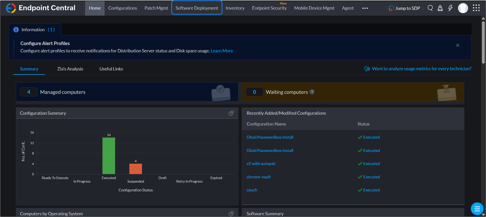

   The **Software Deployment** screen is displayed.
3. Click **+ Add Package > Windows.**

   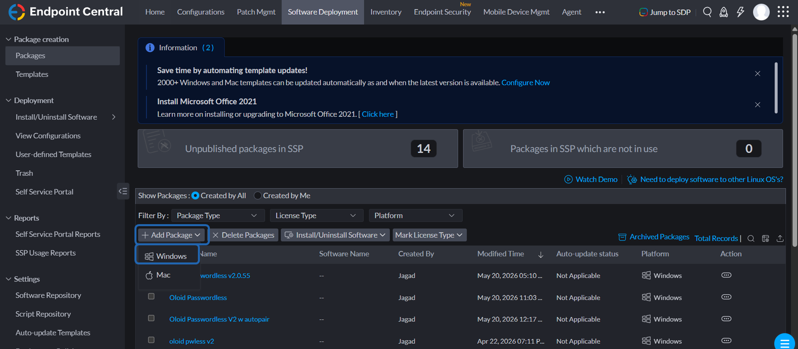

   The **Windows Package Creation** screen is displayed.
4. Do the following:
   1. Enter Package Name.
   2. Select **EXE / APPX / MSIEXEC / MSU / MSIX / MSIX Bundle** as the Package Type.
   3. Select **Commercial** as the License Type.
   4. Select **From Local Computer** as Locate Installable.

      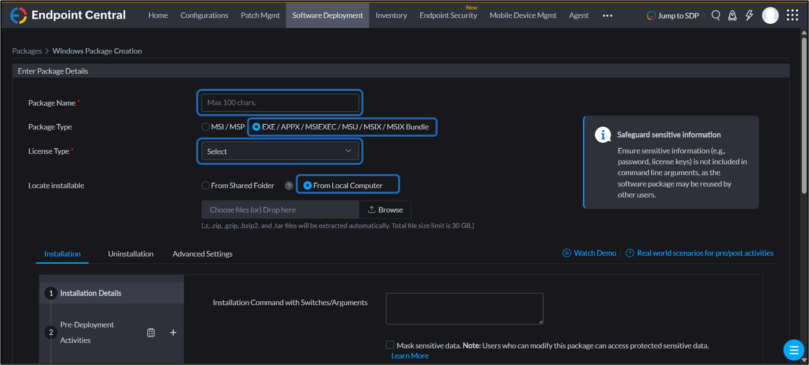

   5. Click **Browse** and upload the following files:
      - Oloid Passwordless installer (`.exe`).
      - AutoPairConfig.txt (Optional)

        <Note>
          **Note:** If the AutoPair configuration file is added, the app is installed and paired automatically. If not, manual pairing is required after installation.
        </Note>

      - Installation script file.
   6. Click **Open.**

      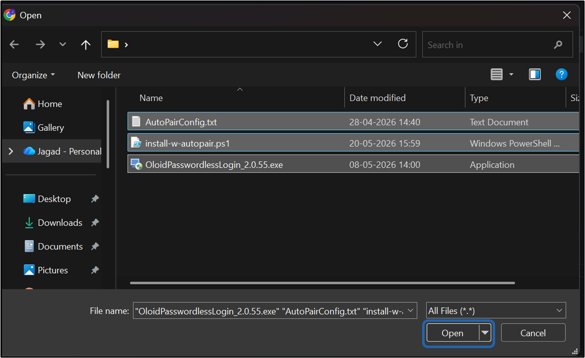

      All files are uploaded successfully.

      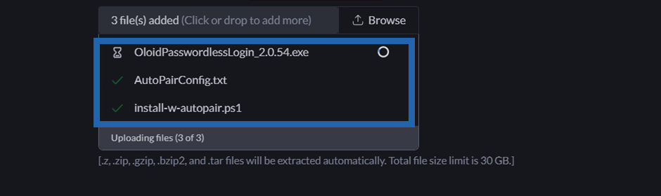

5. Go to Installation tab and do the following:

Enter the installation command in the **Installation Command with Switches/Arguments** field.

<Note>
  **Note:** Use the following command.
</Note>

```
%SystemRoot%\sysnative\WindowsPowerShell\v1.0\powershell.exe -ExecutionPolicy Bypass -File .\<installation script file name>
```

1. **Note:** Replace the &lt;installation script file name> text with actual installation script file name.
2. Enable **Mask sensitive data** to hide sensitive information from users who can modify the package (Optional).

   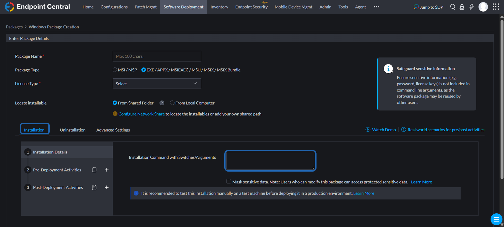

   The installation command is configured successfully.
6. Click **Uninstallation** tab and do the following:

Enter the installation command in the **Uninstallation Command with Switches/Arguments** field.

<Note>
  **Note:** It is recommended to use the below command.
</Note>

```
%SystemRoot%\sysnative\WindowsPowerShell\v1.0\powershell.exe -NoProfile -ExecutionPolicy Bypass -Command "Uninstall-Package -Name 'Oloid Passwordless Login' -Force"
```

2. Enable **Mask sensitive data** to hide sensitive information from users who can modify the package (Optional).

   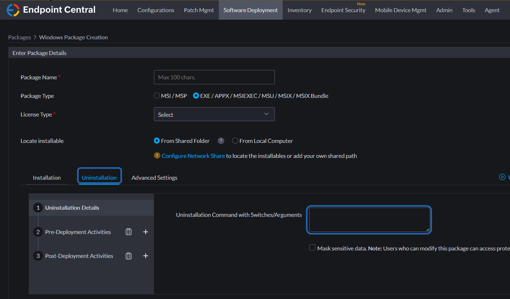

   The Uninstallation tab is configured successfully.
7. Go to the **Set Package Properties** section, expand **Package Properties**, and enter the version number of the Passwordless installer file.

   <Note>
     **Note:** The version number helps identify and track a specific package release and ensures that the correct package version is deployed.
   </Note>

8. Click **Add Package.**

   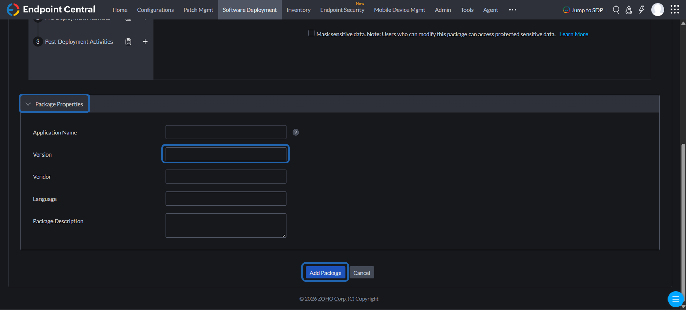

   The package is created and listed in the Packages screen.

### Steps to Deploy the Package

1. Go to **Software Deployment** home page, select the checkbox next to **Oloid Passwordless.**

   <Note>
     **Note:** Select the Oloid Passwordless package created in the previous step.
   </Note>

2. Click **Install/Uninstall Software > Computer Configuration (Windows).**

   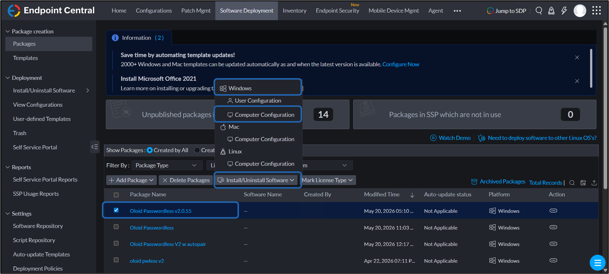

   The **Install/Uninstall Windows Software (Computer)** screen is displayed.
3. Do the following:
   1. Enter the **Name**.
   2. Click **Add Description** and then enter the description in the displayed text box. (Optional)
   3. Select **Install** as the Operation Type.
   4. Select **Oloid Passwordless** as the Package Name. (Default)
   5. Expand **Configure Install/Uninstall options and do the following.**
      1. Select **System User** for *Install As.*
      2. Ensure *Allow user interaction* is unchecked.

         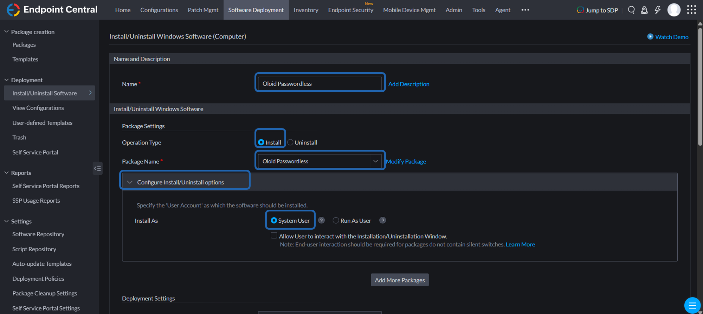

4. Scroll down to the **Deployment Settings** section and select Policy from the **Apply Deployment Policy** drop-down list.

   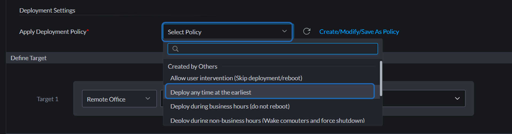

5. Under **Define Target**, configure **Target 1**:
   1. Select the required **Target Type** from the drop-down.
   2. Configure the **Target settings**.

      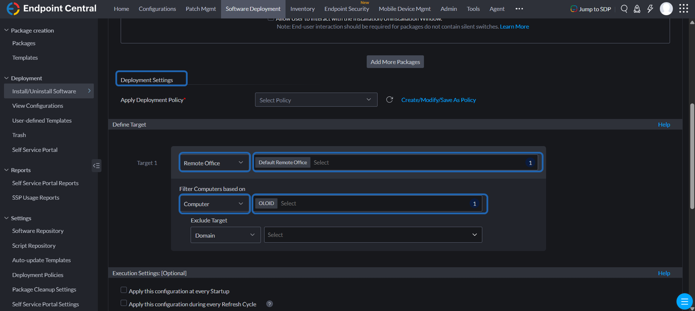

6. Click **Deploy.**

   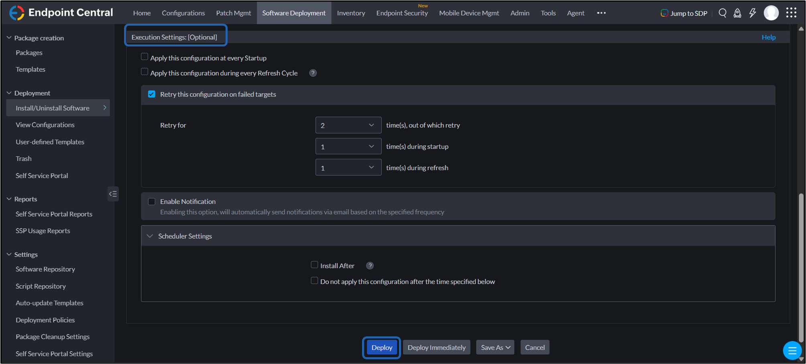

   The deployment is initiated and the configuration is pushed to target machines.

   <Note>
     **Note:** Changes may take a few minutes to apply. To deploy the changes immediately, click **Deploy Immediately**.
   </Note>

   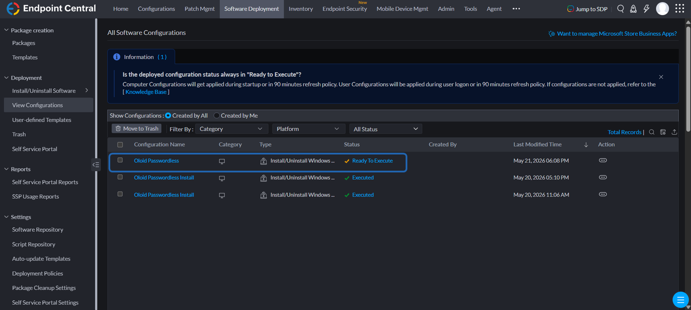
