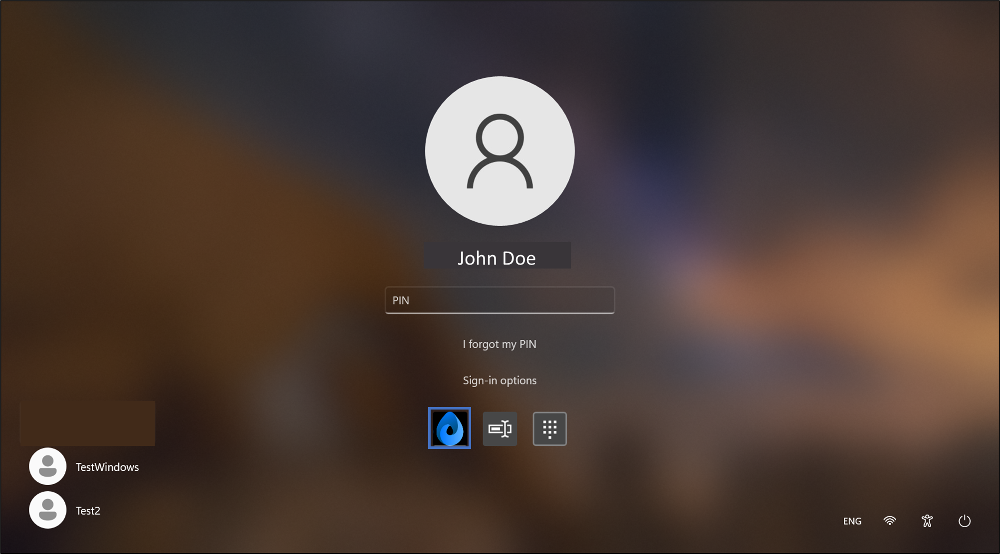
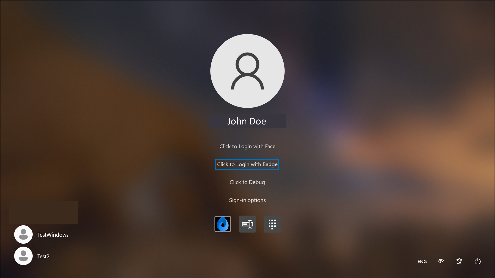

{/* Source: Intercom article 8420008 -  */}
{/* Generated by intercom_to_mintlify.py - re-running overwrites this file. */}

Oloid Windows Device Login supports badge and pin for multi-factor authentication.

To set up your Oloid portal for the Multi-factor authentication, refer **Credential Sequencing for Multi-factor authentication in Windows Device Login**.

## Pre-requisite

- You should download the Windows Device Login installer.
- The badge reader should be connected to your Windows system.

Steps to log in using multi-factor authentication:

1. On the Windows sign-in screen, click **Sign-in** options.
2. Click **Oloid** logo under sign-in option.

   

3. Select **Click to login with Badge**.

   

   The **Scan your Badge** pop-up box is displayed.
4. Tap the Badge on the Badge Reader to scan it.
   On badge validation, **enter your pin** pop-up box is displayed.

   <Note>
     **Note:** If you have multiple accounts associated with the user, then **Choose an Account** pop-up box is displayed. From the list of local accounts, select the specific local account you wish to use."
   </Note>

5. Enter the Pin.
6. On Pin authentication, you are successfully signed in to the Windows system.
