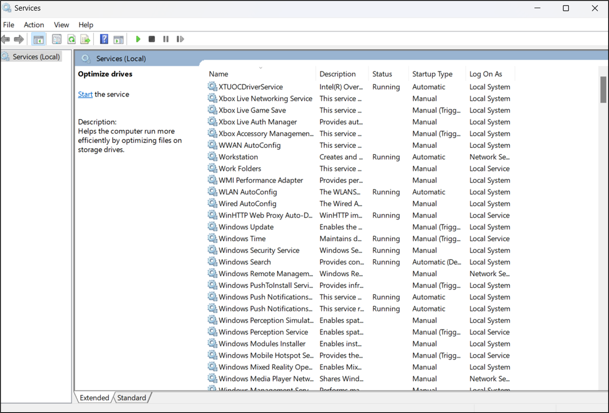
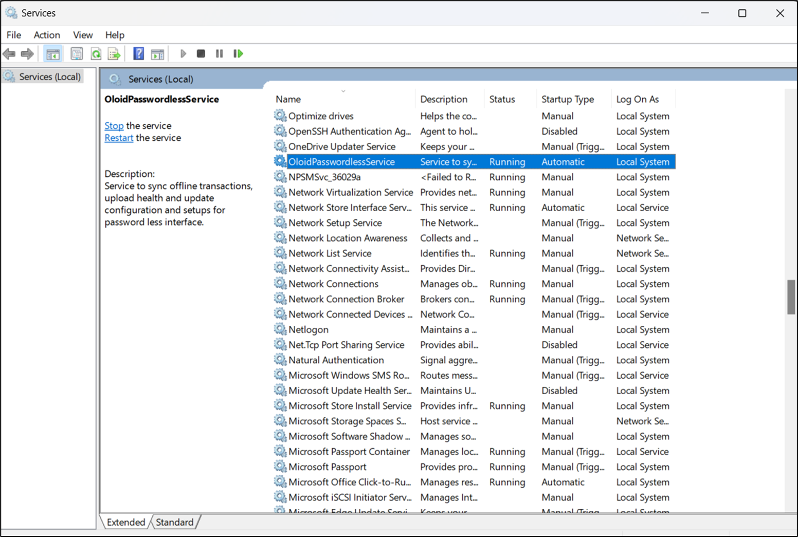
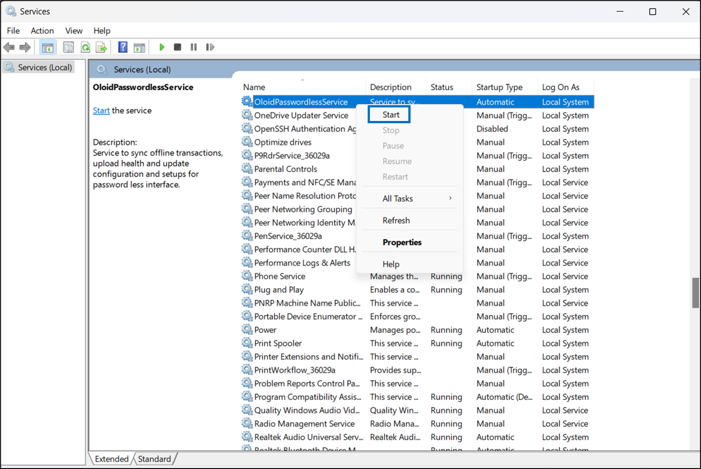

{/* Source: Intercom article 8978764 -  */}
{/* Generated by intercom_to_mintlify.py - re-running overwrites this file. */}

Offline processing for Windows Device App lets you log in to your computer even without the internet.

To diagnose offline processing for Windows Device app:

1. Search **Services** in the Start menu and select it from the corresponding result.
   The Services window is displayed.

   

2. Click on a specific service then search for **OloidPasswordlessService**.

   

3. Check the status by looking at the **Status** column.
4. Make sure the status is **Running**.
5. If the service is not running, then right-click on the service, select **Start**, and wait for the service to restart.

   

   Now, the Windows Device app is up and running.
