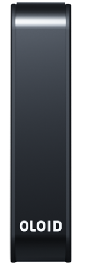
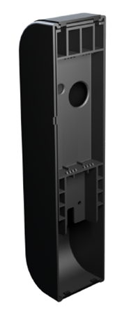
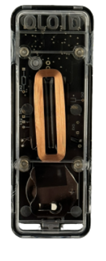
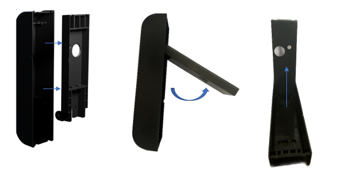
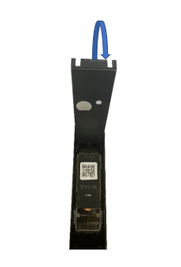
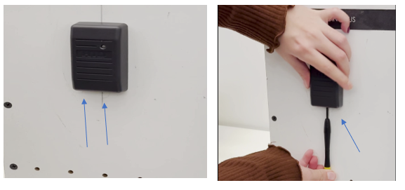
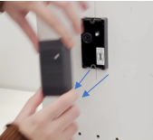
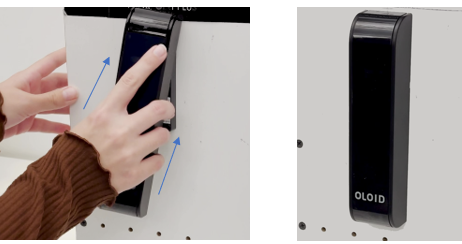

{/* Source: Intercom article 7120406 - https://oloid.help/en/articles/7120406-oloid-m-tag-setup-guide */}
{/* Generated by intercom_to_mintlify.py - re-running overwrites this file. */}

## Introduction

This guide describes the basic set up and configuration for using M-Tag.

## Requirements

- M-Tag Hardware
- M-Tag Admin app
- Oloid App

## Set Up Process

1. [Install M-Tag.](#step-1-install-m-tag)
2. [Register the M-Tag through the M-Tag Admin App.](#step-2-register-the-m-tag-through-the-m-tag-admin-app)
3. [Configure users in Oloid Admin Portal.](#step-3-configure-users-in-oloid-admin-portal)
4. [Download Oloid App and use the mobile app to unlock the door.](#step-4-download-oloid-app-and-use-the-mobile-app-to-unlock-the-door)

### Step 1: Install M-Tag

Installation process of M-tag involves attaching the M-Tag on top of the existing badge reader.

Oloid M-Tag Comprises of the following:

- M-Tag Reader Cover
- M-Tag

|  |  |  |
| --- | --- | --- |
| M-Tag Reader Cover | Rear Side Reader Cover | M-Tag |

To attach the M-Tag on top of the existing badge reader.

1. Open the M-Tag Reader Cover. No screws are needed for Reader Cover.

2. Place the M-Tag inside the reader cover and close the back cover.

3. Unscrew the cover of the existing Badge Reader.

4. Remove the existing badge cover.

5. Place the M-tag Reader over the existing Badge Reader and press to fit it.

The installation is complete and M-Tag is ready to use.

### Step 2 Register the M-Tag through the M-Tag Admin App

Registering M-Tag is performed by the customer once they receive the device. This activity must be done before the end user can use the M-Tag to access a door.

Prerequisite for this activity: Customer should have an active Online Account as a Tenant (This is created by Oloid).

Registering the M-Tag can be done through the Oloid's M-Tag Admin App.

**Steps to Register M-Tag :**

1. Install the Oloid M-Tag Admin App and login to the app. See [M-Tag Admin App installation and login](/drafts/unassigned/intercom/m-tag-admin-app-installation-and-login)

2. Register your M-tag . See [How to register M-Tag](/drafts/unassigned/intercom/how-to-register-m-tag)

3. Follow the recommended settings. See [Recommended Settings](/drafts/unassigned/intercom/recommended-settings).

### Step 3: Configure users in Oloid Admin Portal

A tenant needs to be created by Oloid Admin to configure users in the Tenant Admin Portal.

1. Log into your Tenant Admin Portal.

2. Import users. See, [Onboarding Users Using Import Template](/drafts/unassigned/intercom/onboarding-users-using-import-template).

<Note>
  **Note:** Once users are imported BadgeBinary is generated. Bluetooth token needs to be generated for Oloid App to function.
</Note>

To generate Bluetooth token, see, [How to create Bluetooth ID](/drafts/unassigned/intercom/how-to-create-bluetooth-id)

To generate Bluetooth token in bulk, see [How to generate BLE token in bulk.](/drafts/unassigned/intercom/how-to-generate-ble-token-in-bulk)

### Step 4: Download Oloid App and use the mobile app to unlock the door.

1. Download the Oloid App in your mobile. See [Oloid App Installation and Login](/drafts/unassigned/unmapped/oloid-app-installation-and-login-tba).

2. You can now use the Oloid Mobile app to unlock the door, See [User Instructions to Operate M-Tag](/drafts/unassigned/intercom/user-instructions-to-operate-m-tag).

3. For detailed info on Oloid App, see [Oloid App Details](https://oloid.help/en/collections/3676856-oloid-app)
