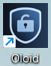
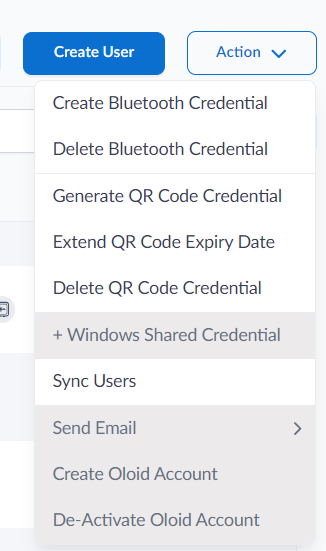

{/* Source: Intercom article 9706052 - https://oloid.help/en/articles/9706052-oloid-portal-icons */}
{/* Generated by intercom_to_mintlify.py - re-running overwrites this file. */}

How to user

how to create
