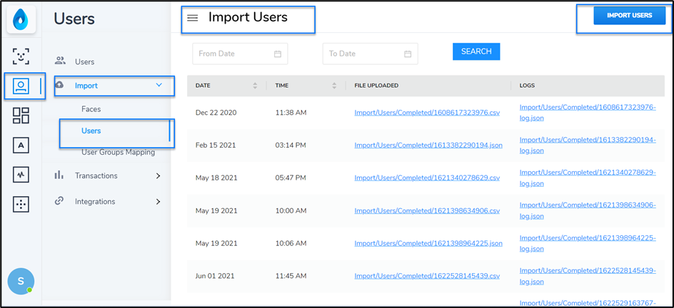
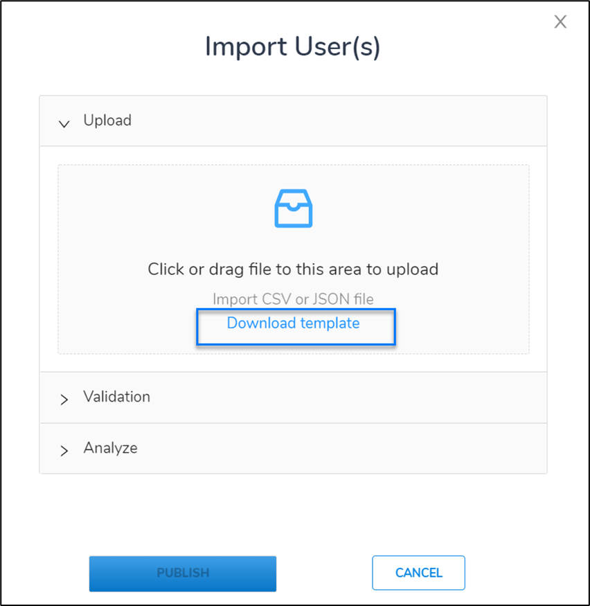

{/* Source: Intercom article 7120185 - https://oloid.help/en/articles/7120185-onboarding-users-using-import-template */}
{/* Generated by intercom_to_mintlify.py - re-running overwrites this file. */}

**To Import Users:**

1. Login to the Tenant Admin Portal.

2. On the Home page of the portal, click **Users** on the left panel menu.

3. Go to **Import** > **Users** on the Users menu panel.

The Import Users page is displayed.

4. Click **IMPORT USERS** button on top right corner of the page.

The **Import User(s)** pop-up box is displayed.

5 Click **Download template** to download the CSV file template.

6. Add values in the CSV file for respective users.

<Note>
  **Note:** You must add email address, secondary ID, Credential Format in addition to Primary ID and Name of the users in the CSV file.
</Note>

7 Upload the csv file.

8. Click **Publish** after validating and analysing the file.

The user and user details are added.
