{/* Source: Intercom article 10334783 -  */}
{/* Generated by intercom_to_mintlify.py - re-running overwrites this file. */}

Steps to configure log in with PingOne for Oloid Portal:

1. Sign in to the Ping Identity Administrator Console with your PingOne account credentials.
2. Select **Create Environment**, then select **Create a Customer Solution**.

   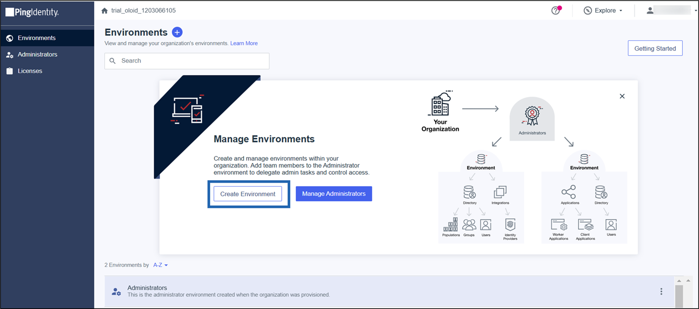

   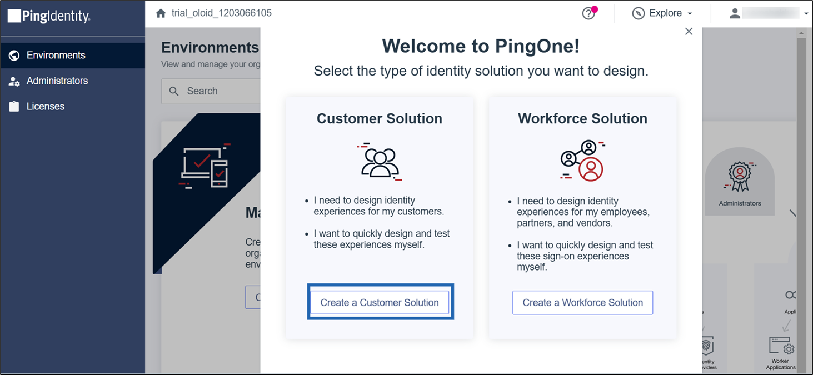

3. Go to the newly created environment, select **Applications** from the left menu, and click the Addicon to add a new application.

   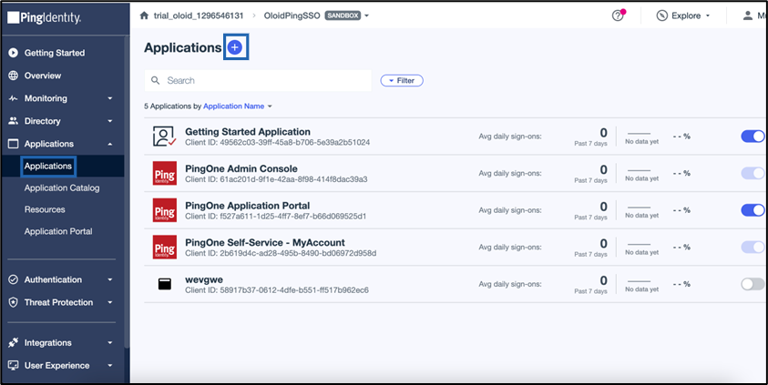

   The add application page is displayed.
4. Do the following:
   1. Enter **Application Name**, then select **OIDC Web App** from Application Type.
   2. Click **Save**.

      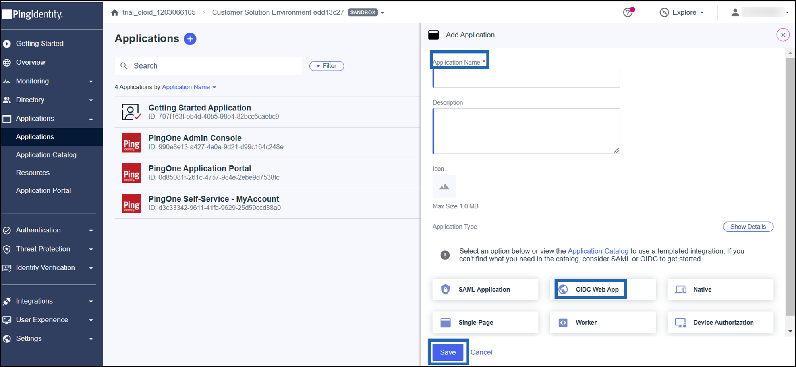

      The application is created successfully.
5. Select the newly created application from the application list to edit.

   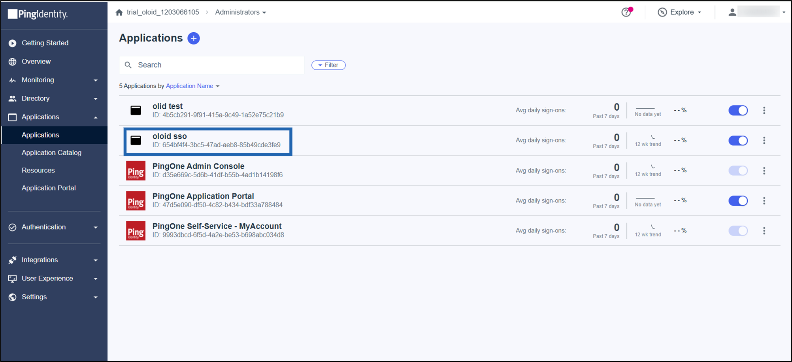

6. On the application **Profile** page, enable the app using the toggle button next to the application name.

   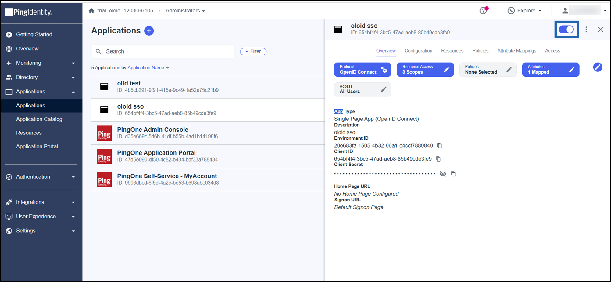

7. Select **Overview** tab > **OpenID Connect** settings and add the **Redirect URL**.

   <Note>
     **Note:** Please contact [Oloid Support](mailto:support@oloid.ai) for the Redirect URL.
   </Note>

   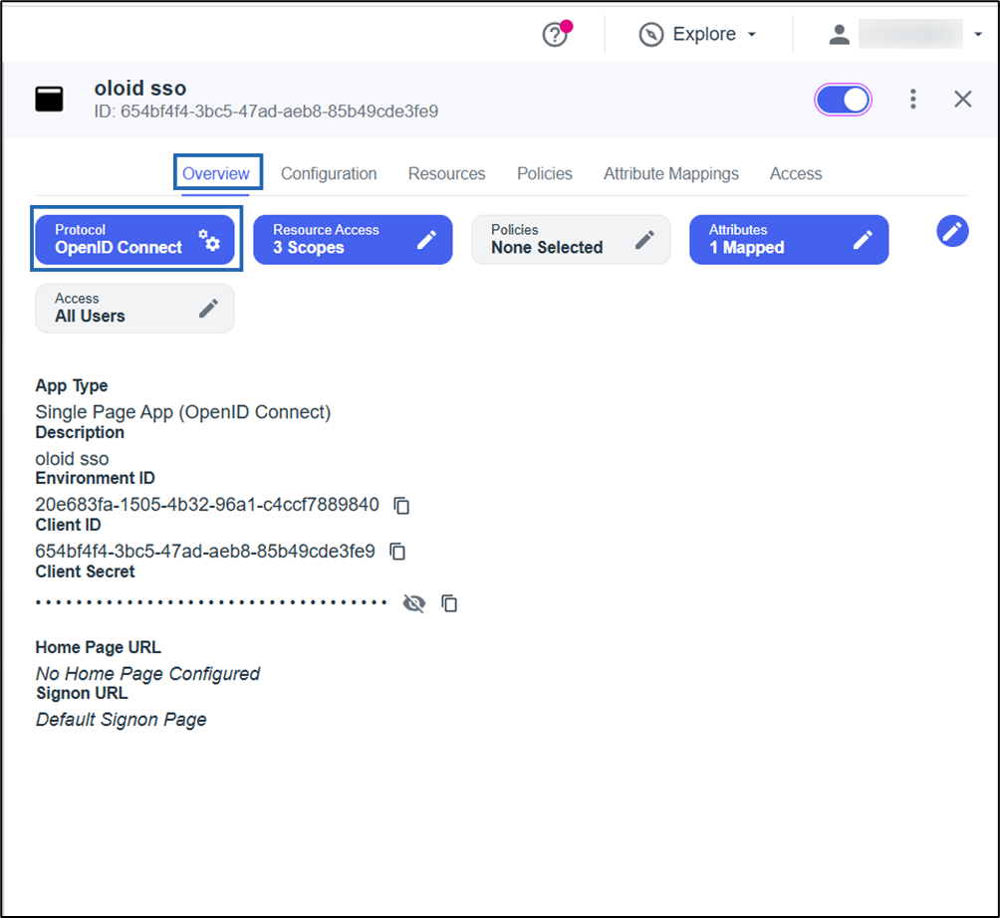

   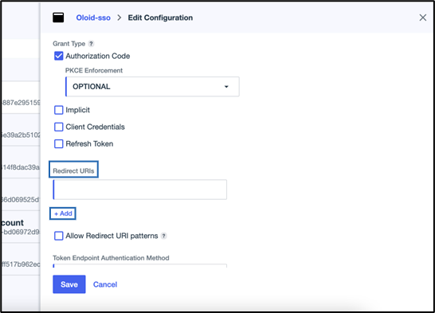

8. Go to **Configuration** tab, and do the following:
   1. Select **URLs** section:
      1. Copy **Authorization URL**.
      2. Copy **Token Endpoint URL**.
      3. Copy **User Info Endpoint URL**.
   2. Select **General** section:
      1. Copy **Client ID**.
      2. Copy **Client Secret**.
   3. Copy **Environment ID**.

      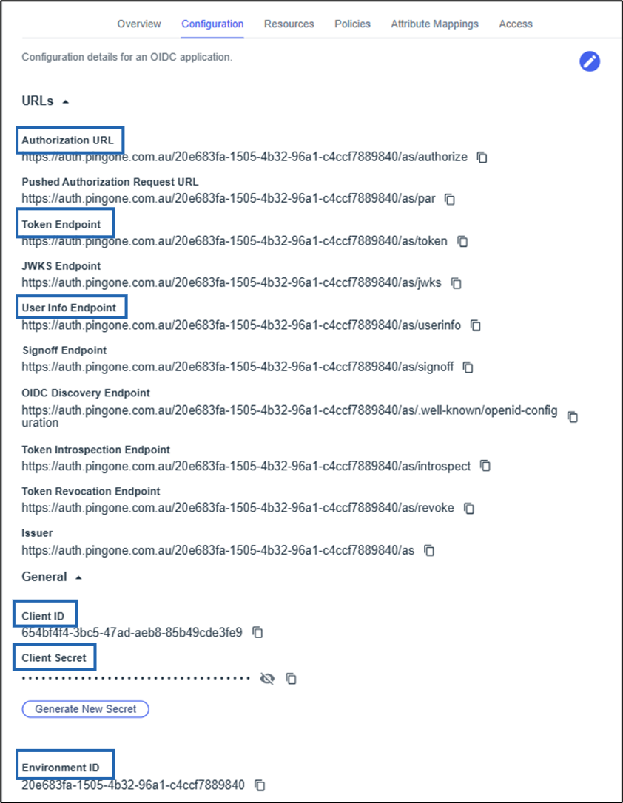

9. Under the **Token Endpoint Authentication Method** select **Client Secret Basic** from the drop-down list, and select **Save.**

   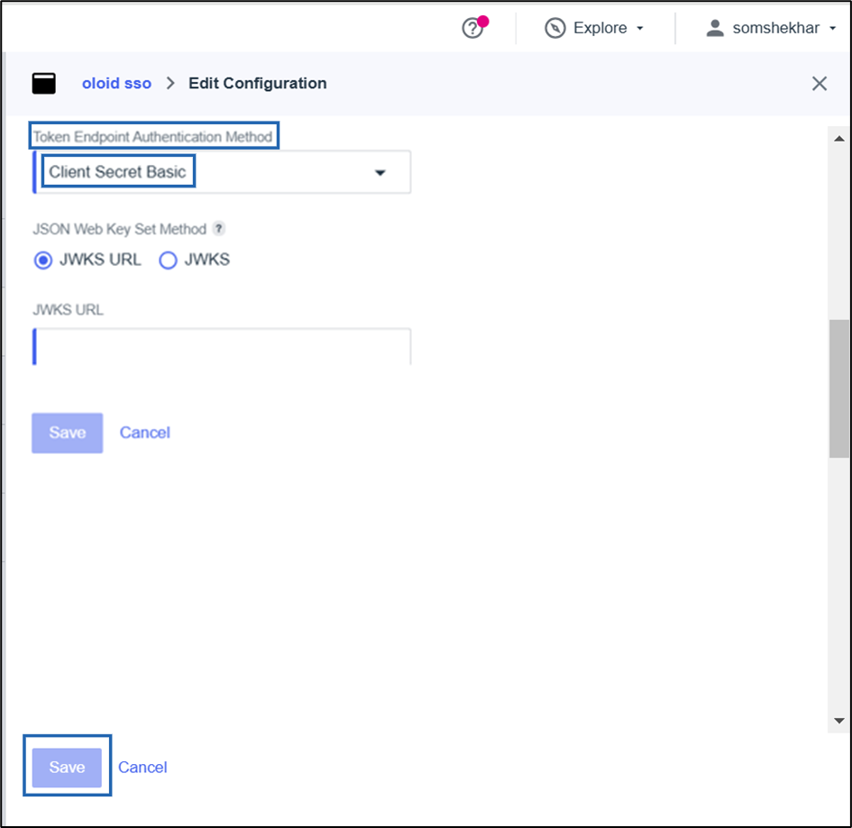

10. Select **Resources** tab and enable **openID, email and profile** scopes.

    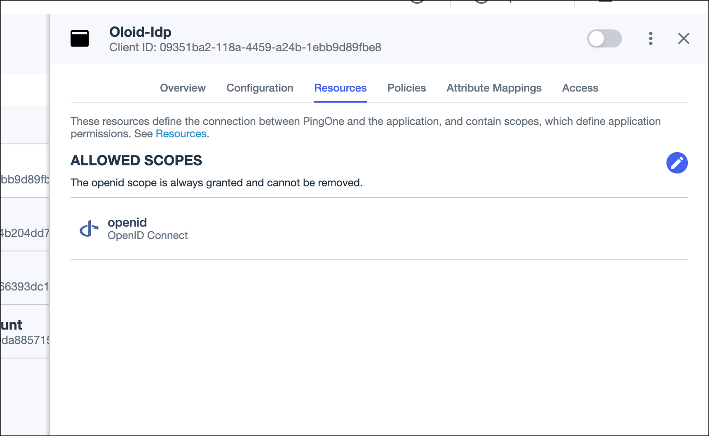

    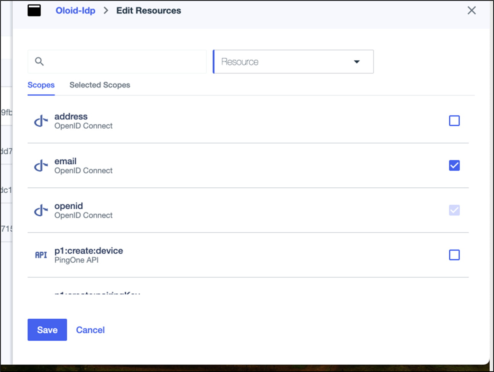

11. Share **ClientID** and **Client secret** with [Oloid Support](mailto:support@oloid.ai)
