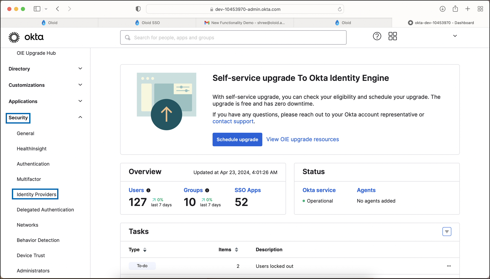
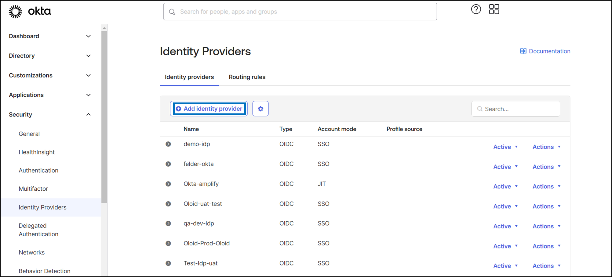
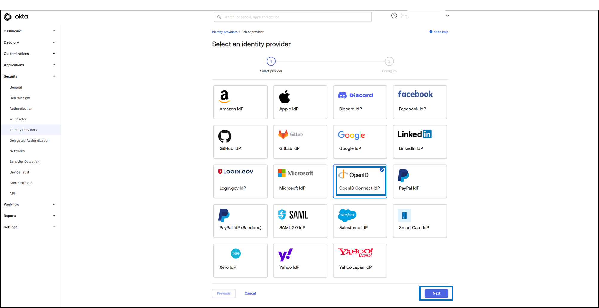
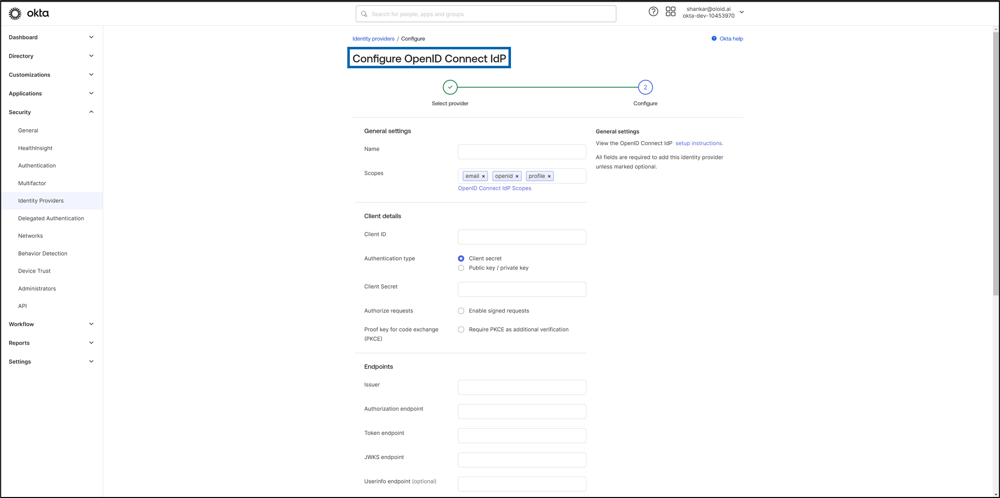
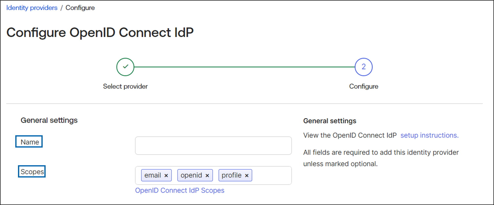
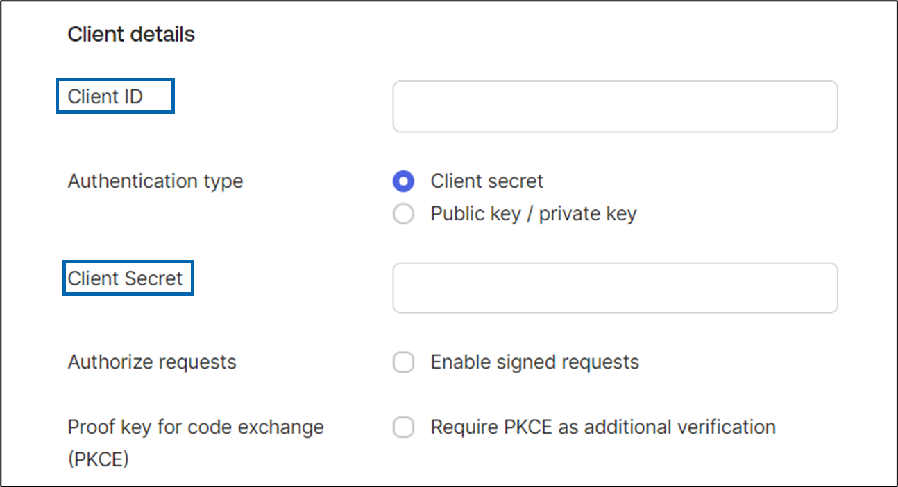
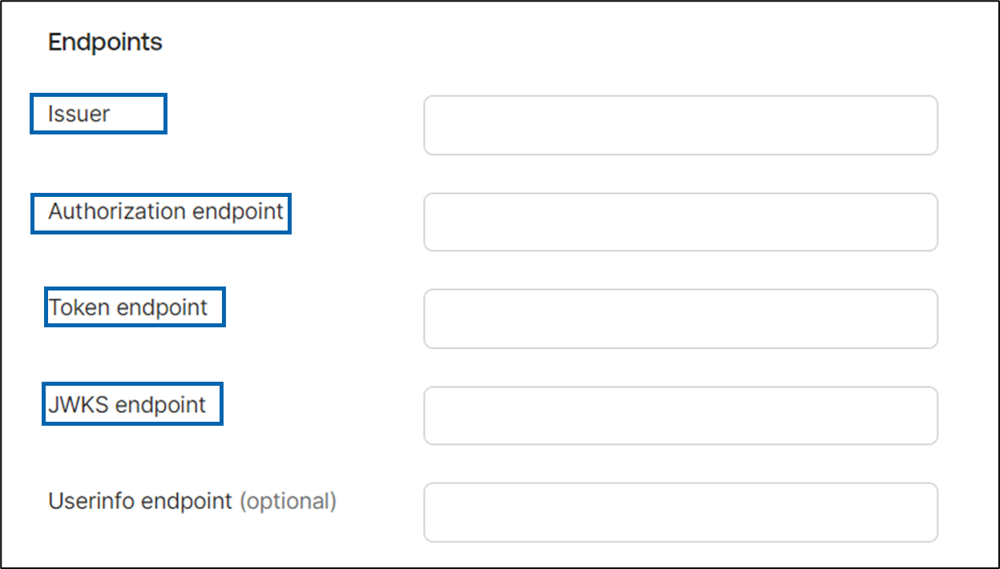
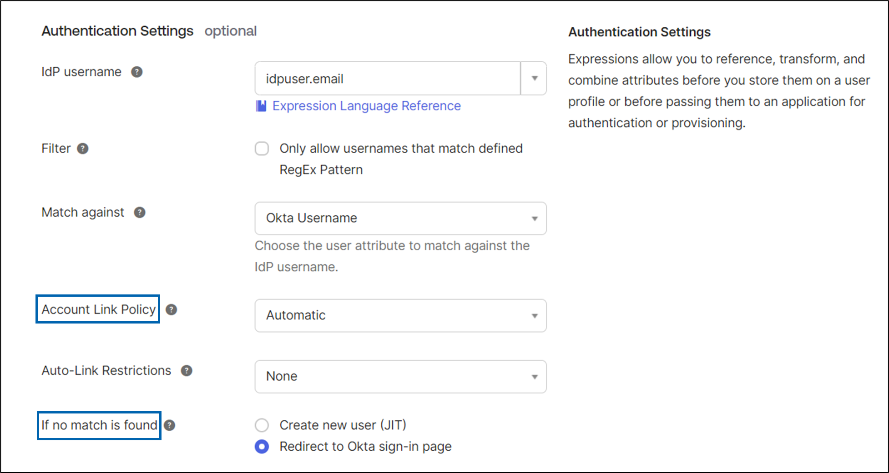
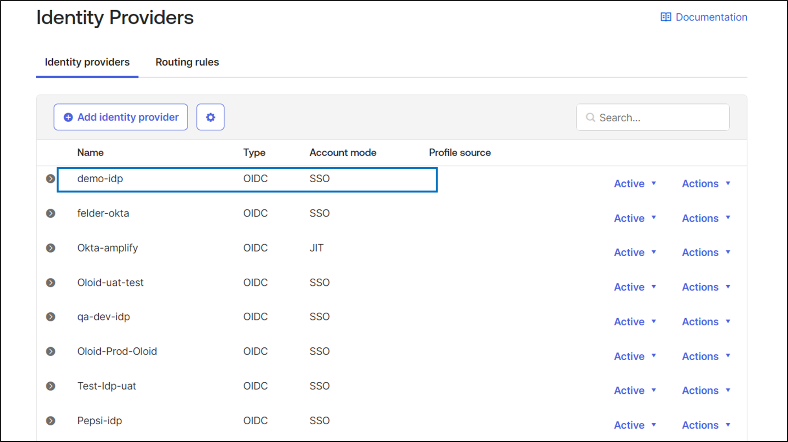
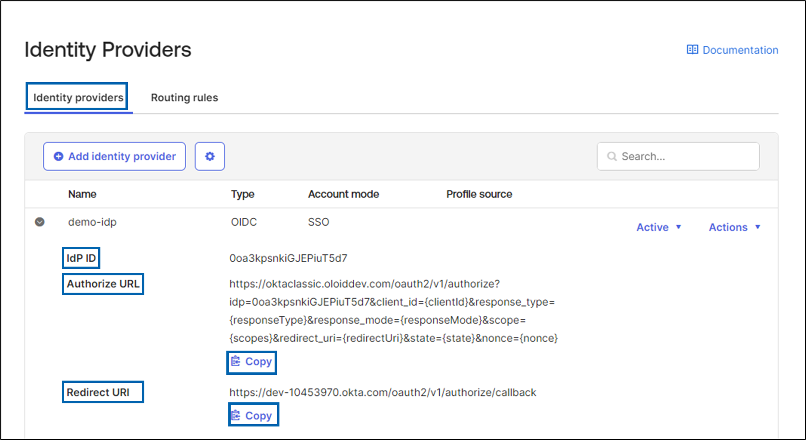

{/* Source: Intercom article 9239638 -  */}
{/* Generated by intercom_to_mintlify.py - re-running overwrites this file. */}

For connecting your Oloid tenant to your Okta(OIDC) instance, you need to configure Okta (OIDC) for Oloid SSO.

Pre-req:

The Webkey application is created in Oloid Portal

The IDP Profile is created and configured for OIDC-Okta.

To generate the parameters to be filled in the IDP Settings Tab of Oloid Portal, you need to do the following in the Okta Admin Console.

1. Add Identity Provider
2. Add Client Application

## Add Identity Provider

Steps to add Identity Provider:

1. On the home page of the Okta Admin Console, in the left menu, go to **Security** > **Identity Providers**.

   

2. Select **Add Identity Provider**.

   

   The identity provider list is displayed.
3. Select **OpenID Connect** and click **Next**.

   

   The **Configure OpenID Connect IdP** page is displayed.

   

4. Do the following:
   1. Under **General settings** section,
      1. **Name**: Enter **Name** for the Identity Provider configuration.
      2. **Scopes**: Default fields should remain unchanged.
         The scope options are included when Okta makes an OpenID Connect request to the Identity Provider.

         

   2. Under **Client details** section,
      1. **Client ID**: Enter the Client ID.
      2. **Client Secret**: Enter the Client Secret.

         <Note>
           **Note:** See **Oloid Portal > Auth Policies >Identity Provider > IDP Profile Detail** page **> Meta Data** tab for the parameters
         </Note>

         

   3. Under **Endpoints** section,
      1. Enter **Issuer**.
      2. Enter **Authorization endpoint**.
      3. Enter **Token endpoint**.
      4. Enter **JWKS endpoint**.

         <Note>
           **Note:** See **Oloid Portal > Auth Policies > Identity Provider > IDP Details** page **> Meta Data** tab for the parameters
         </Note>

         

   4. Under **Authentication Settings** section,
      1. Select **Automatic** from **Account Link Policy** dropdown.
      2. **If no match is found**, select **Redirect to Okta sign-in page** option.

         

5. Click **Finish**.
   The IDP is created and listed under **Identity Providers** tab.

   <Note>
     **Note:** In the search bar, you can search using identity provider name .
   </Note>

   

6. Go to IDP detail and copy **IDP ID**, **Authorize URL,** and **Redirect URL** to your notepad. It will be used later for the configuration of IDP Profile in the Oloid Portal.

   
