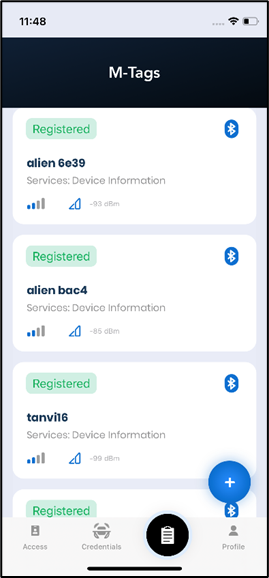
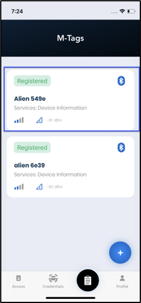
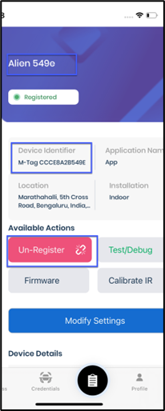
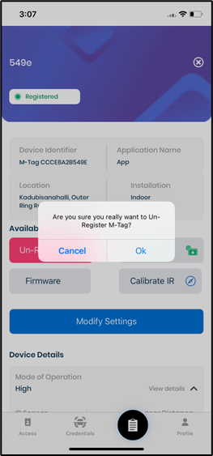
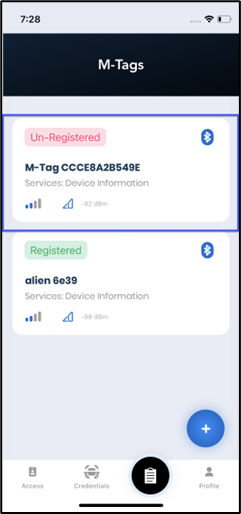

{/* Source: Intercom article 6984762 - https://oloid.help/en/articles/6984762-unregister-m-tag */}
{/* Generated by intercom_to_mintlify.py - re-running overwrites this file. */}

1. Launch the **M-Tag Admin** App.
2. Log in to the App.
   The M-Tag screen is displayed with the list of the available M-Tags.

   

3. Select the **M- Tag** to unregister.

   

   The M-tag detail screen is displayed.

   

4. Click **Un-Register**.
   A pop-up box is displayed to confirm de-registration.

   

5. Click **Ok**.
   The M-Tag is unregistered. You can verify it in the M-Tag list screen.

   
