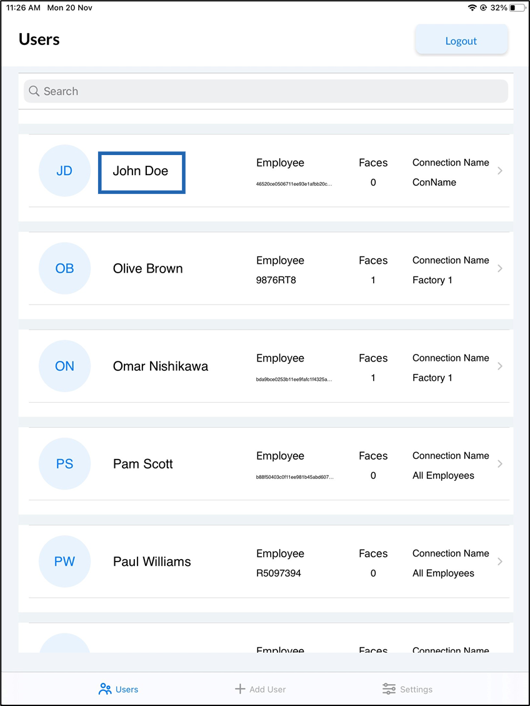
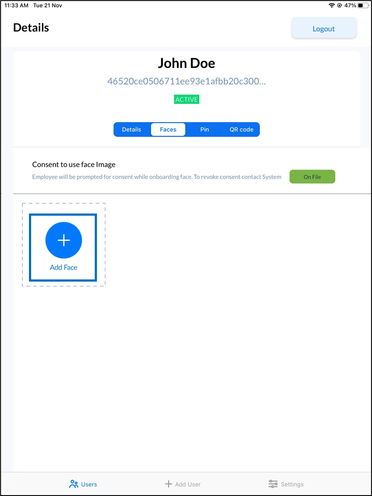
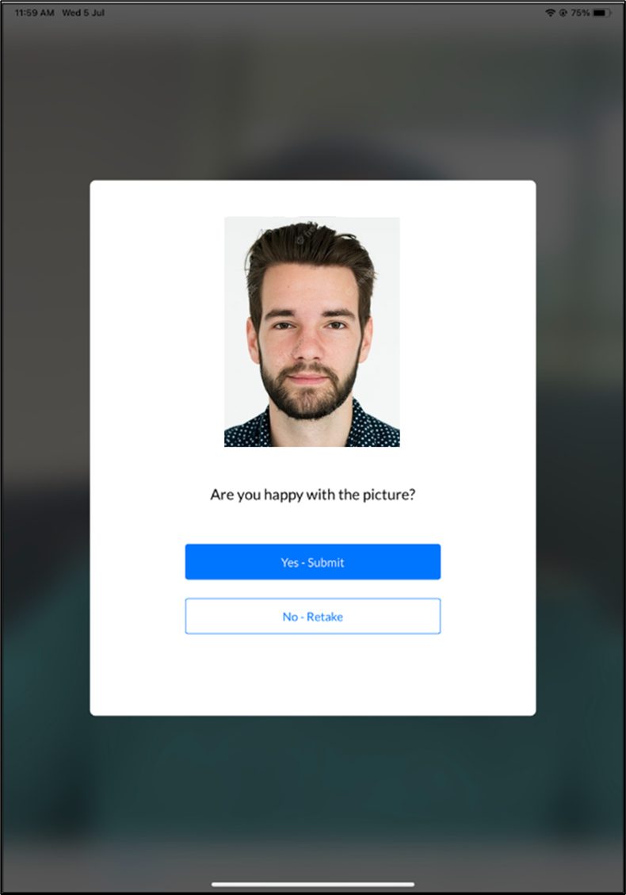

{/* Source: Intercom article 10319222 -  */}
{/* Generated by intercom_to_mintlify.py - re-running overwrites this file. */}

**Introduction**

This feature of Oloid Connect app allows the user to add faces to their profile.

<Note>
  **Note:** If connection is enabled to take consent for user, it will ask for consent before uploading the picture.
</Note>

## Pre-requisite

User should be added to the connection.

## Steps to add Face

1. Open the Oloid Connect App.
   The Users screen is displayed.
2. Select an User.

   

   <Note>
     **Note:** If the user doesn't exist you can add the user and then add the face. See **[Oloid Connect: Add User](/platforms/ios/time-clock/oloid-connect/oloid-connect-how-to-add-a-user)** to know more.
   </Note>

   The details screen is displayed.

   

3. Tap **Faces** tab and do the following:
   1. Tap **+Add Face**.
      This opens the camera on your device.
   2. Look at the camera to confirm your identity.
      The pop-up screen appears with the captured image.

      

4. Do one of the following:
   1. Tap **Yes- Submit** to submit the image.
      The face is submitted successfully and is displayed on the details screen.
   2. Tap **No- Retake** to take the photo again.
      The camera turns on to retake photo.

      <Note>
        **Note:** You can add a maximum of five faces per user.
      </Note>

      Your face should be visible in the camera, else it might get rejected. It is recommended to avoid wearing things that cover your facial features such as sunglasses, masks, headbands etc. Refer to Oloid's [Image Reference Guide](/platforms/web/webkey/guidelines-for-face-enrollment-onboarding-images) to see guidelines on face onboarding images.
