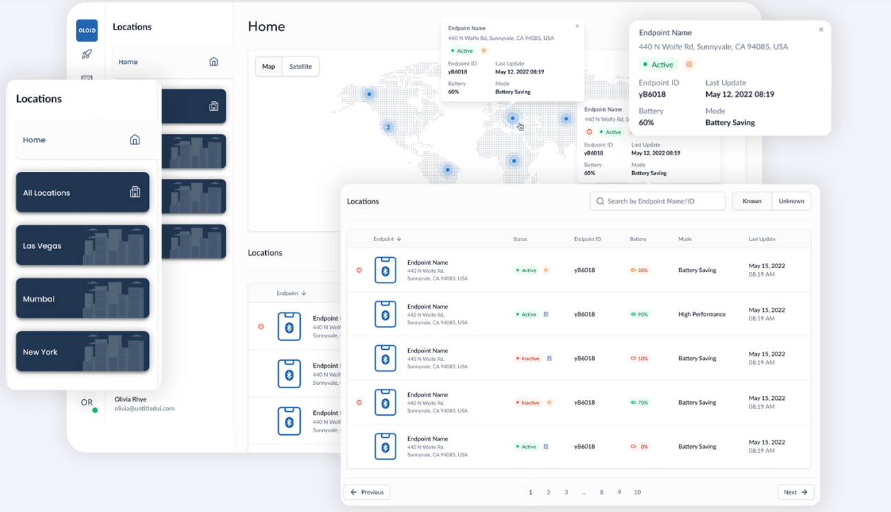

{/* Source: Intercom article 8153002 - https://oloid.help/en/articles/8153002-what-is-oloid-platform */}
{/* Generated by intercom_to_mintlify.py - re-running overwrites this file. */}

Oloid Platform is a cloud-based access control solution that empowers organizations to manage their facilities with enhanced intelligence, safety, and efficiency. It is designed to deliver simple access and management for all Oloid products and users across all sites from virtually anywhere in the world. From Oloid Platform, users can set up new Oloid applications, create connections, manage settings, access live and archived data , manage users and access the advanced features powered by Oloid’s edge–based analytics. Oloid Platform allows Tenant admins to remotely manage doors and access rights, monitor real-time access events, and create secure, frictionless workspaces.

Watch our videos on [Getting Started with Oloid](https://www.oloid.ai/oloid-product-videos/#:~:text=OLOID%20getting%20started%20overview) to learn more .
