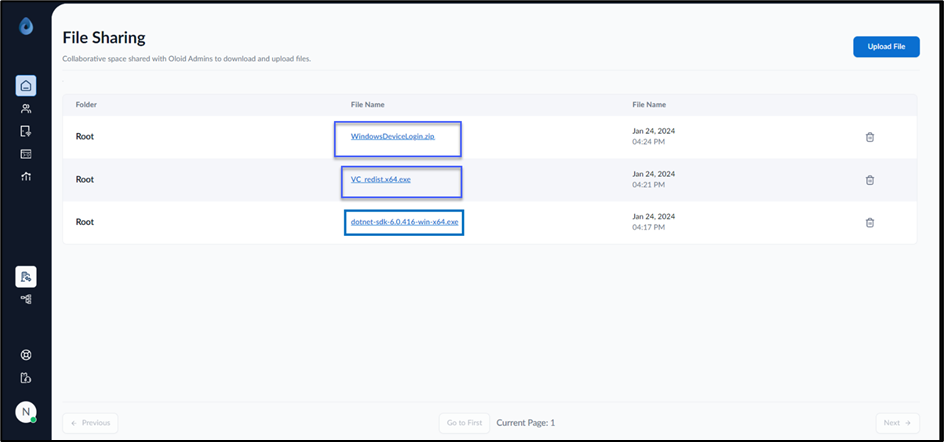

{/* Source: Intercom article 8886907 - https://oloid.help/en/articles/8886907-windows-device-agent-app-set-up-process */}
{/* Generated by intercom_to_mintlify.py - re-running overwrites this file. */}

The setup process of Windows Device app involves the following:

1. [Platform Provisioning](#platform-provisioning)
2. [Installation of the Application](#installation-of-the-application)
3. [Post Installation process**.**](#post-installation-process)
   1. [Application configs](#application-configs)
   2. [Test the application](#test-the-application)

## Platform Provisioning

1. Login to the Oloid Platform using your credentials.
2. Create an application. Select application type as **Passwordless** >> **Windows Login** >> **Single Factor Authentication** (SFA). For detailed instructions, see [How to create and configure Windows Login application](https://oloid.help/en/articles/8702215-how-to-create-and-configure-windows-login-application) guide.
3. Under **Applications** >> **Authenticator** tab , enable the credentials that you want to use.

   <Note>
     **Note:** Pin does not work as an SFA.
   </Note>

4. Create a connection and enable it for the application created in the previous step. For detailed instructions, see
   - [How to create a connection](/platform/tenant-admin-portal/tenant-admin-portal-how-to-create-connection) guide.
   - [How to Map Connection to Application](/platform/tenant-admin-portal/how-to-map-connections-to-an-application-in-the-tenant-admin-portal) guide.
5. Add users to the connection created in the previous step. For detailed instructions, see [How to add user](/platform/tenant-admin-portal/tenant-admin-portal-how-to-create-user) guide.
6. Add the following under User section:
   1. Under Credentials, add [Face](/more/passwordless-authenticator/face-onboarding) , [Badge](/more/passwordless-authenticator/badge-onboarding) , and [Passwords](/platform/tenant-admin-portal/how-to-create-password-for-windows-login).
   2. If shared credentials are required , add the shared credentials and assign them to the required users. For detailed instructions, see [How to create Shared credentials and assign it to users](/drafts/unassigned/intercom/how-to-create-shared-credentials-and-assign-it-to-users)
   3. Please check if the installer files (Net SDK, C++ Redistributable, Oloid Windows Device Login) are added for your login under file sharing option. If these are not present, contact Oloid support. If the files are present, download all the three files in the machine where you want to use the application. For detailed instructions on downloading the files ,see [How to download Windows Device Login installer files?](/drafts/unassigned/intercom/how-to-download-windows-device-login-installer-files) 

## Installation of the Application

Pre requisite: All the three installer files should be downloaded on that machine from the Platform.

1. Install the downloaded files on the machine. For detailed instructions , see [Windows Device Login Setup](/drafts/unassigned/intercom/windows-device-login-setup)guide**.**
2. Now, restart your system to use Windows Device Login app.

## Post Installation process

### Application configs

Pre requisite: Application was successfully installed without any errors. Check if there is an Oloid folder in C:\ ( c drive).

1. Click on the Application shortcut seen on the desktop.
2. Configure the Windows Device with Tenant. For detailed instructions, see
   - [Configuring Windows Device with Tenant](/drafts/unassigned/intercom/configuring-windows-device-app-with-tenant-name)
   - [Configuring Windows Device Admin App with Workflow as a Proxy](/more/workflow/how-to-configure-windows-device-admin-app-with-workflow-as-a-proxy)
3. Pair the endpoint. For details see, [How to pair a Windows Device Login endpoint for Passwordless](/platforms/windows/windows-login/windows-login-how-to-pair-windows-login-endpoint-from-supervisor-app).

### Test the application

**Pre-requisite**: In case you want to use badge, the badge reader needs to be connected to the machine.

1. Lock the machine.
2. Click on **Sign-in options**.
3. Click on Oloid logo.
4. Do one of the following
   1. Click **Login with Face**.
      The camera is switched on. Show your face. On successful facial authentication , you are logged in to the system. For detailed instructions, see [How to log in to Windows device using face through Windows device Login app?](/platforms/windows/windows-login/windows-login-how-to-log-in-to-windows-device-using-face) guide.
   2. Click **Login with Badge.**
      The badge scanner is displayed. Tap the **Badge** on the **Badge Reader** to scan it. On successful badge authentication, you are logged into the system. For detailed instructions, see [How to log in to Windows device using Badge through Windows device Login app](/platforms/windows/windows-login/windows-login-how-to-log-in-to-windows-device-using-badge)guide.
      On successful testing, the Windows device is ready to use.
