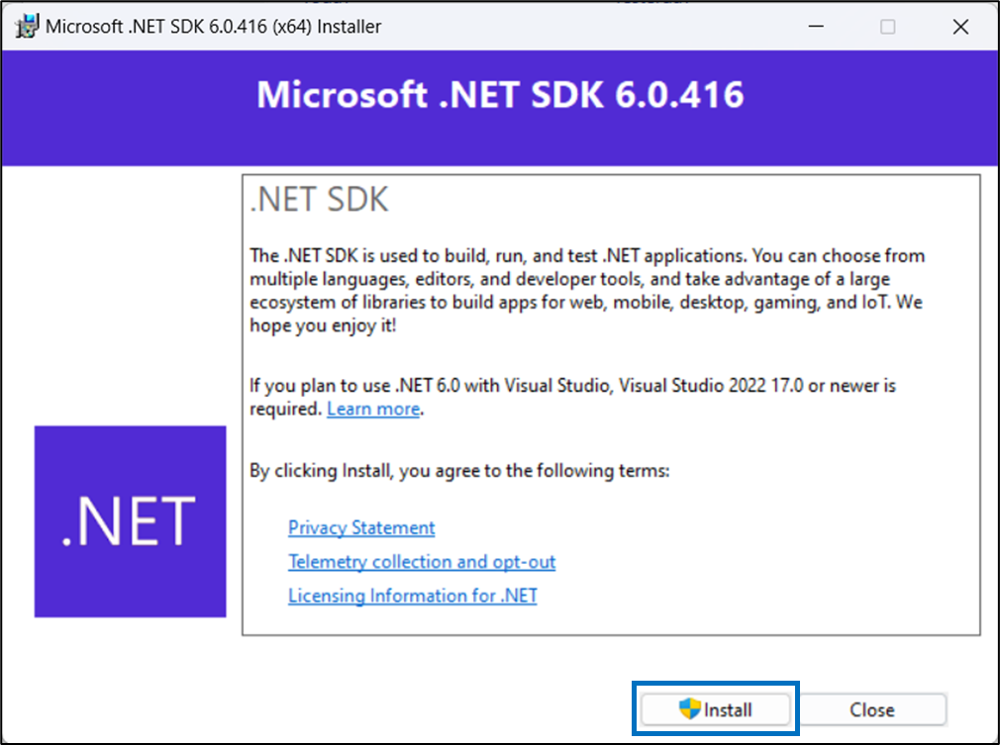
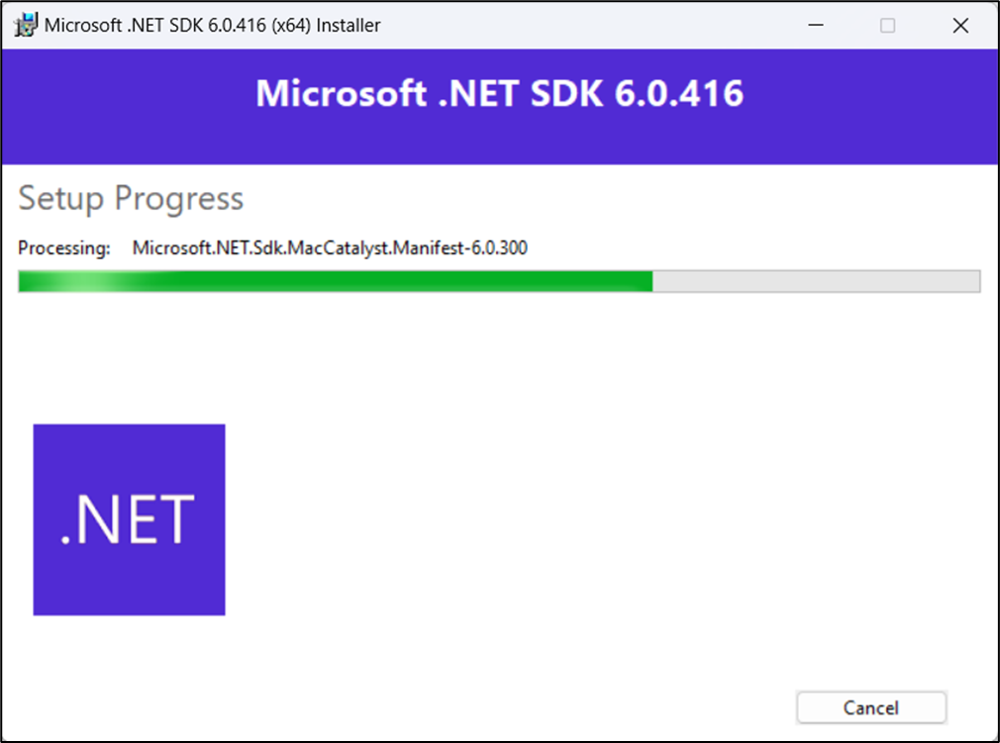
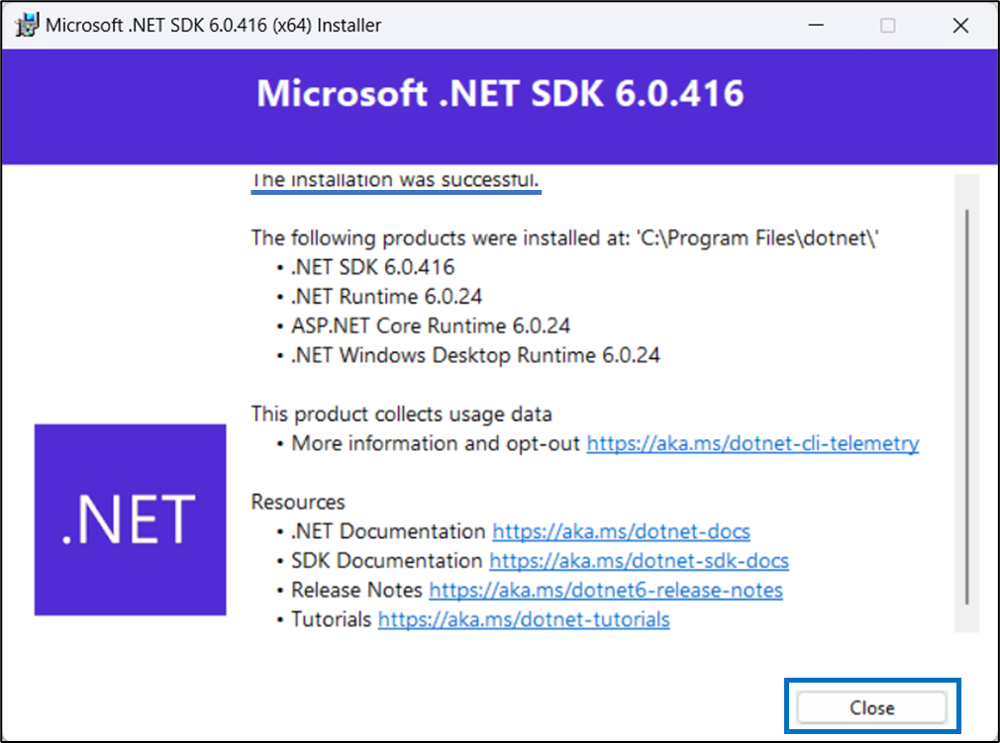
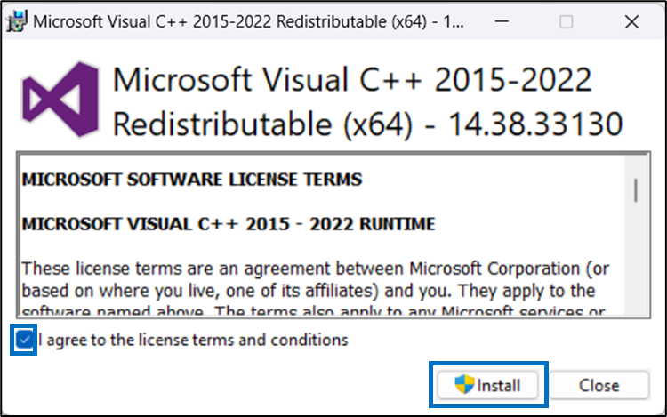
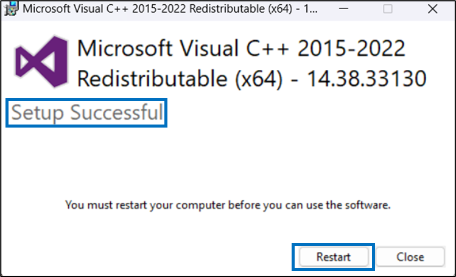
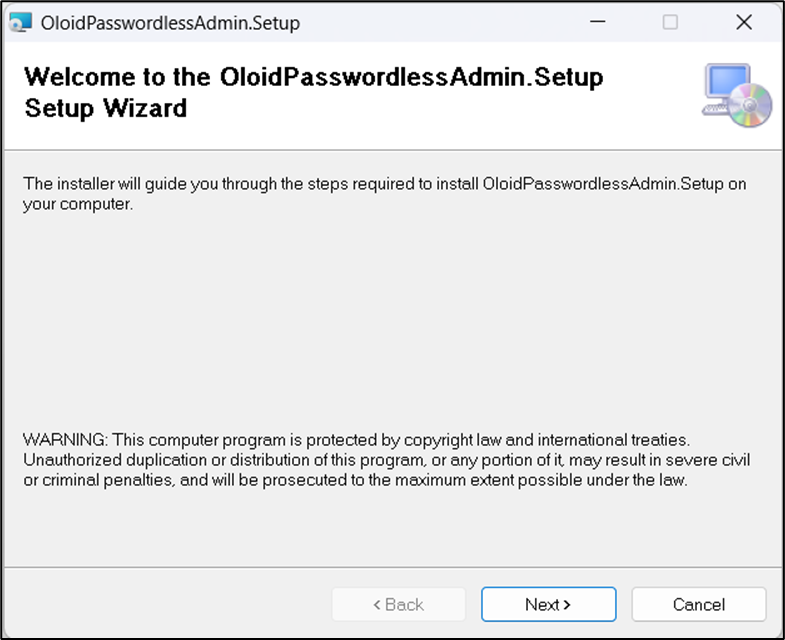
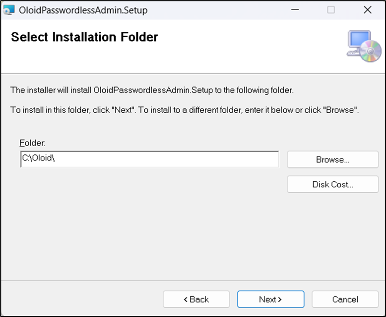
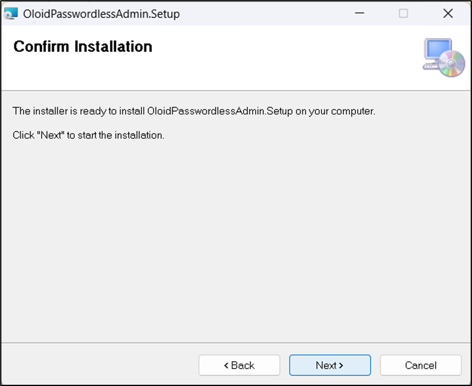
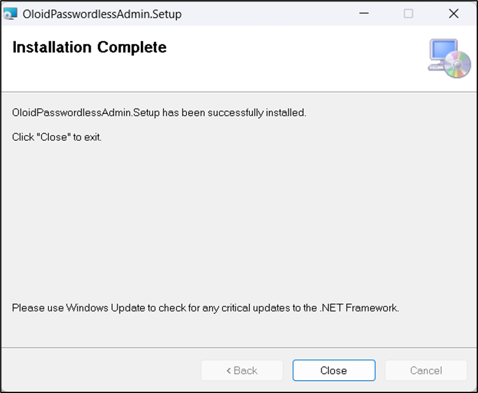

{/* Source: Intercom article 8624137 - https://oloid.help/en/articles/8624137-windows-device-login-setup */}
{/* Generated by intercom_to_mintlify.py - re-running overwrites this file. */}

## Application to be installed

1. .Net SDK (prerequisite)
2. C++ Redistributable (prerequisite)
3. Oloid Windows Device Login

All the above files are available for download in Oloid platform, refer to **[How to download Windows installer files](/drafts/unassigned/intercom/how-to-download-windows-device-login-installer-files)**.

## Installation Procedure

### Steps to install .Net SDK

1. Download the **dotnet-sdk-6.0.416-win-x64** file on your system.
2. Click **dotnet-sdk-6.0.416-win-x64** file to open.
3. Click **Install**. 

   The installation process begins. 

4. On successful installation, click **Close**. 

### Steps to install Microsoft Visual C++ Redistributable

1. Download the **VC_redist.x64** file on your system.
2. Click **VC_redist.x64** file to open.
3. Select the license agreement checkbox and click **Install**. The installation begins. 

4. On successful installation, restart your system. 

   <Note>
     **Note:** You must install the Windows installer file before restarting your system.
   </Note>

### Steps to install Windows Installer file

1. Download the **WindowsDeviceLogin.zip** file on your system.
2. After the download is complete, unzip the **WindowsDeviceLogin** folder, and right-click to select **Extract All**.
3. Select **OloidPasswordlessAdmin.Setup** and run it to install the application.
4. On the **OloidPasswordlessAdmin** Setup wizard, click **Next**. 

5. Use the default path to install the application and click **Next**. 

6. Click **Next** to confirm the installation. 

7. Click **Close** after the installation is complete. 

   You can find the app icon on your desktop.

Now, restart your system to use Windows Device Login app.
