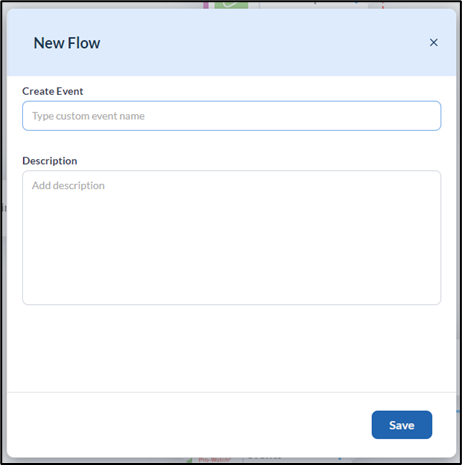
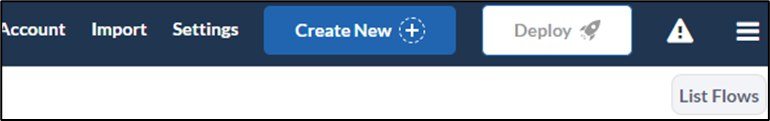
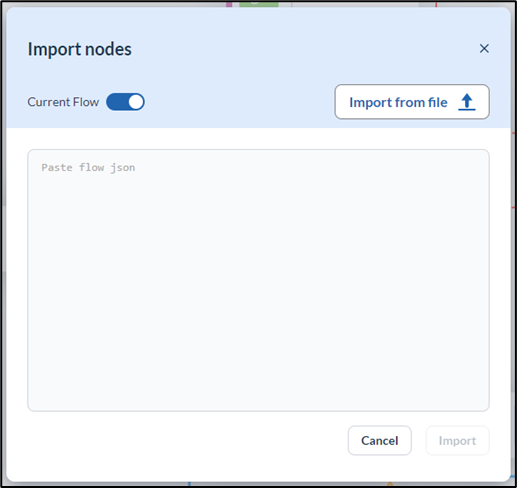
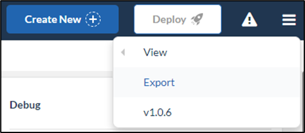
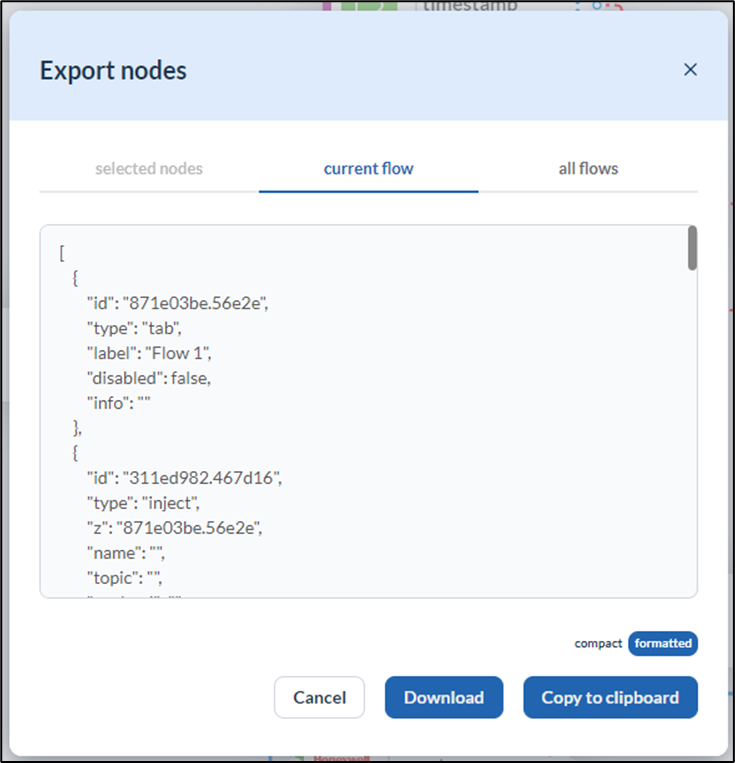

{/* Source: Intercom article 6955307 -  */}
{/* Generated by intercom_to_mintlify.py - re-running overwrites this file. */}

Flows are automated processes built by users that can span multiple applications. Each flow comprises of triggers and actions that are carried out when a trigger event is picked up.

Following sections describe how to create a new flow, import flow and export flow

**[Create New Flow](#create-new-flow)**

**[Deploy Flow](#deploy-flow)**

**[Import Flow](#import-flow)**

**[Export Flow](#export-flow)**

## Create New Flow

To create a new flow, click on "Create New" button on top-right corner of the application. It will display pop-up to enter name and description for new flow. Once the flow is created, flow will be visible in the Flow tab bar.

## Deploy Flow

Once the flow is configured fully, it is ready to deploy to run the intended business logic. To deploy the flow, click on "Deploy" button on top-right corner of the application.

## Import Flow

To import a flow, click on "Import" button on top-right corner of the application. It will display pop-up to browse the files for importing flow.

## Export Flow

To export a flow, click on hamburger menu button on top-right corner of the application. It will display option to export a flow. In export flow pop-up window, you can either copy the flow json OR download the flow json.

