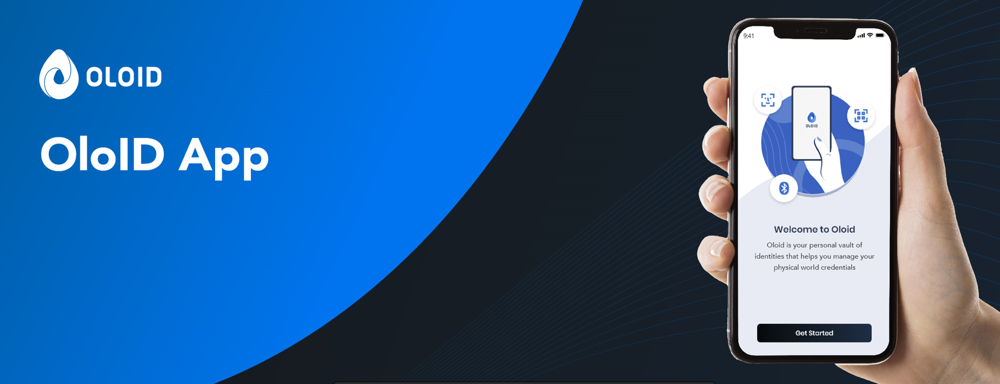

{/* Source: Intercom article 7213973 -  */}
{/* Generated by intercom_to_mintlify.py - re-running overwrites this file. */}

## Getting Started with OloID Mobile App

Download OloID App : [Android](https://play.google.com/store/apps/details?id=com.oloid.oloidapp) or [Apple iOS](https://apps.apple.com/us/app/oloid-app/id1567885248)

OloID mobile app provides an easy contactless way to authenticate and provide secure access over your mobile. The OloID app allows you to unlock a door.

The OloID mobile app works only with Oloid M-Tag enabled doors.

You can do it in two modes:

1. **Foreground mode**: It supports opening the door by the tap of a button.
2. **Auto Unlock mode**: It supports opening the door by holding your hand against the M-Tag, by tapping on push notification or just enabling your Bluetooth which opens door as you are within the range of the M-Tag.

OloID app is compatible with all mobile devices. Below is a condensed list of compatible devices.

- Android phones with OS 9 and above
- iPhone with OS 12 and above

Here is a list of articles that will help you get up and running with OloID App

- [OloID App Installation and Login](/drafts/unassigned/unmapped/oloid-app-installation-and-login-tba)
- [Log in to OloID App with Azure](/drafts/unassigned/unmapped/log-in-to-oloid-app-with-azure-tba)
- [Using the OloID App Wallet](/drafts/unassigned/unmapped/using-the-oloid-app-wallet-tba)
- [Using the OloID App Profile](/drafts/unassigned/unmapped/using-the-oloid-app-profile-tba)
- [Using the OloID App: Credentials Tab](/drafts/unassigned/unmapped/using-the-oloid-app-credentials-tab-tba)
- [Using the OloID App: Activity Tab](/drafts/unassigned/unmapped/using-the-oloid-app-activity-tab-tba)
