{/* Source: Intercom article 9807063 - https://oloid.help/en/articles/9807063-how-to-configure-user-sync-in-microsoft-entra-id-admin-console */}
{/* Generated by intercom_to_mintlify.py - re-running overwrites this file. */}

## Introduction

This document provides instructions to configure Microsoft Entra ID for user synchronization with Oloid.

## Prerequisite

You must have admin access for Microsoft Entra ID Admin console.

## Steps to Configure Microsoft Entra ID for User Sync

1. [Register an Application](#register-an-application)
2. [Configure the Application](/integrations/entra-id/how-to-configure-advanced-user-sync-in-microsoft-entra-id-admin)
3. [Create Client Secret](#create-client-secret)
   Microsoft Entra ID is configured Successfully.

### Register an Application

1. Log in to Azure Portal and select **Microsoft Entra ID** on the home page.

   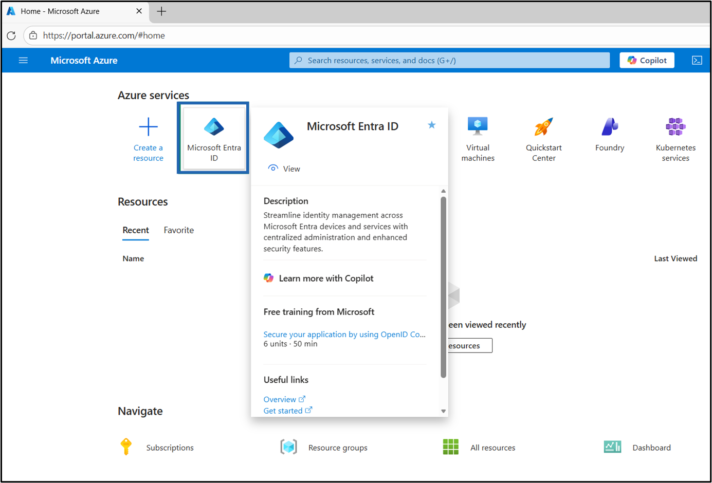

   The Microsoft Entra ID page is displayed.
2. Go to **Overview > Manage** **> App registrations > New registration**.

   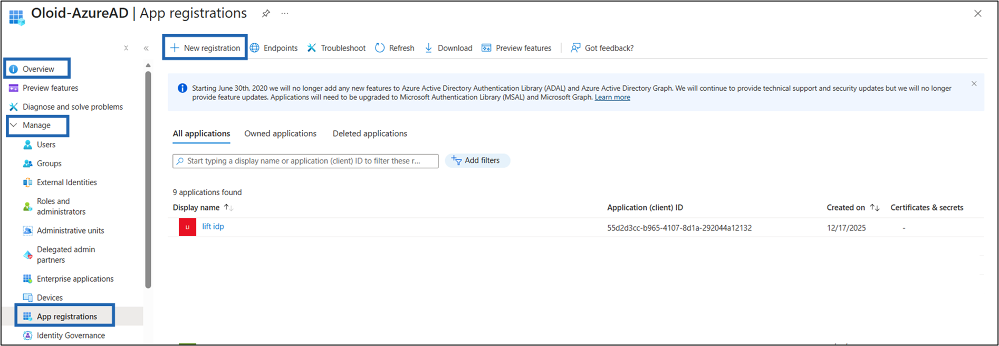

   The Register an application page is displayed.
3. Do the following.
   1. Enter **Name**.
   2. Select Supported account types as **Single tenant only - Oloid AzureAD**.
   3. Click **Register**.

      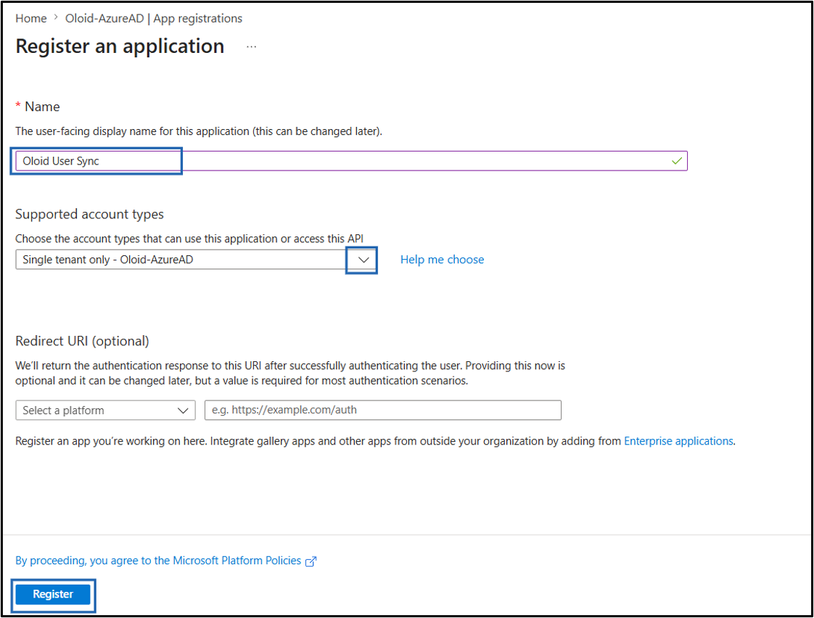

      The application is registered successfully.

### Configure the Application

1. Navigate to the **newly registered app > API permissions >** **Add a permission > Microsoft Graph.**

   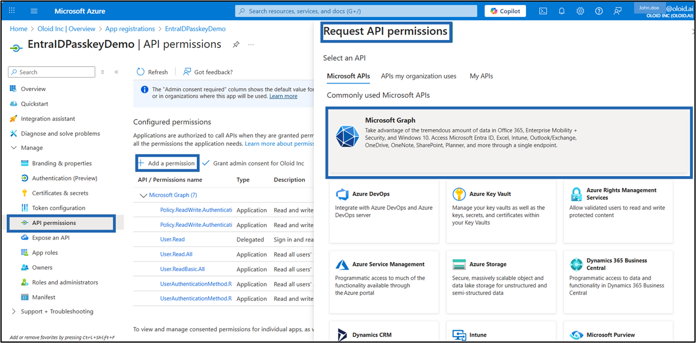

   The **Request API permissions** pop-up box is displayed.
2. Select **Application permissions**.

   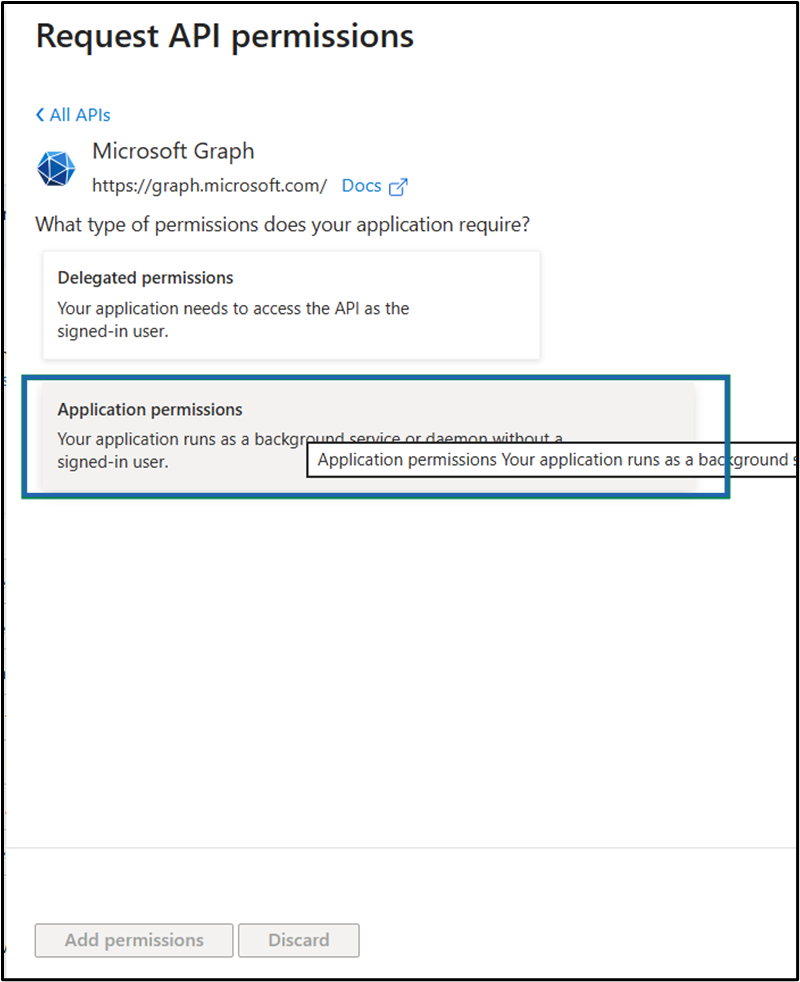

   The **Request API permissions** screen is displayed.
3. On **User** drop-down, select **User.Read.All.**
4. Click **Add permissions**.

   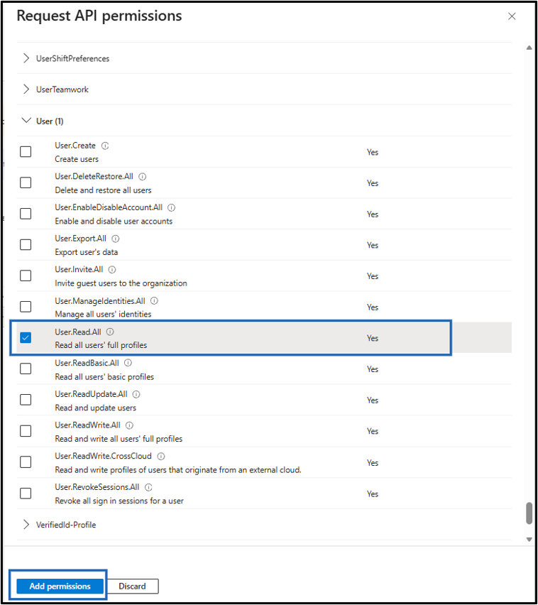

   The API is added in the list.
5. Click **Grant admin consent for Oloid-AzureAD.**

   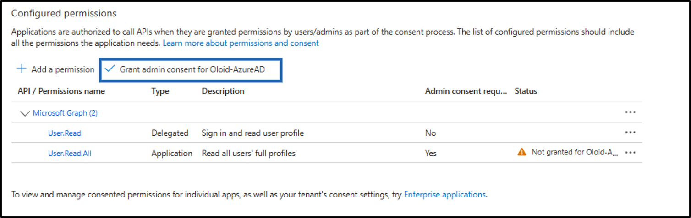

   The **Grant admin consent confirmation** pop-up box is displayed.
6. Click **Yes**.

   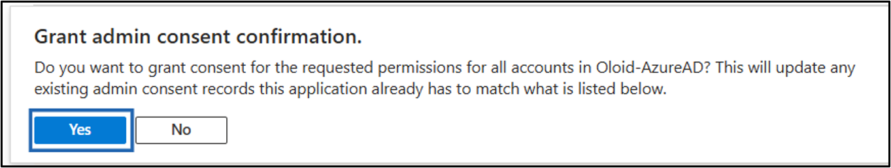

   The API is added successfully.

   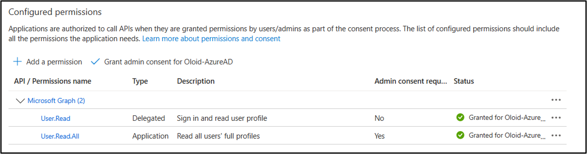

### Create Client Secret

1. Go to **Certificates & secrets** > **Client Secrets > + New client secret**.

   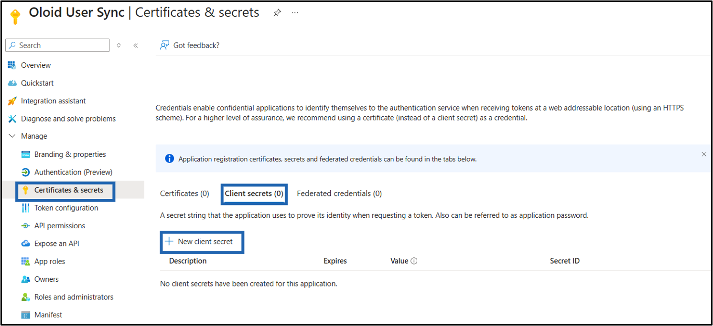

   The **Add a client secret** screen is displayed.
2. Do the following:
   1. Enter **Description**.
   2. Select the **Expires** duration from the drop-down list.

      <Note>
        **Note:** Select a key duration (preferably the max available).
      </Note>

   3. Click **Add**.

      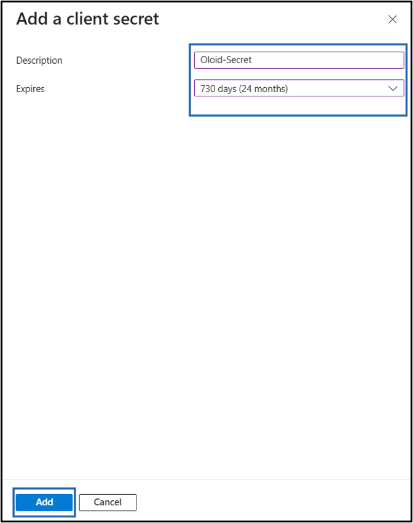

      The **Client Secret** is added successfully and listed on **Client Secret** tab.

      <Note>
        **Note:** Click on the **Copy to Clipboard** icon next to the value field to copy the secret. This option is available only at the time of creation.
      </Note>

      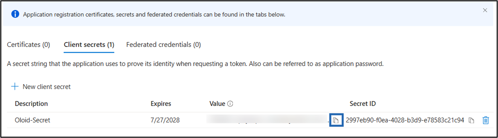

      The application is configured successfully.
3. Share the **Application (client) ID**, **Directory (tenant) ID,** and **Client Secret** with Oloid support.

   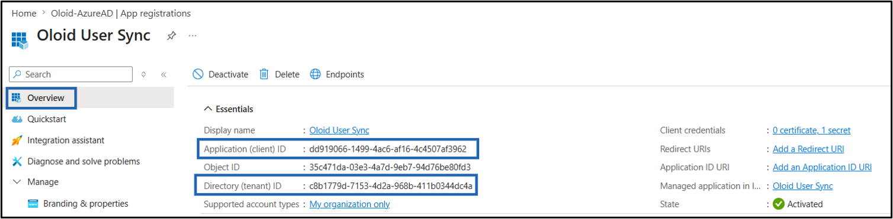

#### Related Article

[Tenant Admin Portal - How to Configure User Sync for Azure](/drafts/unassigned/unmapped/tenant-admin-portal-how-to-configure-user-sync-for-azure)
