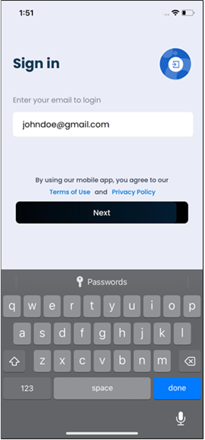
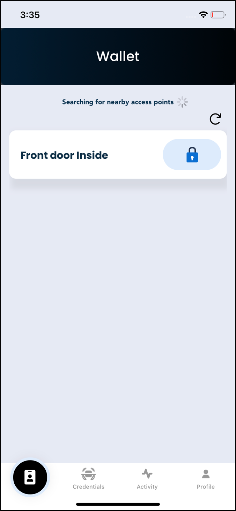
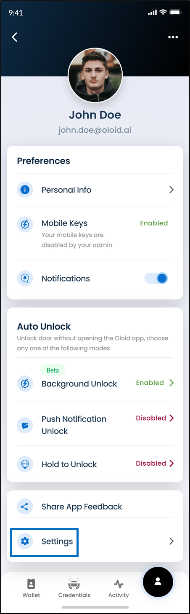
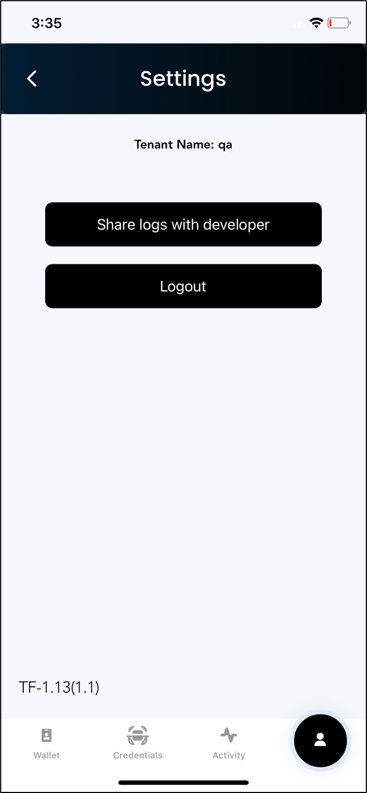

{/* Source: Intercom article 8170508 -  */}
{/* Generated by intercom_to_mintlify.py - re-running overwrites this file. */}

To share logs with developer:

1. Launch the **OloID app.**
2. Log in using your registered email ID. 

   The **Wallet** page with a list of doors is displayed. 

3. Tap on the **Profile tab** at the bottom right of the screen. 

4. Scroll down the bottom of the screen and tap **Settings**.
   The **Settings page** is displayed.
5. On the Settings screen, click on **Share logs with developer**. 

   The logs are uploaded and shared with the developer.
