{/* Source: Intercom article 6950909 -  */}
{/* Generated by intercom_to_mintlify.py - re-running overwrites this file. */}

**[Applications to be installed](#applications-to-be-installed)**

**[Installation Procedure](#installation-procedure)**

***[Steps to Install Node JS:](#steps-to-install-node-js)***

***[Steps to Install Python](#steps-to-install-python)***

***[Steps to Install Oloid-Workflow:](#steps-to-install-oloid-workflow)***

## Applications to be installed

1. Python 3.10.x (prerequisite)

2. Node JS 14.x (prerequisite)

3. Oloid Workflow application

## Installation Procedure

1. Copy and paste the installer files from the local desktop to the destination machine.

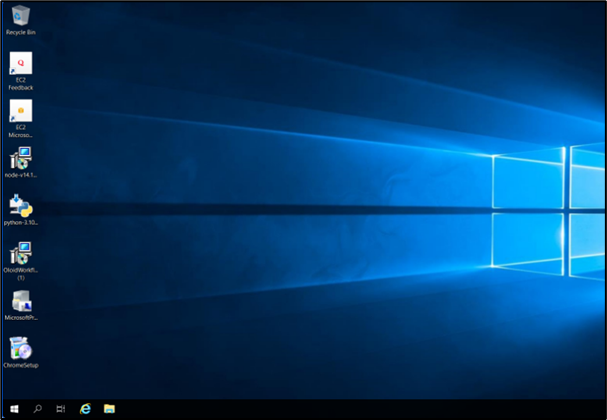

2. Always verify files have been installed in the Start → Services or Command prompt or Control panel → uninstall a program.

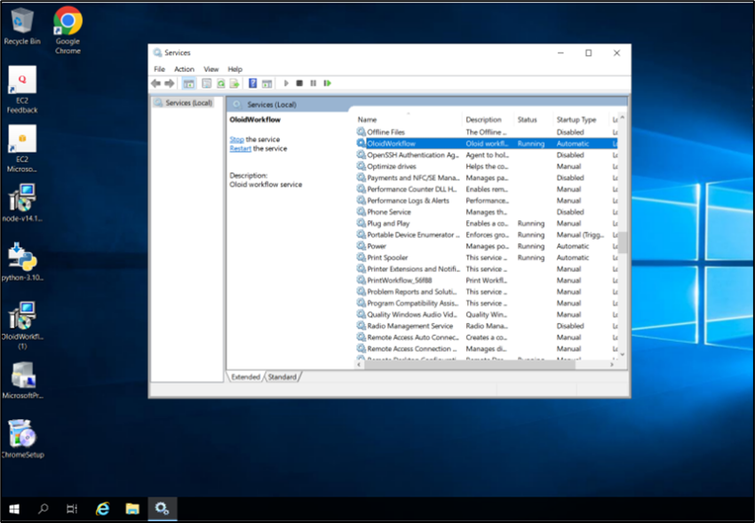

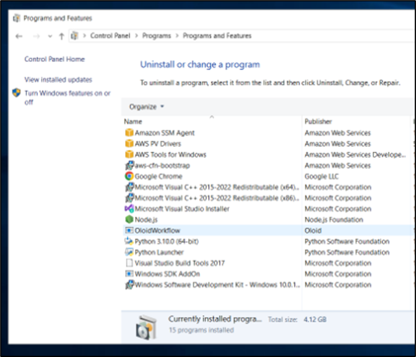

### Steps to Install Node JS

1. Double click on **node-v14.x** and click **Next** on the pop-up screen to continue with the installation.

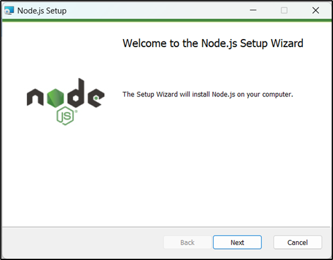

2. Accept the license agreement and click **Next**.

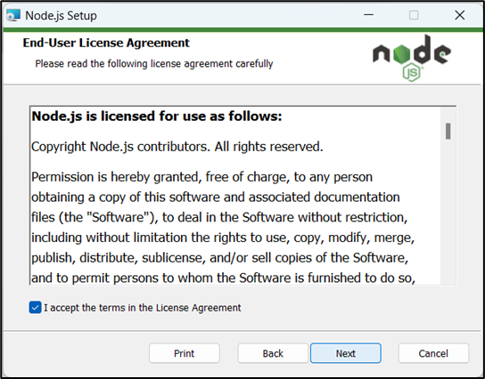

3. Click **Next** on **Destination Folder** screen.

4. Click **Next** on **Custom Setup** screen.

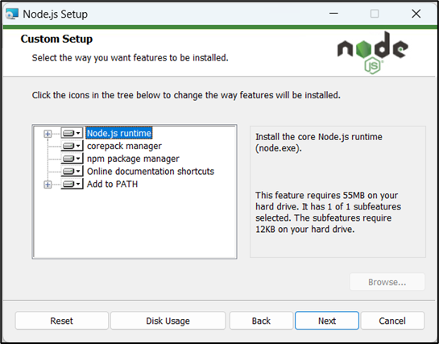

5. Check the **Automatically install the necessary tools** and click **Next**.

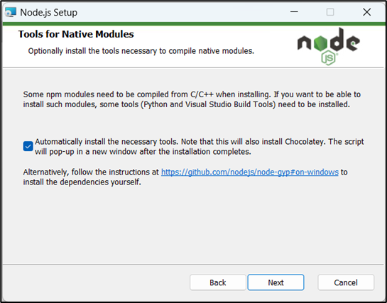

6. Click **Install**.

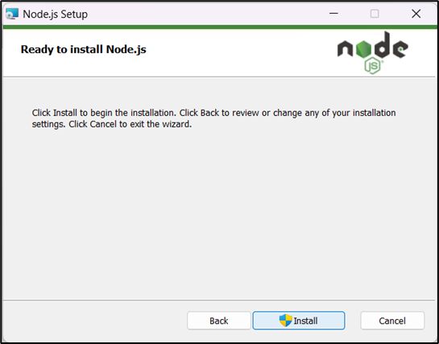

**7.** Click **Finish.**

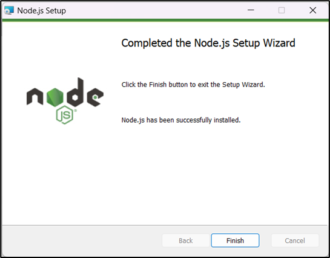

The Command line screen opens.

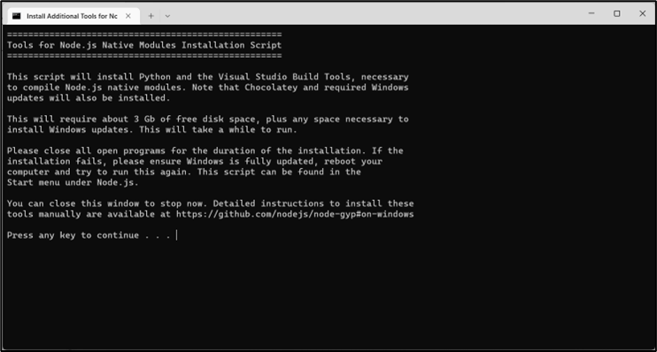

8. Press **Enter**.

Wait until Windows starts PowerShell and successfully complete installation.

9. Press **Enter** to exit.

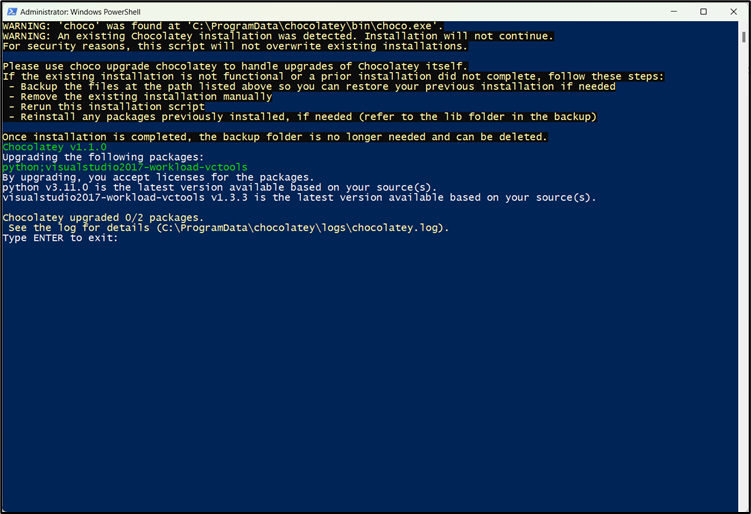

### Steps to Install Python

1. Double click on **Python-3.10.x** → Select **Add Python checkbox** → Choose **Customize installation** → Click **Next.**

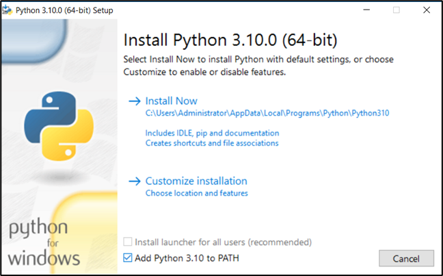

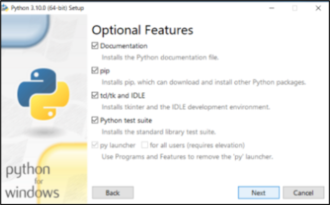

**2.** Select **Install for all users** checkbox and click **Install**.

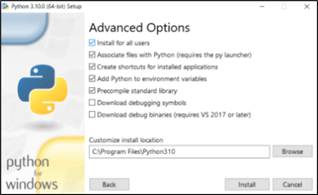

3. Wait till Setup progress is successful.

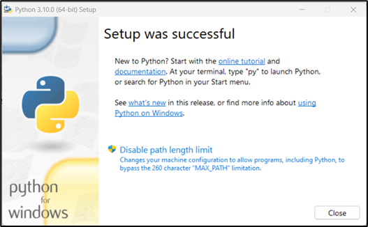

### Steps to Install Oloid-Workflow

1. Double click on Oloid-Workflow.

**The OloidWorkflow Setup Wizard is displayed.**

**2. Click Next on the OloidWorkflow Setup Wizard welcome screen.**

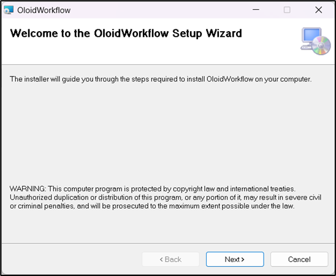

**3. Click Next on the Select Installation Folder screen.**

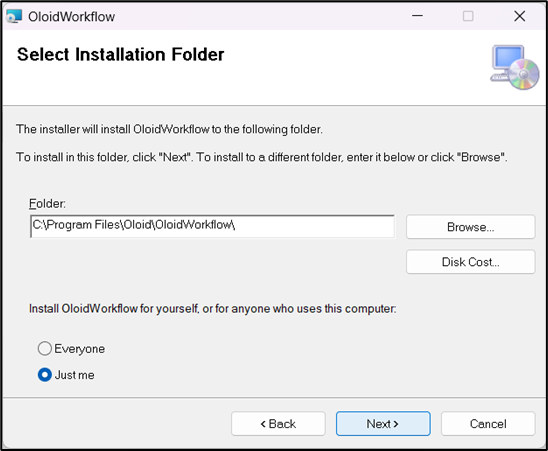

**4. Click Next on the Confirm Installation screen.**

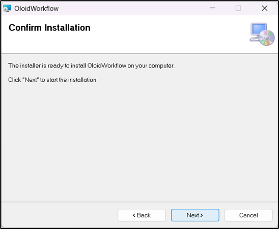

5. Wait till the Oloid Workflow installation is complete.

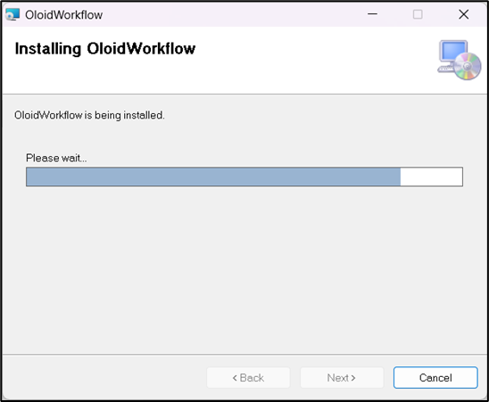

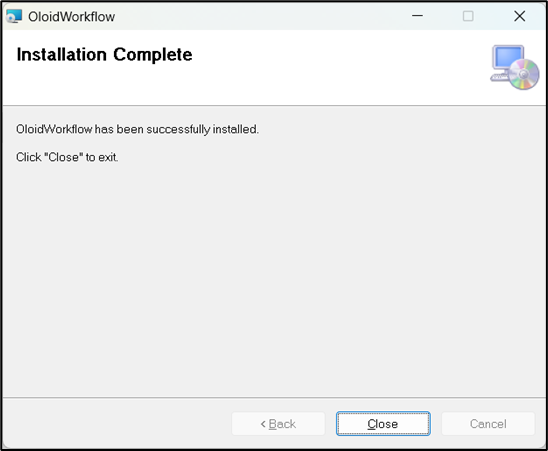

6. Open **Microsoft Services** in the instance and see that **Oloid Workflow service** is up and running.

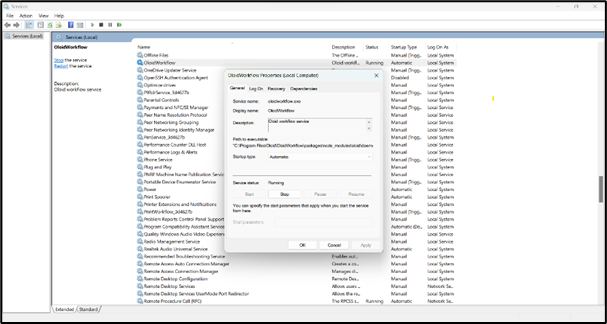

7. To verify Workflow is installed→ Enter **localhost: 3000** in your browser.

The **Login** page is displayed.

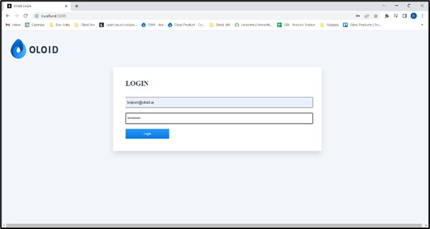

**8.** Enter **username** and **password** → Click **Login.**

The Oloid Workflow application page is displayed.

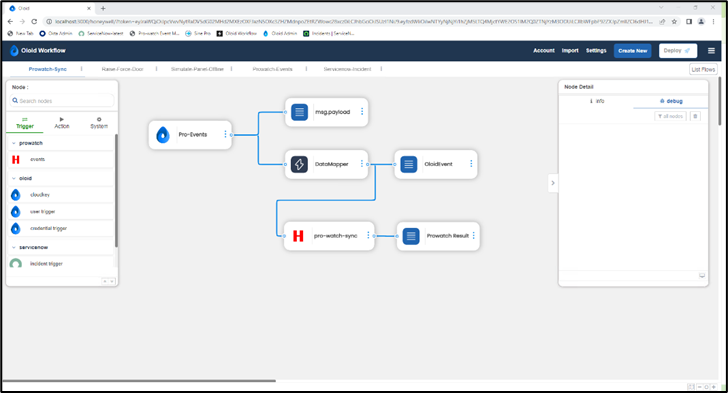
