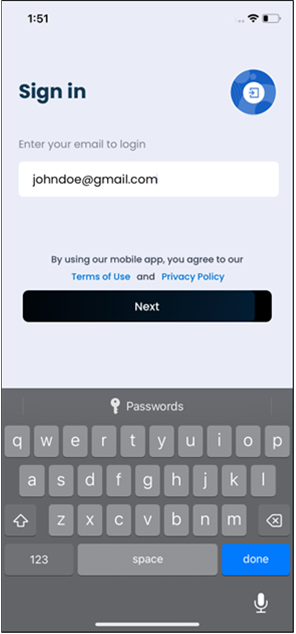
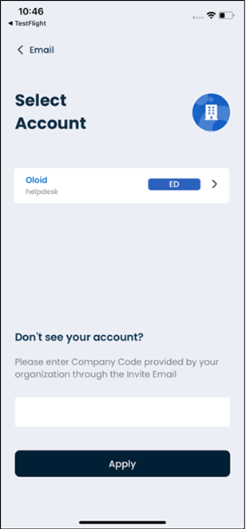
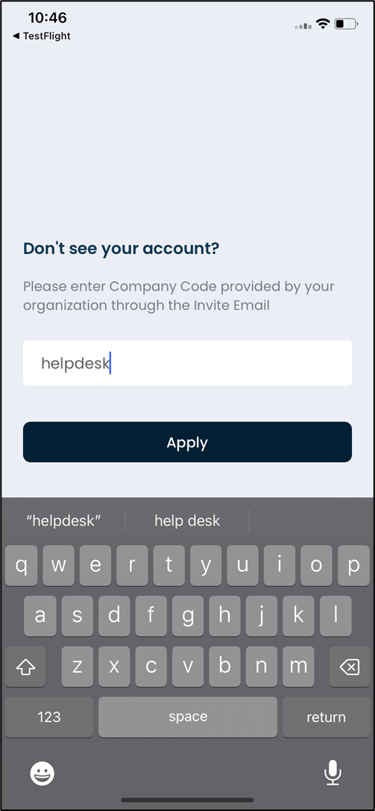
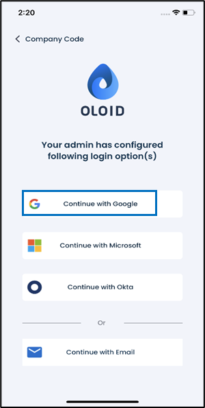
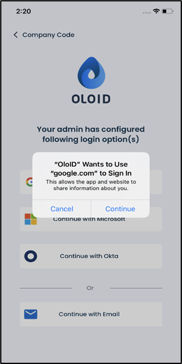
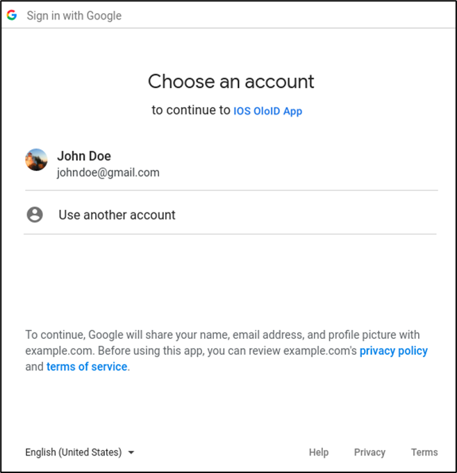

{/* Source: Intercom article 8078596 -  */}
{/* Generated by intercom_to_mintlify.py - re-running overwrites this file. */}

## Introduction

This document provides instructions to log in to the **OloID App** using **Google**.

## Pre-requisites

- The App user should have a verified **Google** email account.
- The App user should be an Oloid user. For more information on this, please **contact your admin.**

## OloID App Login using Google

To log in to the **OloID App** using **Google**, follow the below steps:

1. Launch the **App**. (If App is not present, download the app from **App Store** / **Play Store**).
2. Enter the **registered email ID** in the **Sign in** page and click **Next**. 

   The **Select Account** screen is displayed.
3. Select your **Account** from the tenant list\*\*.\*\* 

   <Note>
     **Note:** You can enter company code to search for your account.
   </Note>

   

   The tenant account is selected, tap on the **tenant name** to proceed.
4. Tap **Continue with Google**. 

5. Tap **Continue** when Oloid App prompts for permission to use Google account for logging in the app. 

   The account is listed on the screen.
6. Select the specific account. 

   <Note>
     **Note:** If you have multiple accounts listed, select the same email ID entered in step 2.
   </Note>

   The **Permission requested** screen is displayed.
7. Tap accept to successfully log in.
   You are successfully logged into the OloID app.
