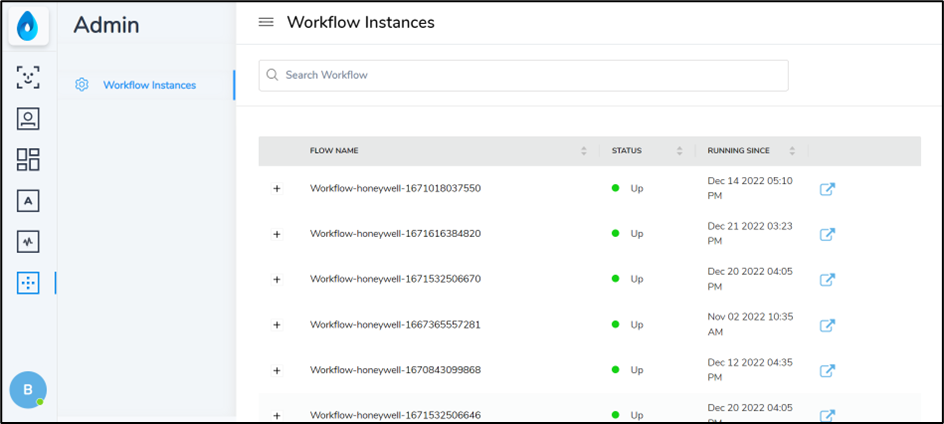
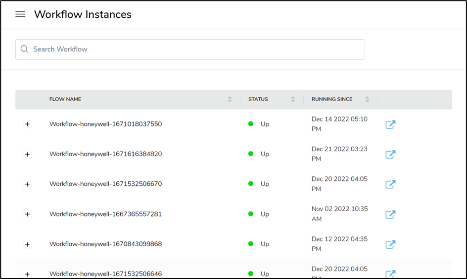
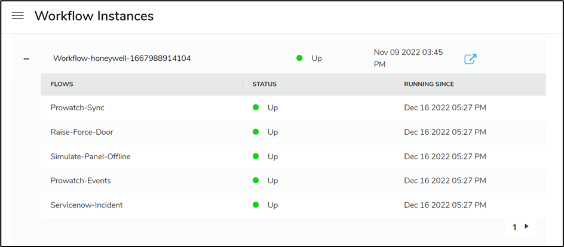

{/* Source: Intercom article 6969144 -  */}
{/* Generated by intercom_to_mintlify.py - re-running overwrites this file. */}

You can monitor your workflow instances in the Tenant Admin Portal.

1. Login to the **Tenant Admin Portal**.

2. On the Home page of the portal, click **Workflow Instances** on the left panel menu.

The Workflow Instances page is displayed.

You can see the following here

- [Instance Summary](#instance-summary)
- [Flow Summary](#flow-summary)

## Instance Summary

| Field | Description |
| --- | --- |
| Flow Name | Name of the Workflow instance on which flows are running. It comprises all the flows within that instance and their runtime status. |
| Status | The 'up' status shows that on-prem Oloid Workflow instances are interacting with Oloid cloud. |
| Running Since | Time stamp when the workflow is created and launched. |
|  | Re-direct link to open on-prem instances. |

<Note>
  **Note:** Expand each workflow to see flows within that instance and their runtime status. See [Flow Summary.](#flow-summary)
</Note>

## Flow Summary

Expand each workflow to see flows within that instance and their runtime status.

| Field | Description |
| --- | --- |
| Flows | Name of the flows |
| Status | The 'up' status shows that flows are running on the on-prem instances. |
| Running Since | Time stamp when the flow is created and deployed. |
