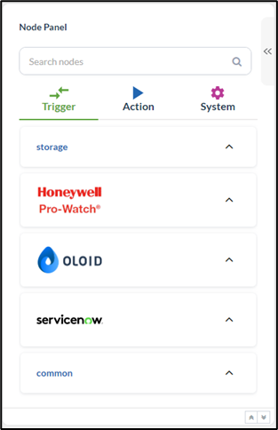

{/* Source: Intercom article 6955144 -  */}
{/* Generated by intercom_to_mintlify.py - re-running overwrites this file. */}

Node Pallet contains application nodes which contains pre-built business logic in them. Node Pallet has three categories of nodes. Every category has application specific sections to group the nodes.

**Trigger Nodes** - Trigger nodes determine what event to listen to execute the actions described in a flow. They are highlighted with GREEN colour.

**Action Nodes** - Action nodes perform intended function based on node configuration and trigger type. They are highlighted with BLUE colour.

**System Nodes** - The System nodes are set of nodes that are the non-application specific nodes. These nodes provide utilities to manage flows. They are highlighted with PURPLE color.

