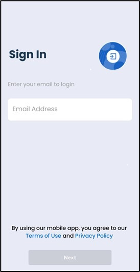
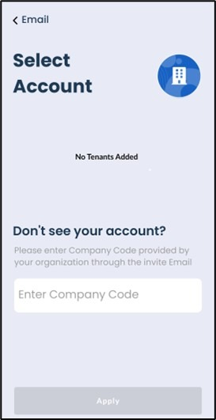
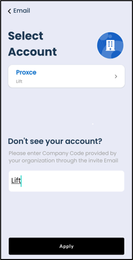
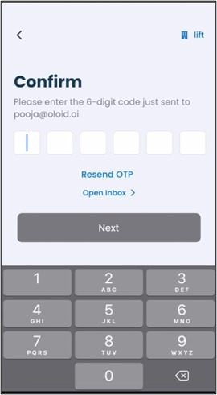
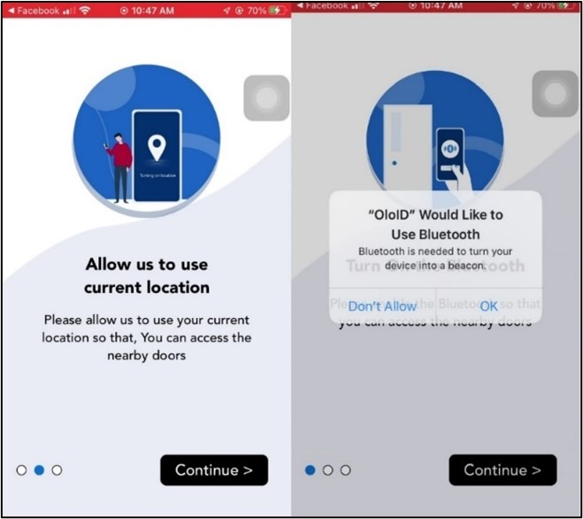
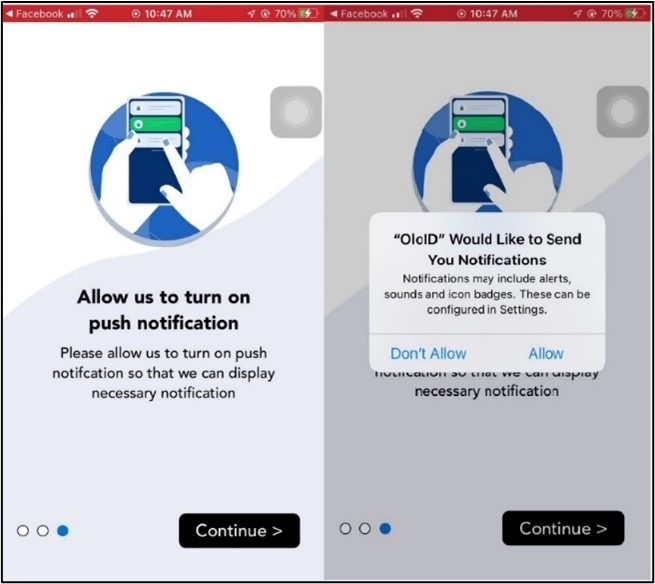

{/* Source: Intercom article 6651618 -  */}
{/* Generated by intercom_to_mintlify.py - re-running overwrites this file. */}

OloID mobile app provides an easy contactless way to authenticate and provide secure access over your mobile. The OloID app allows you to unlock a door.

You can do it in two modes:

1. **Foreground mode**: It supports opening the door by tap of a button.
2. **Auto Unlock mode**: It supports opening the door by holding your hand against the M-Tag, by tapping on push notification or just enabling your Bluetooth which opens the door as you are within the range of M-Tag.

OloID app is compatible with all mobile devices. Below is a condensed list of compatible devices.

- Android phones with OS 9 and above
- iPhone with OS 12 and above

**Pre-requisite**: You should have a valid OloID account.

1. Go to **App Store** or **Play Store** and download **OloID App.**
2. Install the application and upon successful installation, open the app.
3. Click **Get Started**.

   

4. Enter **Email ID** and Click **Next** on the **Sign In** screen.

   

5. Enter **Company Code** and click **Apply**.

   

   The Tenant is listed on the screen.

   

6. Tap on the **Tenant** and click **Apply**.

   

7. Enter your registered email id and click **Next**.

   <Note>
     **Note:** You can also use SSO login.
   </Note>

   

   A 6-digit code is sent to the registered email.
8. Enter the **6-digit code** to successfully log in.

   

   The Welcome screen is displayed.

   

9. Click **Allow** when OloID App prompts for Bluetooth, location, and push notification permissions.

   

   

   The **Wallet** screen is displayed.

   
