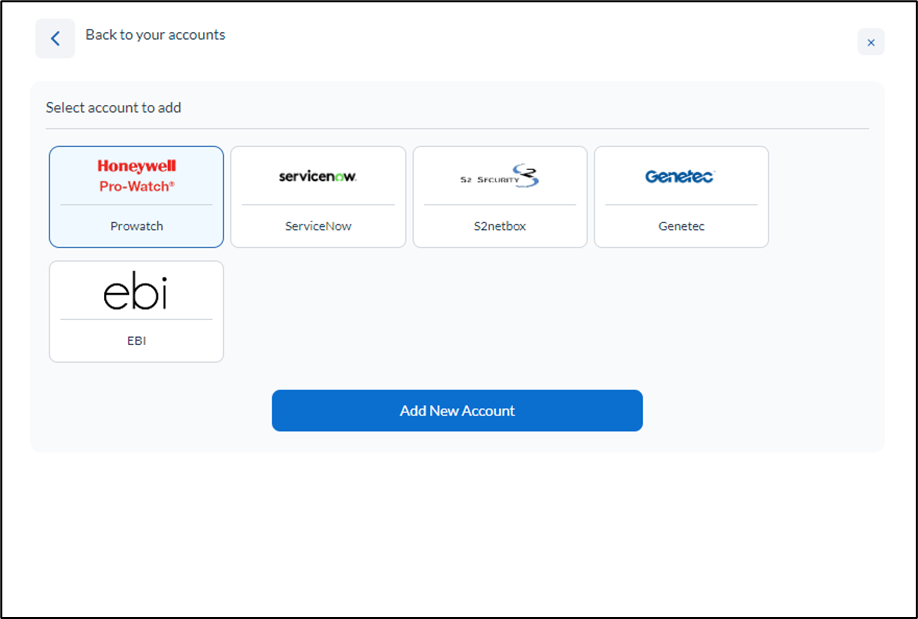
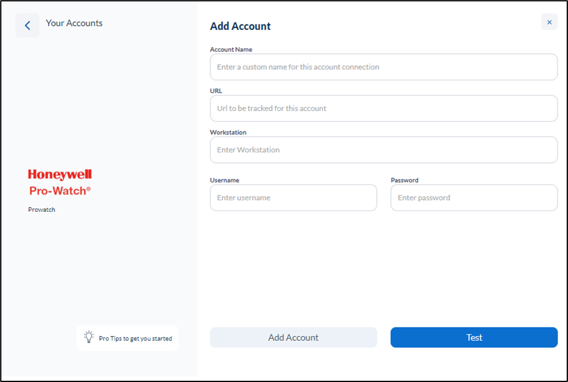
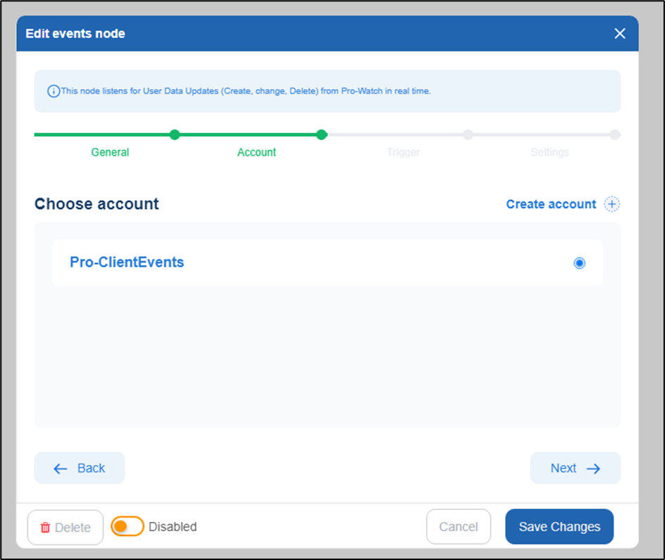

{/* Source: Intercom article 6951377 -  */}
{/* Generated by intercom_to_mintlify.py - re-running overwrites this file. */}

Pro-Watch provides users control of their building security through an integrated solution of network video recording technology, access management, and cloud connected ecosystems.

## How to add ProWatch Account in Oloid Workflow

1. Click **Accounts** on top right of main page.

The Accounts pop-up box is displayed.

2. Select ProWatch from the displayed accounts and click **Add New Account**.

The Add Account pop-up screen is displayed.

| Field | Description |
| --- | --- |
| Account Name | A unique name that identifies which ProWatch instance it is connected to. |
| URL | A ProWatch Rest API URL. |
| Workstation | A ProWatch workstation name. |
| Username | Username to connect to ProWatch. |
| Password | Password to connect to ProWatch. |

3. Do the following:

a. Enter **Account Name** for the account.

b. Enter instance **URL**.

c. Enter **Workstation** name**.**

d. Enter **Username** and **Password.**

4. Click **Test** to test for connectivity (optional but recommended)

5. Click **Add Account**.

The account is created and listed in the Accounts page.

## How to associate ProWatch Account to a Trigger/Action Node

While creating a flow, whenever you are using ProWatch action/trigger node, you can associate ProWatch account in the second tab of node config pop-up box.

