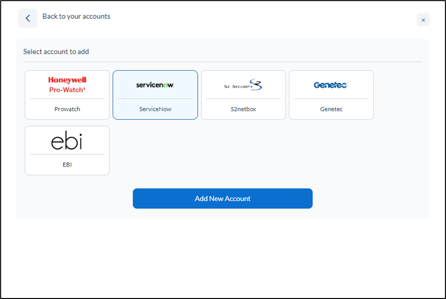
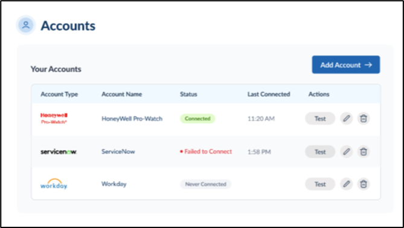
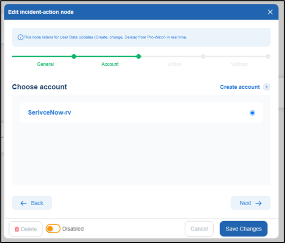

{/* Source: Intercom article 6951455 -  */}
{/* Generated by intercom_to_mintlify.py - re-running overwrites this file. */}

[ServiceNow](https://www.servicenow.com/) is a cloud software solution that offers a comprehensive suite of IT management software in the areas of IT service, IT operations, and IT business.

## How to add ServiceNow Account in Oloid Workflow

1. Click **Accounts** on top right of main page.

The **Accounts** pop-up box is displayed.

2. Select **ServiceNow** from the displayed accounts and click **Add New Account**.

The Add Account pop-up screen is displayed.

| Field | Description |
| --- | --- |
| Account Name | A unique name that identifies which ServiceNow instance it is connected to. |
| Instance name | A ServiceNow Rest API URL. |
| Username | Username to connect to ServiceNow. |
| Password | Password to connect to ServiceNow. |

1. Do the following:

a. Enter **Account Name** for the account.

b. Enter **Instance URL**.

**c.** Enter **Username** and **Password.**

2. Click **Test** to test for connectivity (optional but recommended).

3. Click **Add Account**.

### How to associate ServiceNow Account to a Trigger/Action Node

While creating a flow, whenever you are using ServiceNow action/trigger node, you can associate ServiceNow account in the second tab of node config pop-up box.

