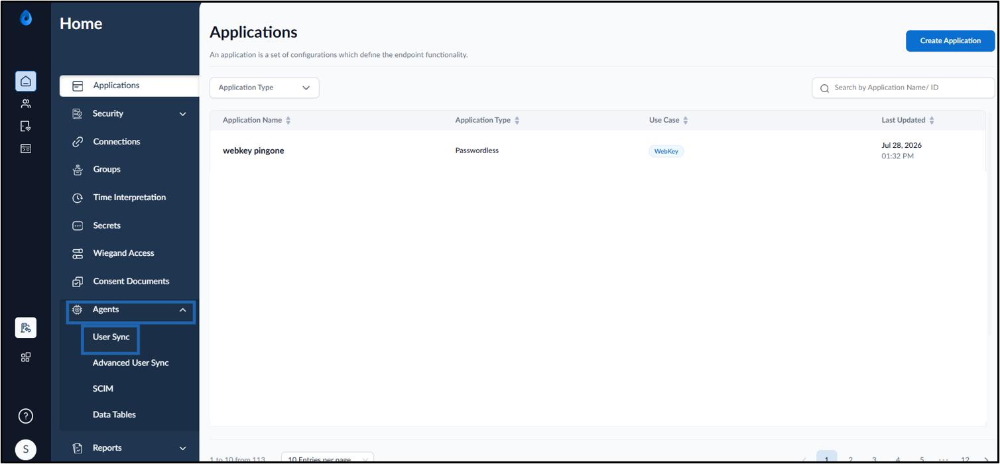
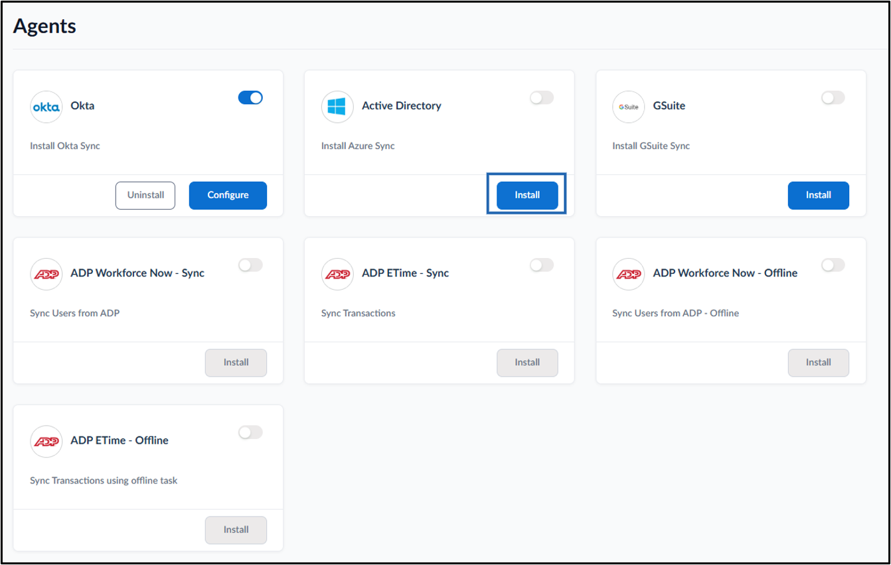
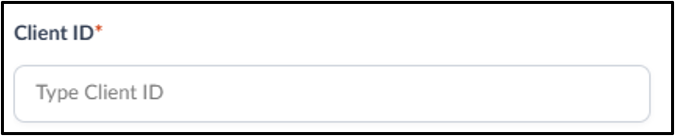
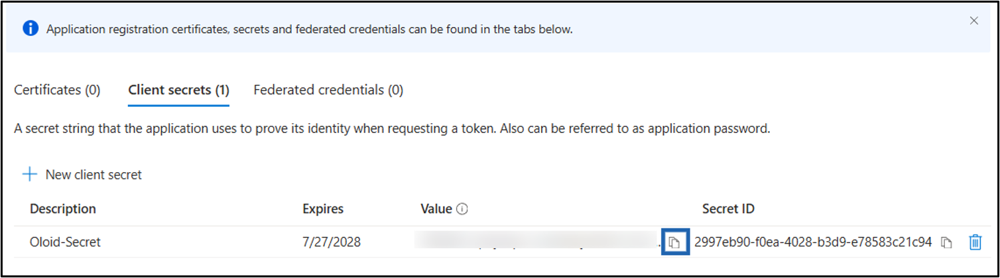
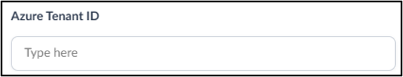
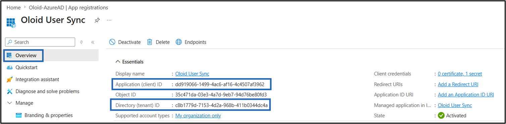
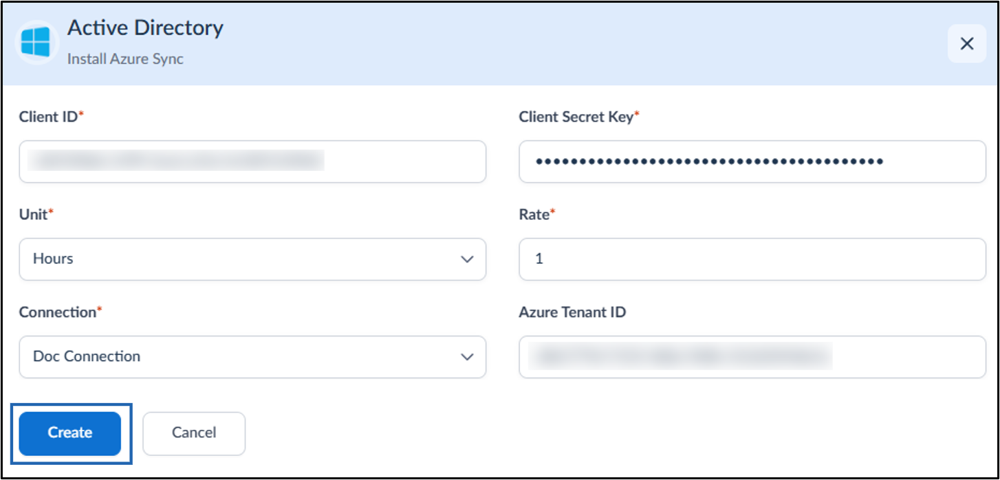
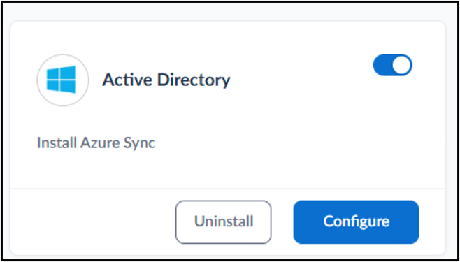

{/* Source: Intercom article 16107870 - https://oloid.help/en/articles/16107870-tenant-admin-portal-how-to-configure-user-sync-for-azure */}
{/* Generated by intercom_to_mintlify.py - re-running overwrites this file. */}

## Introduction

This document provides instructions to set up user sync between Microsoft Entra ID (Azure) and Oloid using the Tenant Admin Portal. This configuration enables user data to synchronize with Oloid.

## Prerequisite

You must have **Admin access** to the Tenant Admin Portal.

## Steps to Configure User Sync for Azure

1. Log in to the **Tenant Admin Portal**.
2. Go to **Agents** tab > **User Sync**.

   

   The Agents page is displayed.
3. Click **Install** on **Active Directory**.

   

   The **Active Directory** pop-up box is displayed.
4. Do the following:
   1. **Client ID**: Enter the Client ID of the Microsoft Entra application.

      

   2. **Client Secret Key**: Enter the client secret for the Microsoft Entra application.

      

      <Note>
        **Note:** You can find this in the Entra ID Admin Console under **Manage > Certificates and Secrets > Client secrets**.
      </Note>

      

   3. **Unit**: Select the time unit for the synchronization interval (**Seconds**, **Minutes**, or **Hours**).

      

   4. **Rate**: Enter the synchronization frequency for the selected time unit.

      

   5. **Connection**: Select the Oloid connection from the drop-down where synchronized users are added.

      

   6. **Azure Tenant ID**: Enter the Tenant ID of your Microsoft Entra tenant.

      

      <Note>
        **Note:** You can find the **Client ID** and **Tenant ID** in the Microsoft Entra admin center on the application **Overview** tab.
      </Note>

      

5. Click **Create**.

   

   The User Sync configuration is configured successfully.

   

#### Related Article

[How to Configure User Sync in Microsoft Entra ID Admin Console](/drafts/unassigned/unmapped/how-to-configure-user-sync-in-microsoft-entra-id-admin-console)
