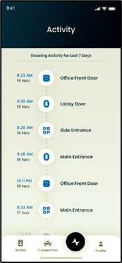

{/* Source: Intercom article 6895908 -  */}
{/* Generated by intercom_to_mintlify.py - re-running overwrites this file. */}

## Activity

Tap **Activity** on the menu at the bottom of the screen to view transactions of last 7 days.

