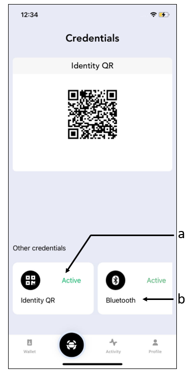
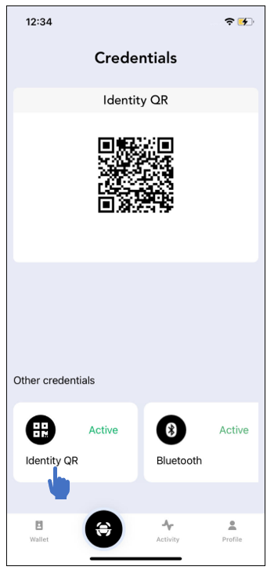
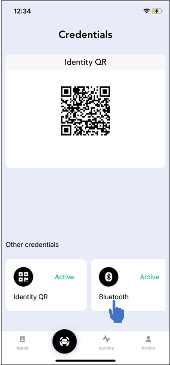

{/* Source: Intercom article 6651616 -  */}
{/* Generated by intercom_to_mintlify.py - re-running overwrites this file. */}

Tap **Credentials** on the menu at the bottom of the screen to see your credentials.

Under **Credentials** tab, you can do the following:

a. [View Identity QR](#view-identity-qr)

b. [View Bluetooth Status](#view-bluetooth-status)

## View Identity QR

Tap **Identity QR** card to see your active QR code. You can use this code to scan in case Bluetooth and facial recognition is not working.

<Note>
  **Note:** The Identity QR card is not displayed if it is not generated. The card status shows up as inactive if the Identity QR has expired.
</Note>

Contact your **Tenant Admin** to generate your Identity QR or extend the expiry date.

## View Bluetooth Status

Tap **Bluetooth** card to see if your Bluetooth ID is active.

<Note>
  **Note:** The Bluetooth Card is not displayed in case Bluetooth ID is not generated.
</Note>

**Contact your Tenant Admin** to generate your Bluetooth ID.

