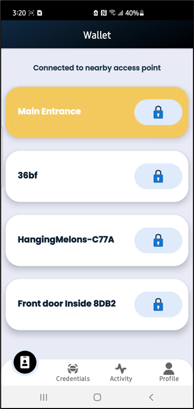
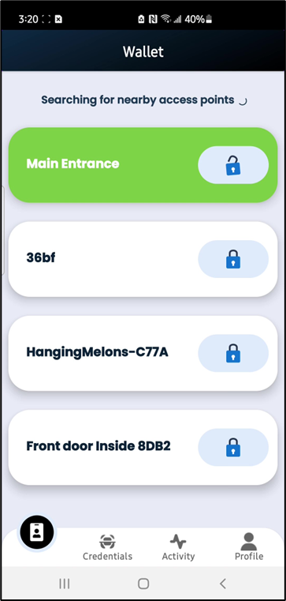
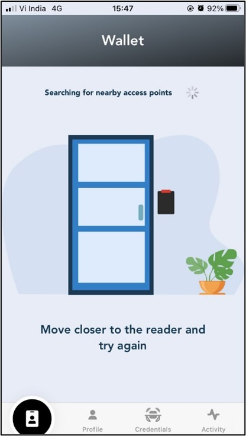

{/* Source: Intercom article 6892645 -  */}
{/* Generated by intercom_to_mintlify.py - re-running overwrites this file. */}

The OloID App has four tabs: Wallet, Credentials, Activity, and Profile.

## Wallet

The Wallet screen shows the list of doors nearest to you. You can tap on the door name to open it.

## Pre-requisite

- You should be near the M-Tag for your app to detect the door.
- Your device Bluetooth should be enabled.

## To use the OloID app Wallet

1. Launch the OloID App.
   The **Wallet** page with a list of doors is displayed.

2. Tap on the door name.

The name bar color changes to yellow.

3. Upon successful communication with the M-Tag, the name bar color changes to greenand the door opens.

<Note>
  **Note:** If your Wallet screen does not display the door names, you need to move closer to the doors.
</Note>

