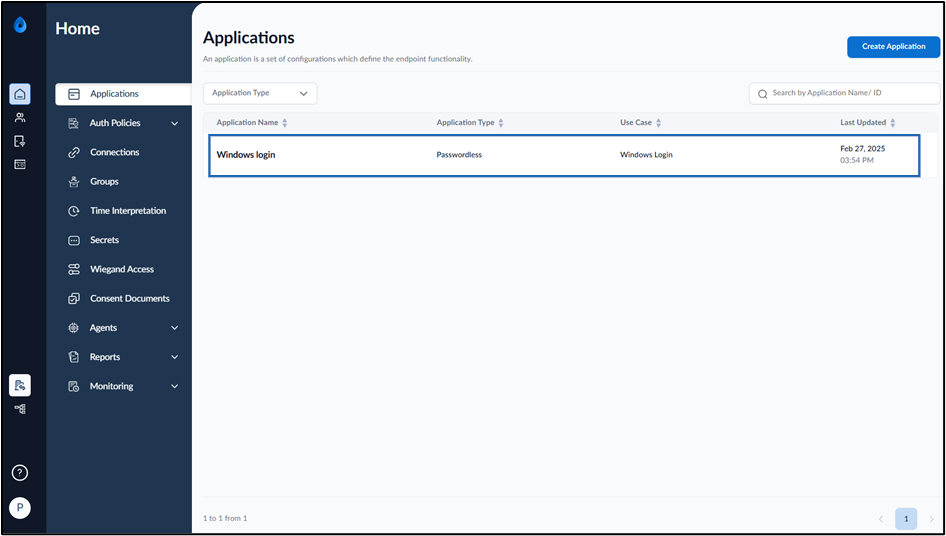
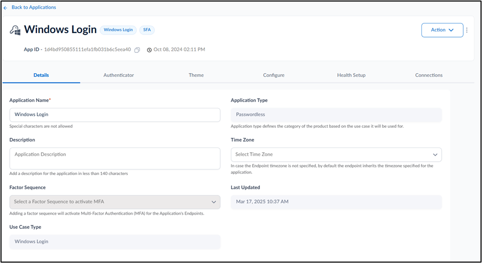
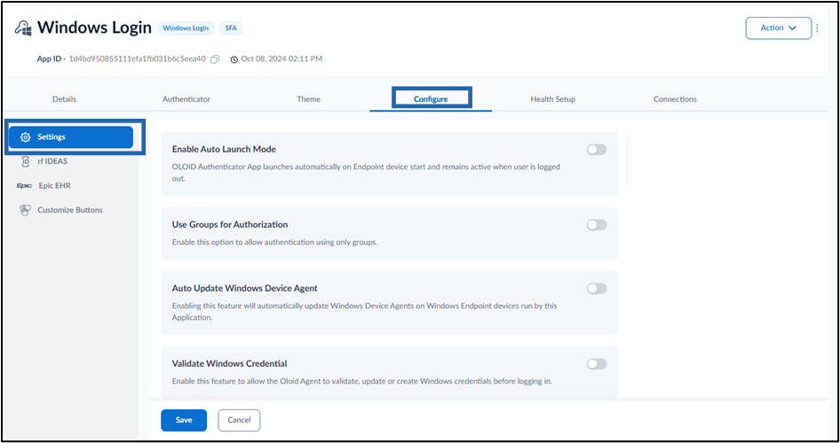
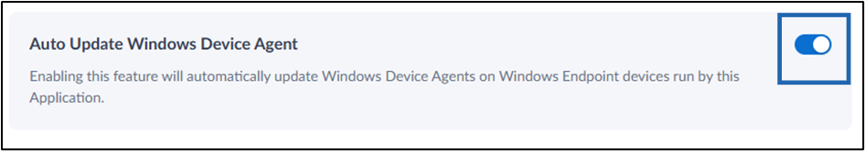
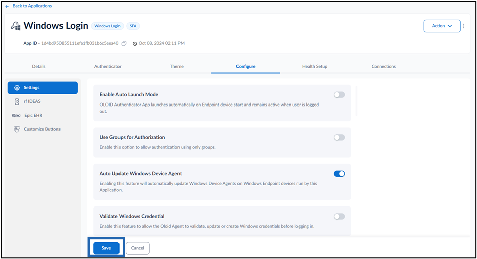

{/* Source: Intercom article 10897576 -  */}

{/* Access: restricted to Cognito groups "test". Not generated: do not overwrite with intercom_to_mintlify.py. */}

<Visibility for="signed-out">
  <Card title="Log in to view this document" icon="lock" horizontal href="/login?redirect=/drafts/windows/general-guides/admin-guides/how-to-enable-auto-update-windows-device-agent-in-windows-login">
    This document is restricted. Sign in with your Oloid account to continue.
  </Card>
</Visibility>

<Visibility for={{ groups:{includes:["*"],excludes:["test"]} }}>
  <Warning icon="lock">
    **Restricted document.** Your account doesn't have access to this document. Contact your Oloid administrator to request access to the **test** group.
  </Warning>
</Visibility>

<Visibility for={{ groups:["test"] }}>
  ## **Introdu**ction

  In Tenant Admin Portal, enabling Auto update windows device agent feature automatically updates the windows device agent for Windows authenticator app.

  ## Steps to enable Auto Update Windows Device Agent

  1. Log in to the **Tenant Admin Portal**.
  2. On the **Applications** page, select the application paired in the Supervisor App (Windows Authenticator App).  The application page is displayed. 
  3. Go to **Configure** > **Settings** tab. 
  4. Turn on **Auto Update Windows Device Agent** toggle button to automatically update the windows device agent for Windows authenticator app. 
  5. Click **Save**.  The configuration is saved successfully.
     <Note>
       **Note:** In **Windows Authenticator** app,you must sync the configuration for auto Update Windows Device Agent.
     </Note>
     For more details, refer [How to sync configuration in Supervisor App](https://oloid.help/en/articles/9329264-how-to-sync-configuration-in-supervisor-app)

  ## Check the latest update in Oloid Supervisor app

  To check the latest update in Oloid Supervisor app, Refer to [How to view updates in Supervisor App](https://oloid.help/en/articles/9637783-how-to-view-updates-in-supervisor-app)
</Visibility>
