{/* Source: Intercom article 8522846 -  */}

{/* Generated by intercom_to_mintlify.py - re-running overwrites this file. */}

## Introduction

Oloid DeviceLock is an Android app that enables secure Workforce/HRMS login, including platforms like Okta, using physical identity factors such as Face, Badge and PIN, NFC and PIN, or Password, while supporting Multi-factor Authentication (MFA).

The Oloid Device Lock App helps you to access your Okta account. For more info see, How to create and configure Device Lock application.

Once the setup is complete, you can use one of the following ways to log in to Okta.

- [Login with Face](#login-with-face)
- [Login with Badge](#login-with-badge)
- [Login with NFC](#login-with-nfc)
- [Login with Password](#login-with-password)
- [Enroll for Face Login](#enroll-for-face-login)

## Login with Face

**Pre-requisite:**

- The user face is added to the credential tab within User section on the Oloid Portal.
- Oloid Device Lock App is launched and Welcome screen is displayed.

To log in with face:

1. Tap **Login with Face**. 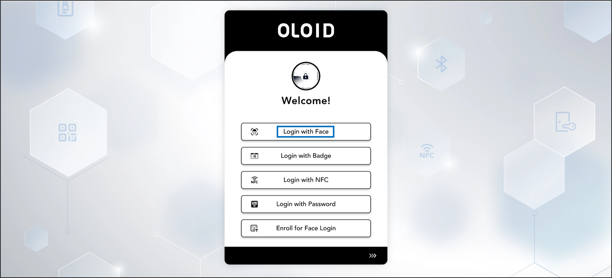 This opens the camera on your device.
2. Look at the camera to confirm your identity. 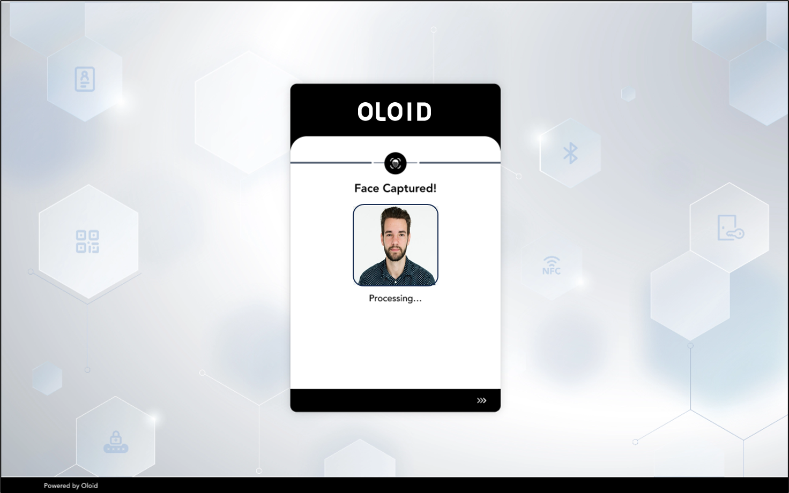
   <Note>
     **Note:** Tap **Capture** button to manually take your photo.
   </Note>
   The application compares your face with the reference image and on a successful face match displays the Okta home screen. 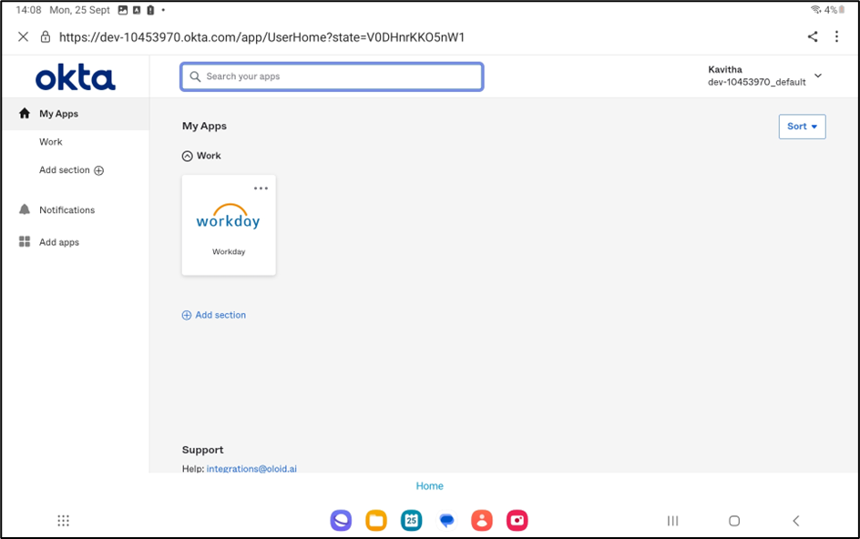

## Login with Badge

**Pre-requisite:**

- You must have an Okta account.
- The badge reader should be connected to your android tablet.
- Oloid DeviceLock App is launched and Welcome screen is displayed.

To log in with badge:

1. Tap **Login with Badge**. 
2. Scan your badge in the Badge Reader. 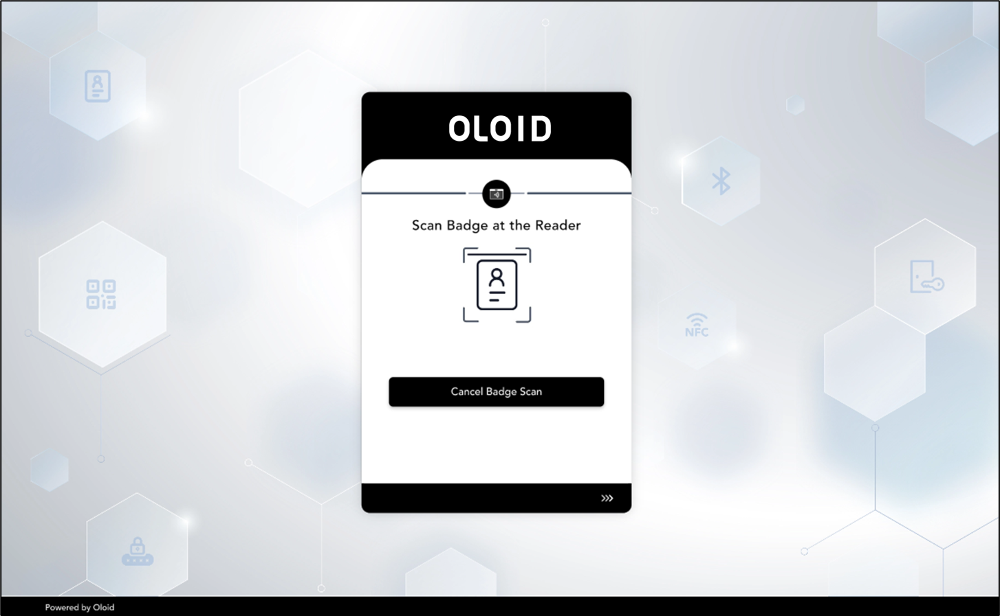 On successful badge authentication, the **Enter PIN** page is displayed.
3. Enter the **PIN**. 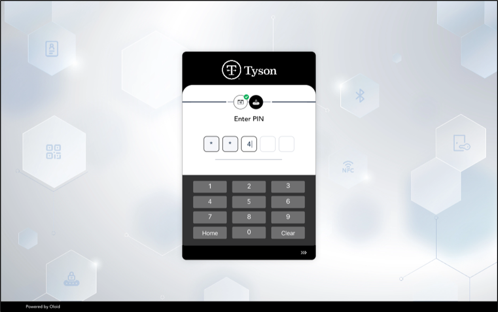 On Pin authentication, you are signed into the Okta system.

## Login with Password

**Pre-requisite:**

- You must have an Okta account.
- Oloid DeviceLock App is launched and Welcome screen is displayed.

To log in with password:

1. Tap **Login with Password**. 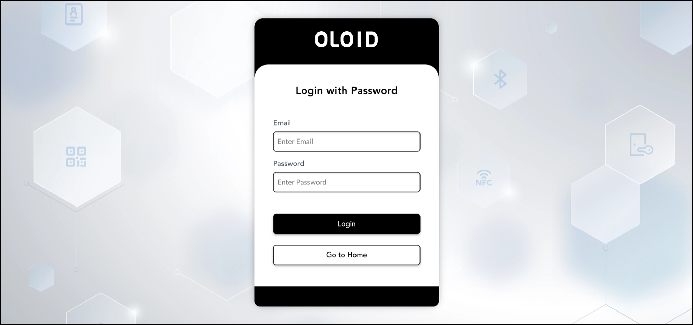
2. Enter your login credential. You are successfully signed in to the Okta system. 

## Login with NFC

**Pre-requisite:**

- The android tablet must support NFC.
- Oloid DeviceLock App is launched and Welcome screen is displayed.

To log in with NFC:

1. Tap **Login with NFC**. 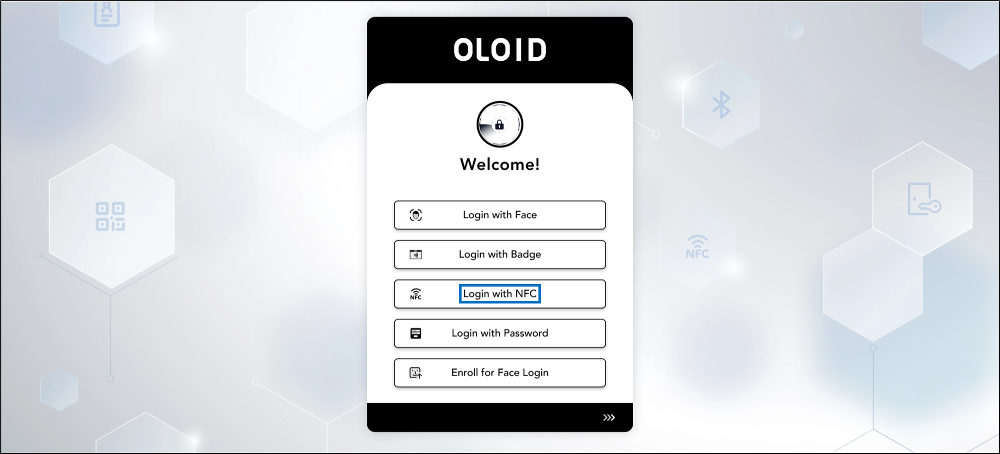
2. Scan the NFC tag on the back of your device. 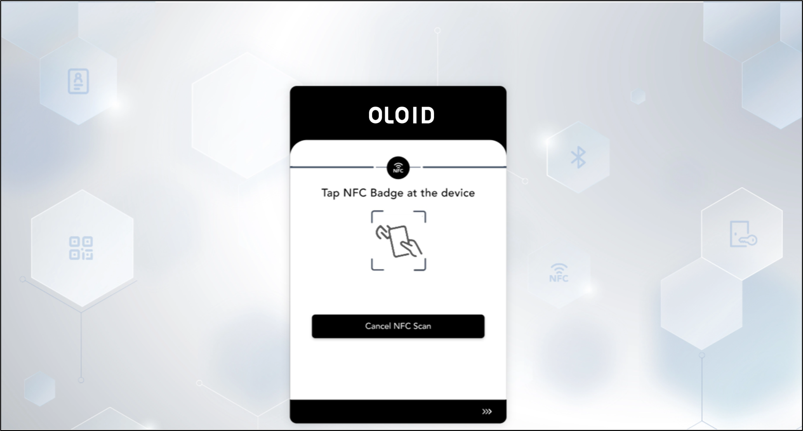 After successful NFC authentication, the **Enter PIN** page is displayed.
3. Enter the **PIN**. 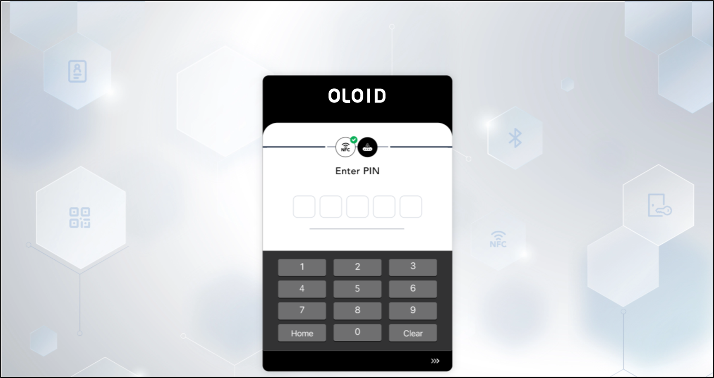 On PIN authentication, you are signed into the Okta system. 

## Enroll for Face Login

**Pre-requisite:**

1. Reference image must be added for face enrollment. Contact [Oloid support](mailto:support@oloid.ai) to add your reference image.
2. Oloid Device Lock App is launched and Welcome screen is displayed.

To enroll for face login:

1. Tap **Enroll for Face Login**. 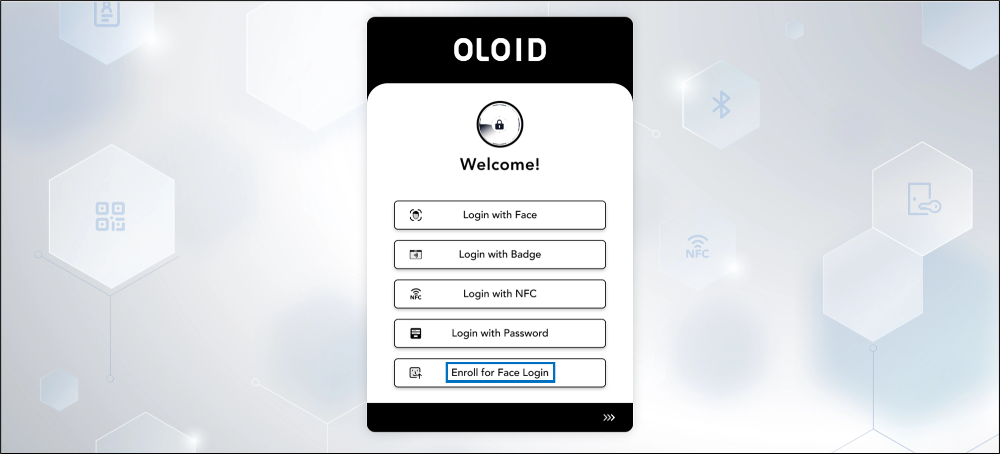
2. On the **Enroll Face page,** enter your primary ID. 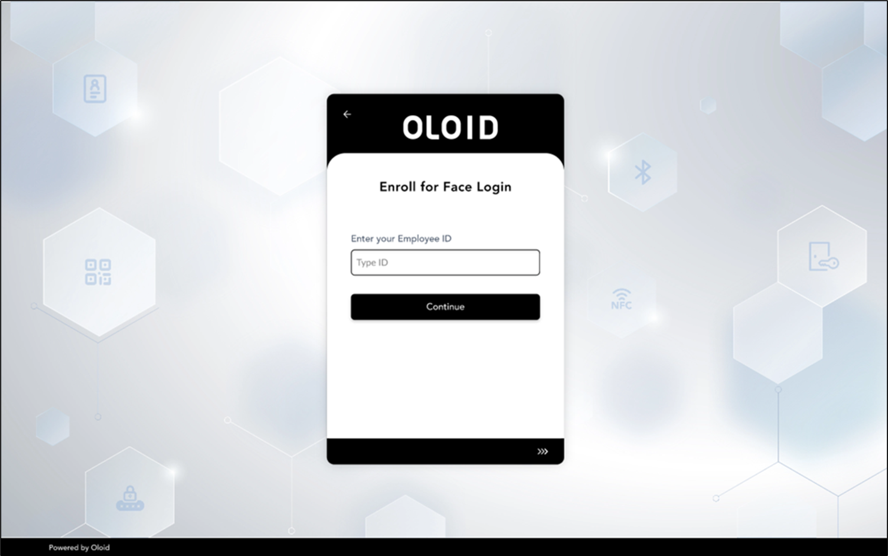
3. Select **Continue**. TheConsentpage is displayed. 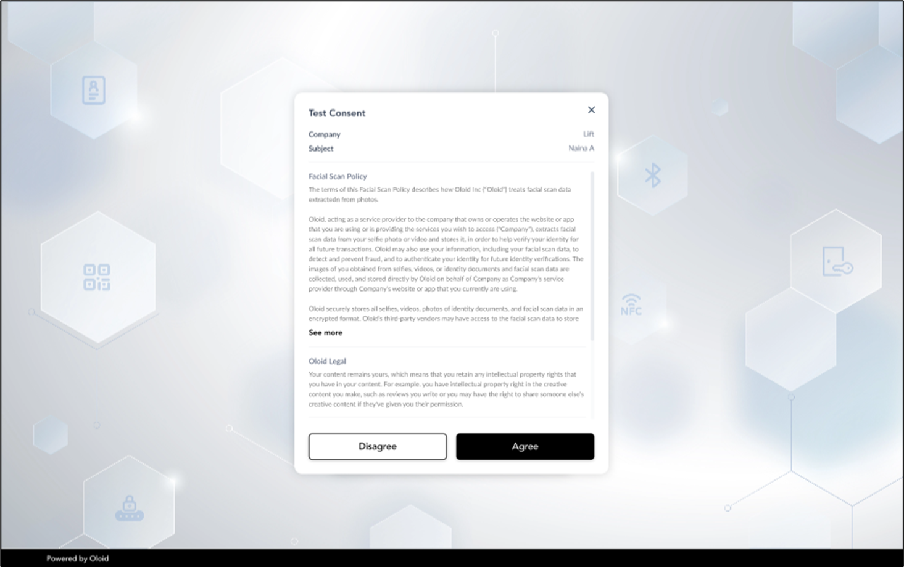
4. Tap **Agree**. This opens the camera on your device.
5. Look at the camera to capture your face for enrollment. 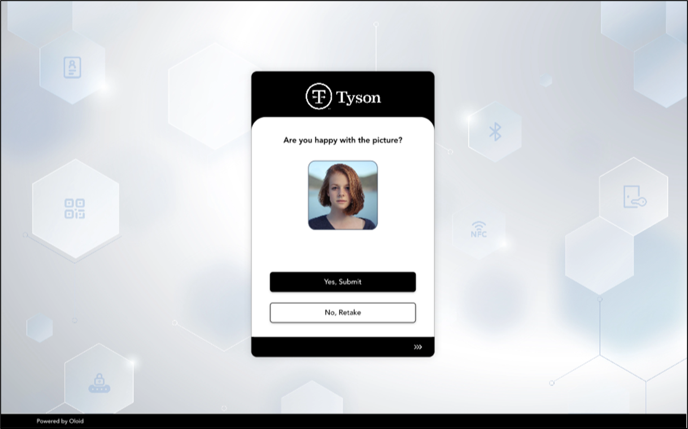
6. Do one of the following:
   1. Tap **Yes- Submit** to submit the image. The face is submitted successfully and is displayed on the details screen.
   2. Tap **No- Retake** to take the photo again. The camera turns on to retake photo.
      <Note>
        **Note:** You can add a maximum of five faces per user. The user's face is added to the Oloid portal only if it matches the reference image.
      </Note>
      You've now enrolled your face in the Oloid Device Lock app. You can log in successfully.
