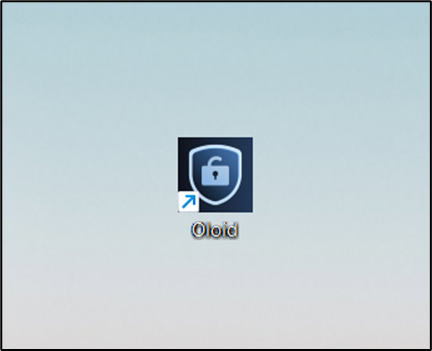
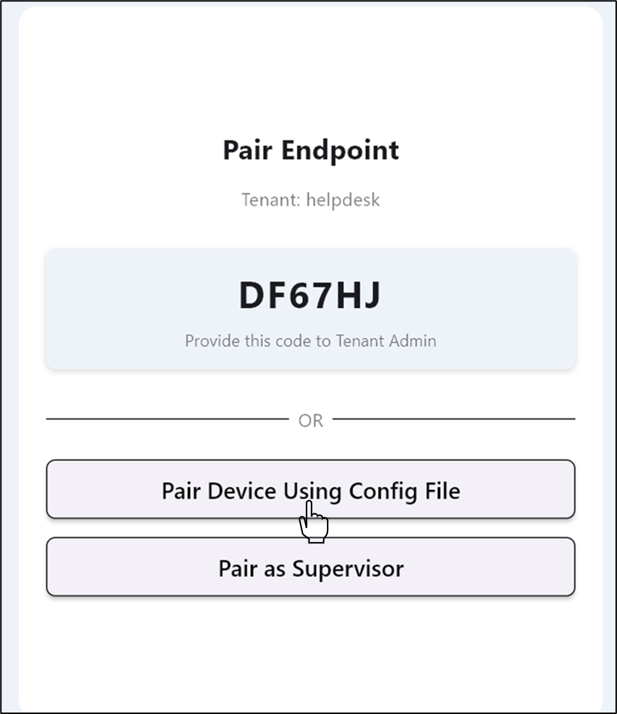
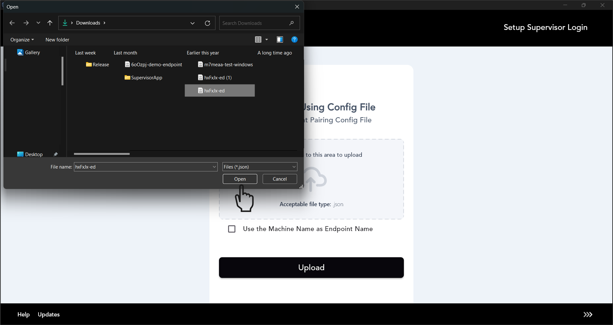
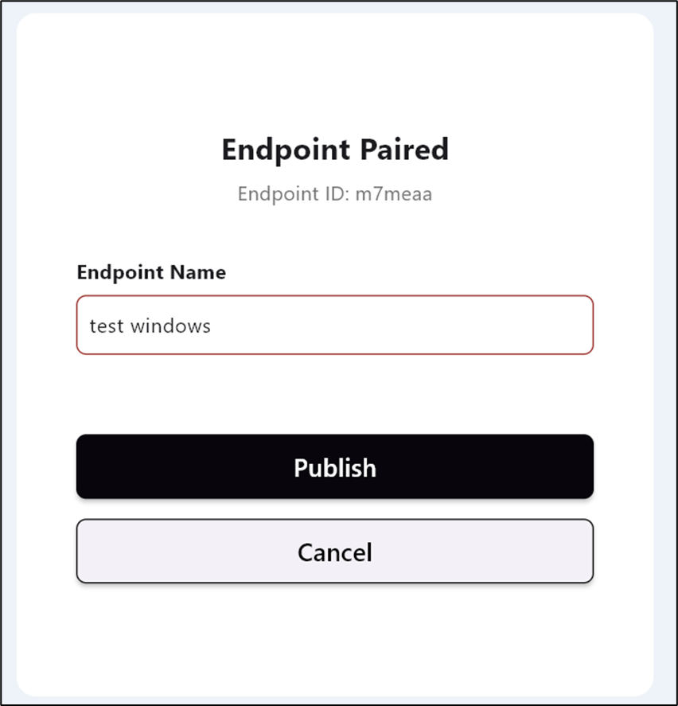
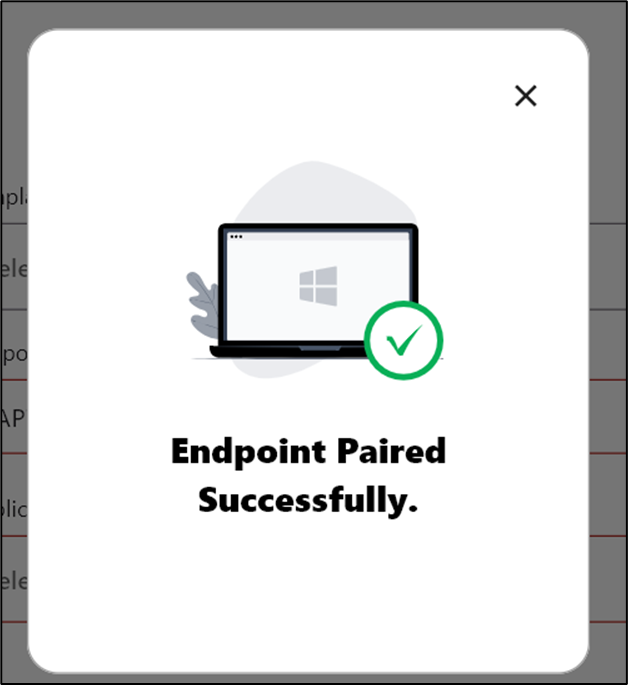
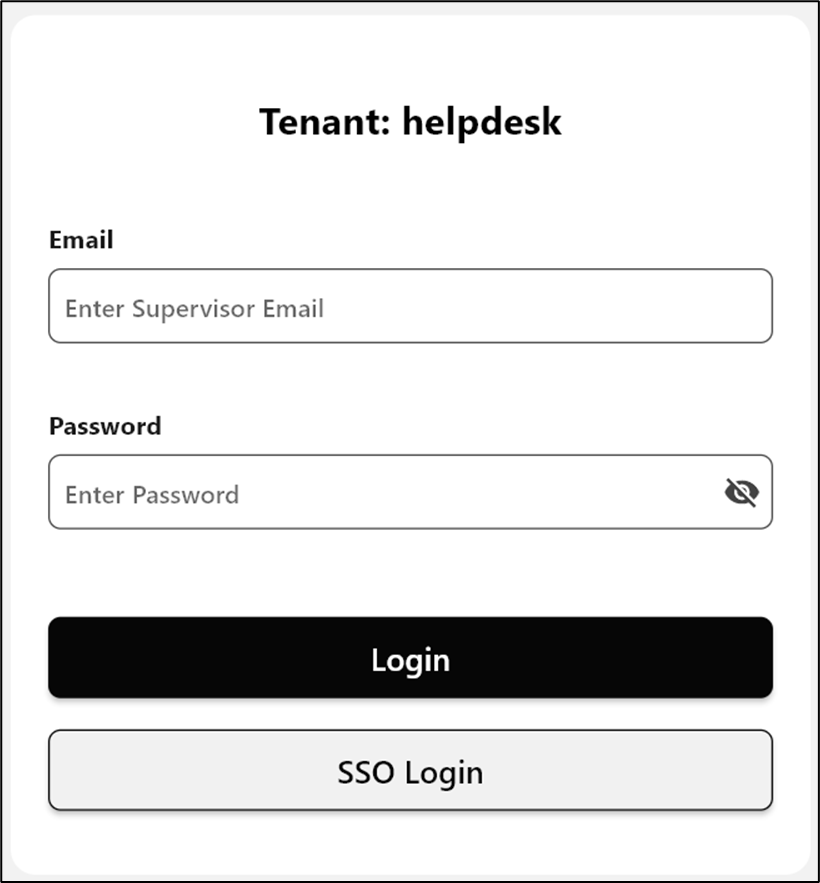

{/* Source: Intercom article 9036798 -  */}

{/* Access: restricted to Cognito groups "test". Not generated: do not overwrite with intercom_to_mintlify.py. */}

<Visibility for="signed-out">
  <Card title="Log in to view this document" icon="lock" horizontal href="/login?redirect=/drafts/windows/version-1/supervisor-app/how-to-pair-supervisor-app-using-config-file">
    This document is restricted. Sign in with your Oloid account to continue.
  </Card>
</Visibility>

<Visibility for={{ groups:{includes:["*"],excludes:["test"]} }}>
  <Warning icon="lock">
    **Restricted document.** Your account doesn't have access to this document. Contact your Oloid administrator to request access to the **test** group.
  </Warning>
</Visibility>

<Visibility for={{ groups:["test"] }}>
  ## Pre-requisite

  If endpoint is created through the Oloid Portal, you need to download the config file of the preferred endpoint from the Oloid Portal. For details, refer [How to download endpoint config file for Windows Login?](https://oloid.help/en/articles/8778331-how-to-download-endpoint-config-file-for-windows-login)

  To pair an endpoint:

  1. Double-click on the **Supervisor App** to start.  The **Pair Endpoint** screen is displayed.
  2. Select **Pair Device Using Config File**.  The **Pair Device Using Config File** screen is displayed.
  3. Select the json file you want to upload and click **Open**. 
     <Note>
       **Note:** Check mark to **Use the Machine Name as Endpoint Name** (Optional).
     </Note>
  4. Click to **Upload** the endpoint JSON file.
     <Note>
       **Note:** You can choose **Reset** to upload the JSON file again.
     </Note>
     The **Pairing endpoint** screen is displayed.
  5. The **Endpoint Name** is auto-populated. 
  6. Select **Publish**. The endpoint is paired successfully.  Now, you can log in to admin mode. 
</Visibility>
