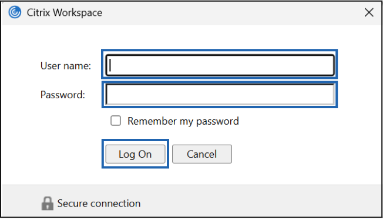
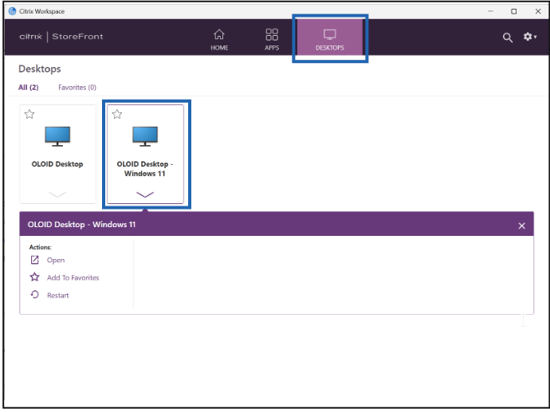
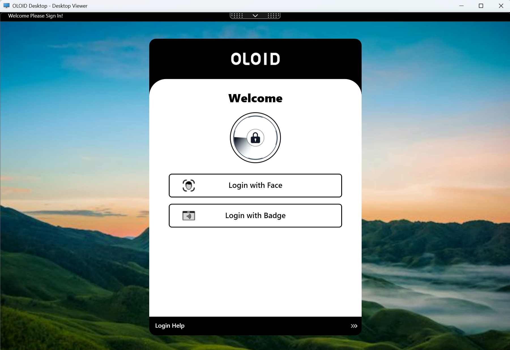
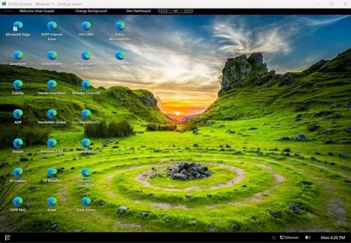
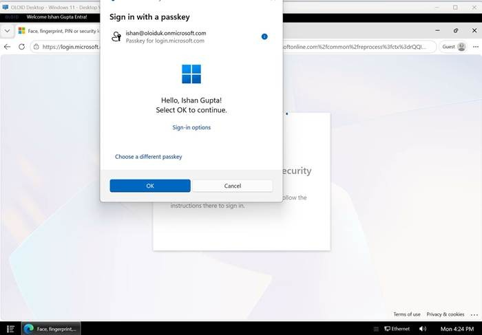
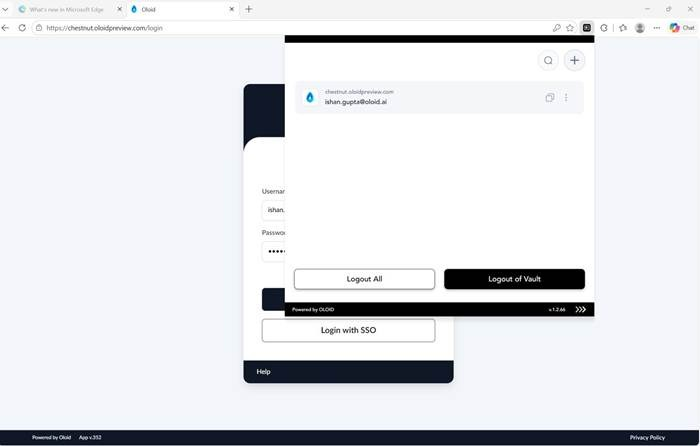
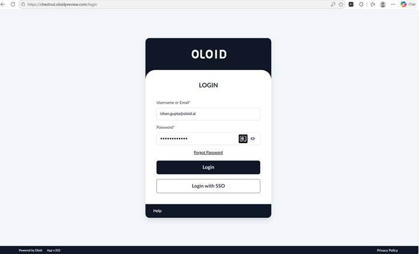
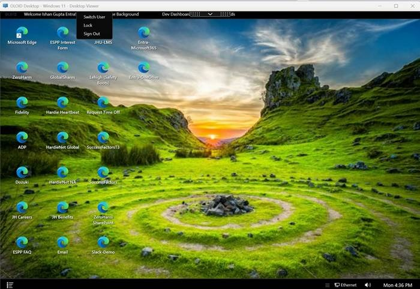
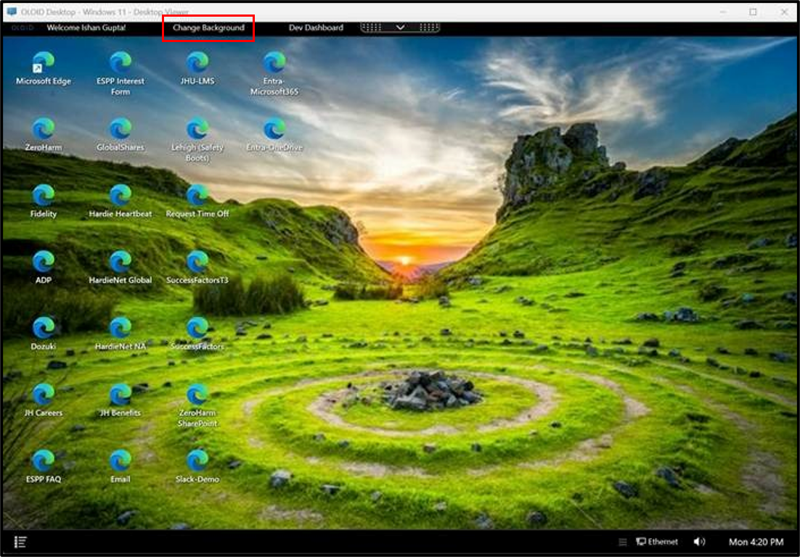

{/* Source: Intercom article 17560852 - https://oloid.help/en/articles/17560852-oloid-launcher-how-to-use-oloid-launcher-on-a-citrix-virtual-desktop-vdi */}
{/* Generated by intercom_to_mintlify.py - re-running overwrites this file. */}

## Introduction

This document describes how to sign in to Oloid Launcher on a shared Citrix virtual desktop (VDI) using your face, badge, or NFC tag, and how to open applications and websites, manage your session, and sign out.

<Note>
  **Note:** Your administrator configures these features, so your screens may differ slightly from this guide.
</Note>

## Prerequisites

- A Dell Wyse thin client or a Windows PC must be available.
- Citrix Workspace must be installed on the device.
- Valid VDI credentials (username and password) must be available to sign in to Citrix Workspace.
- The user’s sign-in method (face, badge, or NFC tag) must be configured in Oloid Launcher.
- A card reader must be connected to the device and configured to sign in with a badge.

## Steps to Sign in to Oloid Launcher

1. Turn on your Dell Wyse thin client or Windows PC and wait for it to finish starting up.
   The device starts up, and Citrix Workspace opens automatically.

   <Note>
     **Note:** If Citrix Workspace does not open automatically, open it from the desktop icon or the **Start** menu.
   </Note>

2. In the Citrix Workspace, do the following:

   <Note>
     **Note:** On many deployments, everyone on your team uses the same shared Citrix Workspace credentials. This sign-in only connects you to the shared remote desktop. Your personal identity is confirmed in the next step.
   </Note>

   1. Enter your Citrix **username**.
   2. Enter your **Password**.
   3. Click **Log On**.

      

      The Citrix Workspace home page is displayed.
3. Click **DESKTOPS**, and then select your virtual desktop.

   

   The Citrix Workspace starts connecting to the remote session. This may take a few seconds.
4. The remote session opens, and the Oloid Launcher **Welcome** screen is displayed.
5. On the **Welcome** screen, select your preferred sign-in method:

   <Note>
     **Note:** The sign-in options depend on your organization’s configuration.
   </Note>

   1. Click **Login with Face** and then look directly at the camera.
      OR
   2. Click **Login with Badge,** and then tap your badge on the card reader.

      

      You are signed in to Oloid Launcher successfully, and the Launcher desktop is displayed.

      

      <Warning>
        **Important:** Your personal sign-in identifies you to every application you open during the session. Never let anyone else sign in for you or use the desktop while you are signed in.
      </Warning>

      <Note>
        **Note:** If you have trouble signing in, select **Login Help** at the bottom of the **Welcome** screen, or contact your IT support team.
      </Note>

### Use the Launcher Desktop

After you sign in, the Launcher desktop shows the shortcuts your administrator has assigned to you.

The following table describes the areas of the Launcher desktop:

| Area | Description |
| --- | --- |
| **Shortcuts** | Icons for your assigned applications and websites. Click an icon to open it. |
| **Your name** (top toolbar) | Shows who is signed in. Click it to open a menu that includes **Sign Out**. |
| **Change Background** (top toolbar) | Lets you select a desktop background from administrator-approved images. |
| **Session timer** (top-right corner) | Shows the time left before you are signed out for inactivity. |

### Open Applications and Websites

To open an application or website, click its shortcut on the Launcher desktop. Depending on how the application is set up, you are signed in using one of the following methods:

| Application type | What happens |
| --- | --- |
| **Standard shortcut** | The application or website opens directly. |
| **Entra ID single sign-on** | You are signed in automatically with your Microsoft Entra ID. |
| **Oloid Vault** | Launcher fills in your saved username and password. |

### Entra-Federated Applications

If your account is federated through Microsoft Entra ID, applications configured for single sign-on use your Entra ID automatically. You do not need to enter a separate username or password.

1. On the Launcher desktop, click the application shortcut.
   The application opens and signs you in with your Entra ID.
2. If you are prompted to confirm your identity with a passkey (for example, Windows Hello), select **OK**.
   Your identity is confirmed, and the application is ready to use.

   

### Applications Signed In with the Oloid Vault

Some applications are not federated through Entra ID. If your credentials for such an application are saved in the Oloid Vault, Launcher retrieves them and signs you in automatically when you open the application.

1. On the Launcher desktop, click the application shortcut.
   Launcher retrieves your saved credentials from the Oloid Vault, and you are signed in to the application.

   

   

### Sign Out of Oloid Launcher

Because the remote desktop is shared, always sign out when you step away so the next person cannot use your session. You can sign out in any of the following ways:

| Method | How it works |
| --- | --- |
| **Toolbar** | In the top toolbar, click your name, and then select **Sign Out**. |
| **Badge tap** | If you signed in with your badge, tap it on the card reader again. This is the quickest way to end a session. |
| **Inactivity timeout** | When the session timer runs out, Launcher signs you out automatically. Treat this as a safety net, not a substitute for signing out. |

To sign out using the toolbar, do the following:

1. In the top toolbar of the Launcher desktop, click your name.
   A menu with the **Sign Out** option is displayed.
2. Select **Sign Out**.
   You are signed out, and the Oloid Launcher **Welcome** screen is displayed.

   

### Additional Information

#### Browse Approved Websites

For security, the browser on your virtual desktop only opens websites approved by your organization. Open an approved website from its shortcut on the Launcher desktop or enter its address in the browser.

<Note>
  **Note:** If a website is not on the approved list, the browser does not load it. This is expected and does not indicate a problem with your session or device.
</Note>

#### Session Timer and Inactivity Timeout

To protect your session on a shared desktop, Launcher signs you out automatically after a period of inactivity. The timer in the top-right corner of the Launcher desktop shows the time remaining.

Using the mouse or keyboard keeps your session active. If the timer runs out, Launcher signs you out and returns to the **Welcome** screen. To continue working, sign in again.

<Warning>
  **Important:** Save your work regularly. Unsaved work may be lost when the inactivity timeout signs you out. If you need to step away, sign out instead of waiting for the timer.
</Warning>

#### Change Your Desktop Background

1. In the top toolbar, click **Change Background**.

   

   The list of approved background images is displayed.
2. Select an image.
   The desktop background is updated with the selected image.

   <Note>
     **Note:** Only administrator-approved images are available. To request a new image, contact your administrator.
   </Note>
