{/* Source: Intercom article 13607433 - https://oloid.help/en/articles/13607433-how-to-configure-advanced-user-sync-in-microsoft-entra-id-admin-console */}
{/* Generated by intercom_to_mintlify.py - re-running overwrites this file. */}

## Introduction

This document explains how to register and configure an application in **Microsoft Entra ID** and enable **FIDO2 (Passkey)** authentication for integration with the Tenant Admin Portal.

## Prerequisite

You must have Admin access to the Microsoft Entra ID admin console.

## Steps to Configure Microsoft Entra ID for Advanced User Sync

1. [Register an Application](#register-an-application)
2. [Configure the Application](#configure-the-application)
3. [Create Client Secret](#create-client-secret)
4. [Enable FIDO2 Authentication in Azure Portal](#enable-fido2-authentication-in-azure-portal).

The Microsoft Entra ID is configured successfully.

### Register an Application

1. Log in to the Azure Portal and select **Microsoft Entra ID** on the home page.

   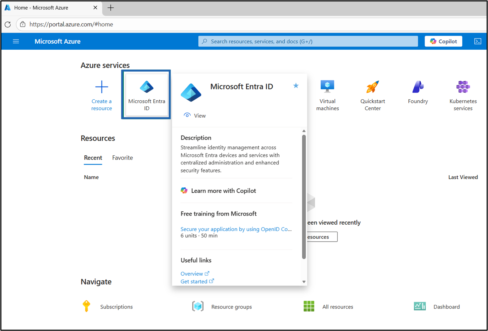

   The Microsoft Entra ID page is displayed.
2. Go to **Overview > Manage** **> App registrations > New registration**.

   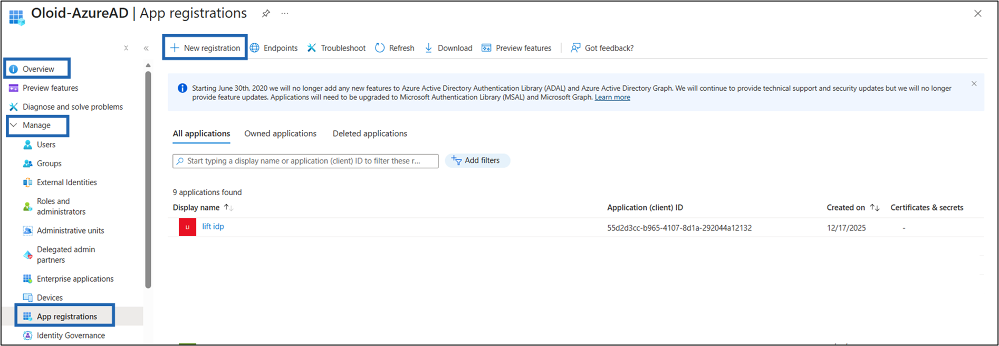

   The Register an application page is displayed.
3. Do the following:
   1. Enter the **Name**.
   2. Select Supported account types.

      <Note>
        **Note:** Select Accounts in this organizational directory only.
      </Note>

   3. Click **Register**.

      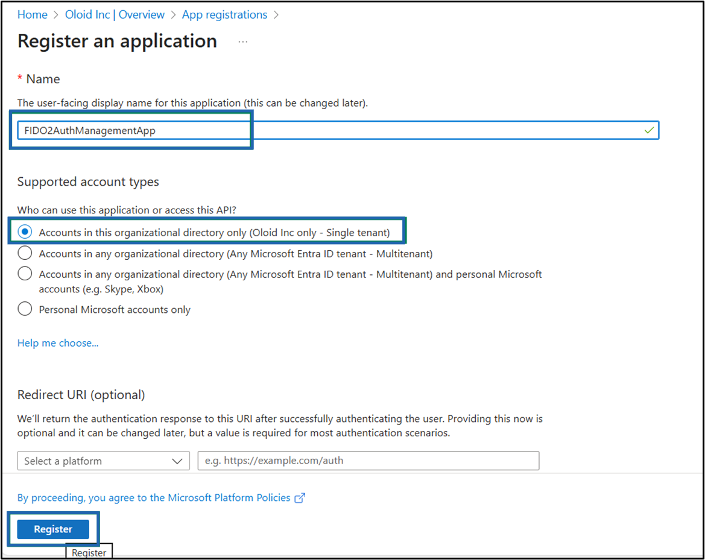

      The application is registered successfully.

### Configure the Application

This section helps you assign the required Microsoft Graph API permissions to the registered application.

1. Navigate to the **newly registered app > API Permissions >** **Add a permission > Microsoft Graph.**

   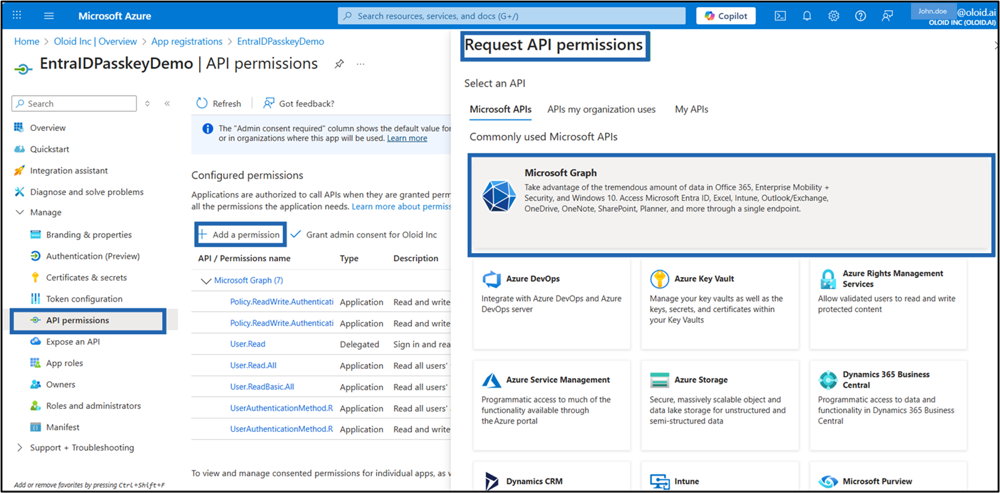

   The **Request API permissions** pop-up box is displayed.
2. Select **Application permissions**.

   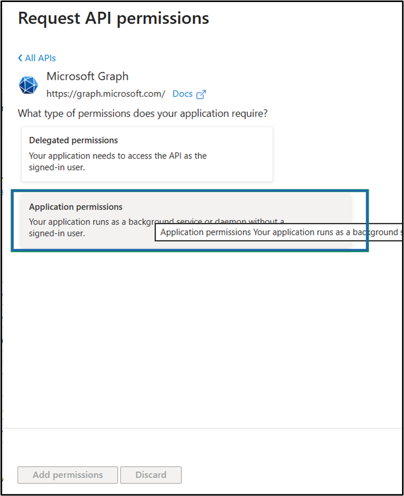

   The **list of API** permissions is displayed.
3. Do the following:
   1. Expand **User**, and then select the **User.Read.All**.

      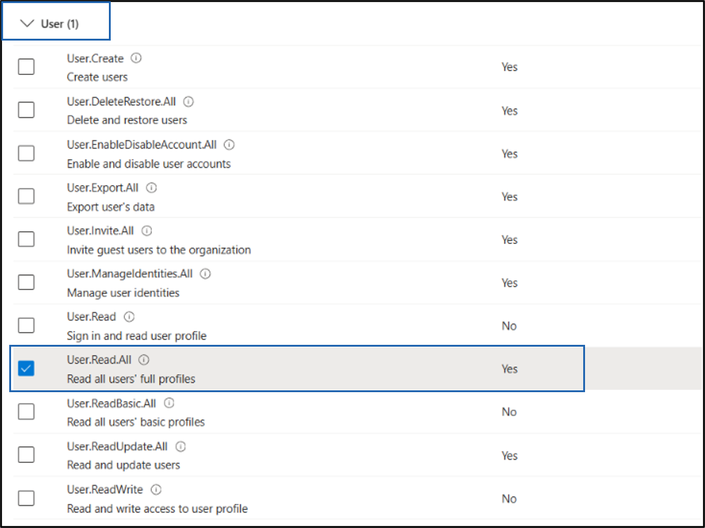

   2. Expand **GroupMember,** and then select the **GroupMember.Read.All**

      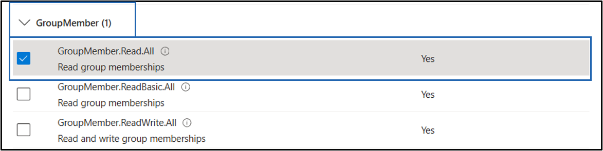

   3. Expand **UserAuthenticationMethod**,and then select the **UserAuthenticationMethod.ReadWrite.All (Optional)**.

      <Note>
        **Note:** Select this permission only if you want to sync passkeys and plan to configure the [Enable FIDO2 Authentication](#enable-fido2-authentication-in-azure-portal) section. Skip this permission otherwise.
      </Note>

   4. Click **Add permissions**.

      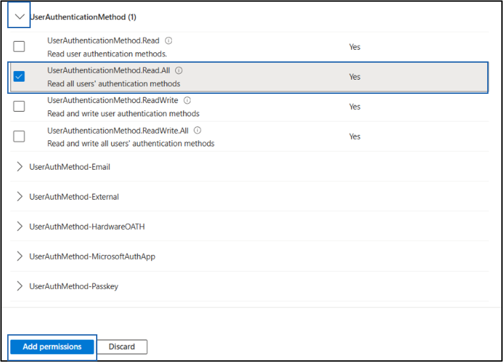

      The Permissions are listed on the API.
   5. Click **Grant admin consent for &lt;your organization name>.**

      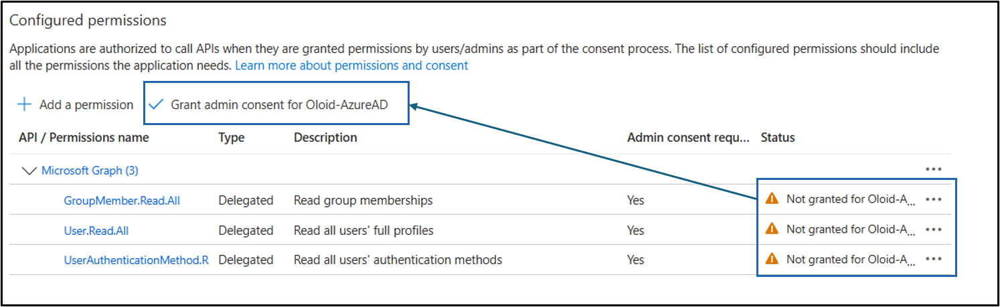

      The **Grant admin consent confirmation** pop-up box is displayed.
   6. Click **Yes**.

      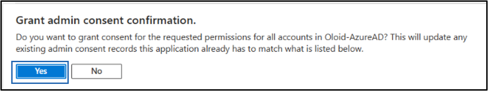

      The admin consent is granted successfully.

      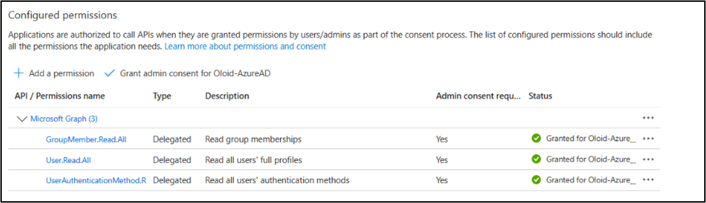

### Create Client Secret

1. Go to **Certificates & secrets** > **Client secrets > + New client secret**.

   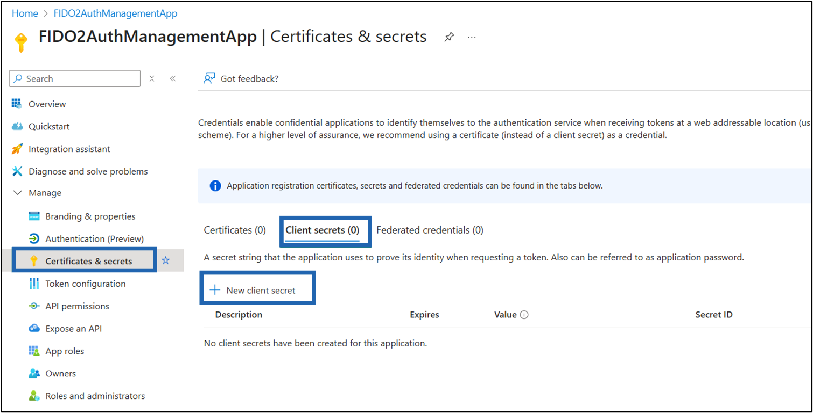

   The **Add a client secret** screen is displayed.
2. Do the following:
   1. Enter the **Description**.
   2. Select the **Expires** duration from the drop-down list.

      <Note>
        **Note:** The client secret expires at the end of the period you choose. Before it expires, create a new secret and update it in the Oloid Tenant Admin Portal. Otherwise, user sync will stop working.
      </Note>

   3. Click **Add**.

      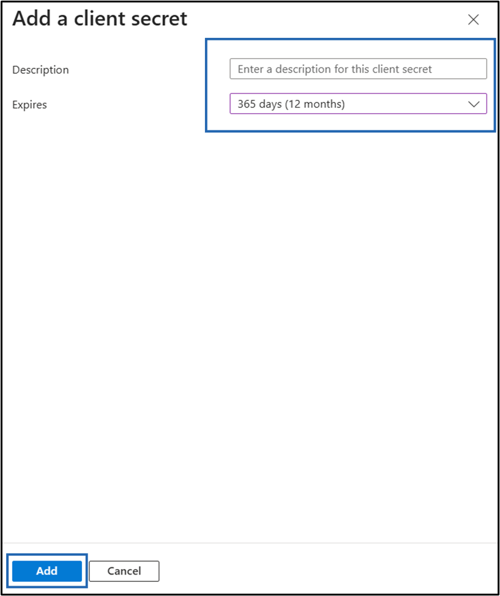

      The **Client Secret** is added successfully and listed on **Client Secret** tab.

      <Note>
        **Note:** Click on the **Copy to Clipboard** icon next to the value field to copy the secret. This option is available only at the time of creation.
      </Note>

      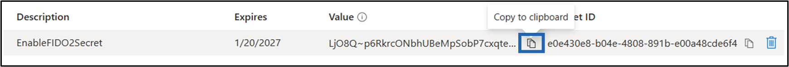

3. Go to **Overview** and copy the values of **Application** (**client) ID** and **Directory** (**Tenant) ID**.

   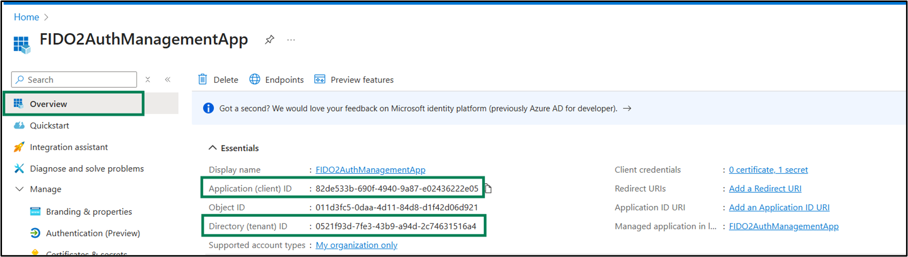

   <Note>
     **Note:** Enter the copied values in your Oloid portal. Go to **Agents** > **Advanced User Sync** > select the required Entra ID profile > **Account** tab, and enter the values as follows:
   </Note>

   1. **Directory (tenant) ID** in **Directory ID**.
   2. **Application (client) ID** in **Client ID**.
   3. **Secret value** in **Client Secret**.

      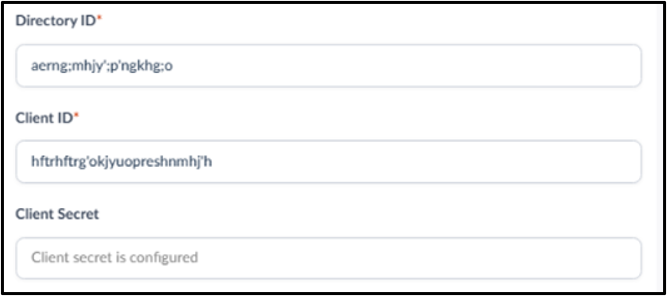

      The application is configured successfully.

### Enable FIDO2 Authentication in Azure Portal

<Note>
  **Note:** Configure this section if you want to sync user passkeys to the Tenant Admin Portal. Ensure that you have added the **UserAuthenticationMethod.ReadWrite.All** permission in the [Configure the Application](#configure-the-application) section.
</Note>

1. Go to **Tenant Overview > Manage > Security** in the vertical navigation menu.

   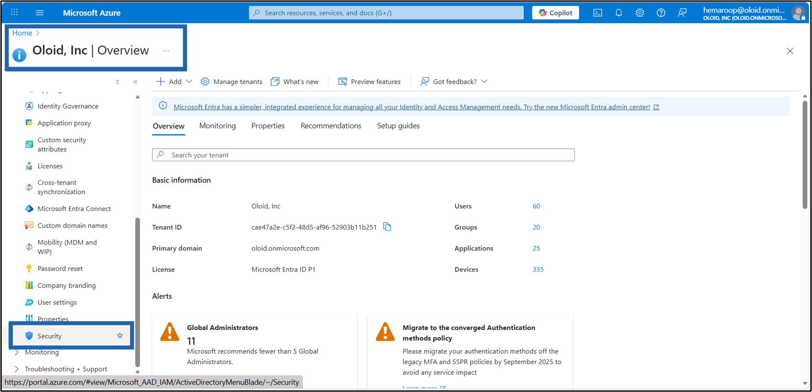

2. Go to **Security > Manage > Authentication Methods**.

   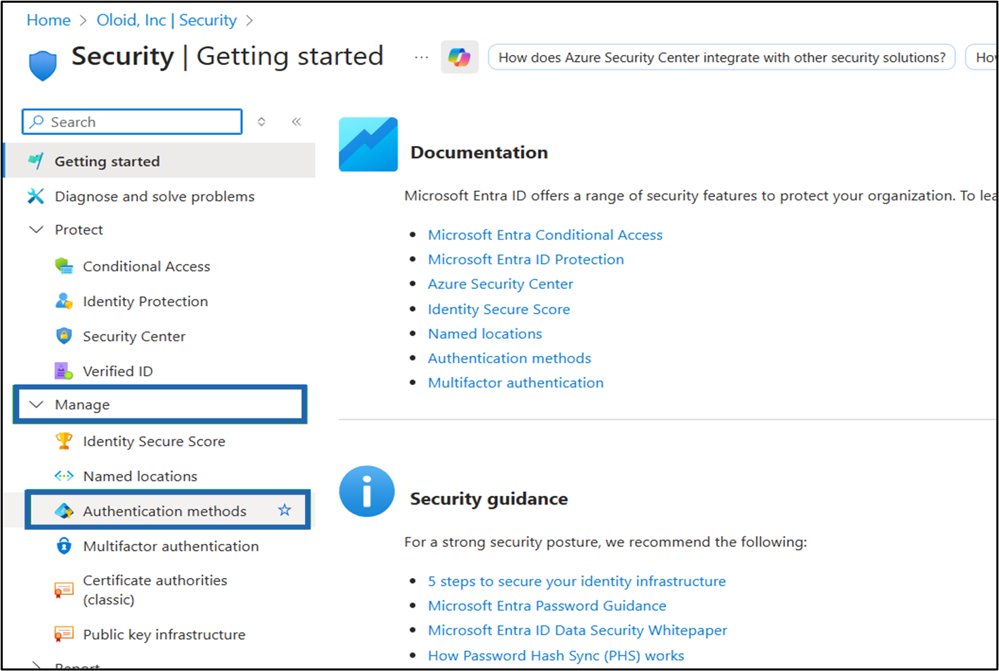

   The Authentication page is displayed.
3. Go to **Manage > Policies**, select **Passkey (FIDO2)** in **Authentication method policies** table.

   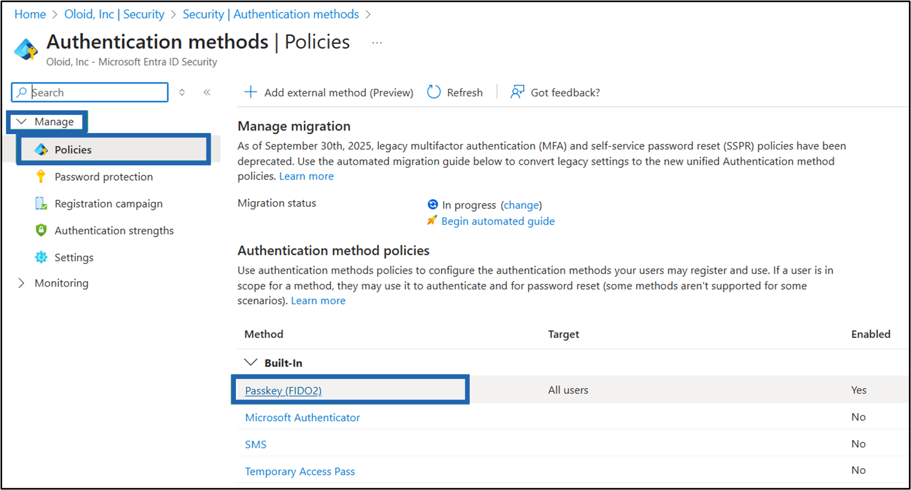

   The Passkey (FIDO2) setting page is displayed.
4. Click **Enable and Target** tab and do the following:
   1. Enable the toggle.
   2. Select **All Users** as Target.

      <Note>
        **Note:** If you target specific groups instead of **All Users**, every user synced to Oloid must be a member of one of those groups. Otherwise, their passkey can’t be created.
      </Note>

   3. Click **Save**.

      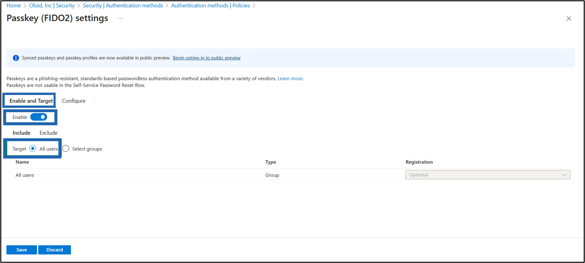

      The **Enable and Target** tab is configured successfully.
5. Click **Configure** tab and do the following:
   1. Select Allow Self-Service set up **Yes**.
   2. Select Enforce Attestation **No**.
   3. Select Enforce key restrictions **No**.
   4. Select Restrict specific key **Allow**.
   5. Click **Save**.

      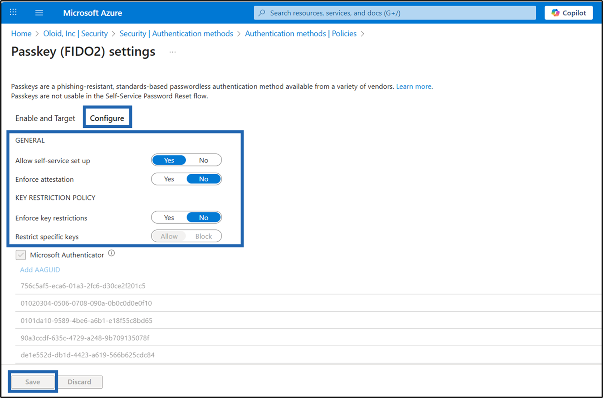

      The Configure tab is configured successfully. FIDO2 is successfully configured.

##### Related Documents

[How to Configure Advanced User Sync for Entra ID - Inbound in the Tenant Admin Portal](/integrations/entra-id/tenant-admin-portal-how-to-configure-advanced-user-sync-for-entra-id)

[Tenant Admin Portal - How to Configure Data Mapper Table for Entra ID - Inbound](/platform/tenant-admin-portal/tenant-admin-portal-how-to-configure-data-mapper-table-for-entra-id)
