{/* Source: Intercom article 10299916 - https://oloid.help/en/articles/10299916-integrating-oloid-as-an-external-method-authentication-eam-with-microsoft-entra-id */}
{/* Generated by intercom_to_mintlify.py - re-running overwrites this file. */}

## Introduction

This document describes how to configure **Oloid External Authentication Method (EAM)** in **Microsoft Entra ID**. The integration allows Oloid’s passwordless authentication to work with Microsoft Entra ID, enabling Oloid to act as an **external MFA provider** for secure and seamless access to enterprise applications.

## Key highlights of this document include

### Obtaining Essential Oloid Tenant Details

- Client ID.
- OpenID Configuration.
- Authorization Endpoints.

### Configuring Microsoft Entra ID

- [Register and configure the application.](#configure-the-application)
- Configure External Authentication Methods (EAM).
- Configure Conditional Access Policies (Optional).

### Testing the Integration

Verify the authentication flow by testing user access to integrated applications, such as ServiceNow. This configuration integrates Oloid’s passwordless authentication with Microsoft Entra ID (Azure AD) to enhance security and improve the user experience.

## Step 1: Obtain Oloid Tenant Configuration

To configure Oloid as an External Authentication Method in Microsoft Entra ID, gather the following details from your Oloid tenant:

| Client ID | &lt;&lt;################################>> |
| --- | --- |
| **OIDC Endpoint** | [https://api.oloidpreview.com/oidc/showcase/eam/oauth2/.well-known/openid-configuration](https://api.oloidpreview.com/oidc/showcase/eam/oauth2/.well-known/openid-configuration) |
| **Authorization Endpoint** | [https://api.oloidpreview.com/oidc/showcase/eam/oauth2/authorize](https://api.oloidpreview.com/oidc/showcase/eam/oauth2/authorize) |

## Step 2: Register and Configure an Application in Microsoft Entra ID

### Register an application

1. Log in to the Microsoft Entra ID **Portal** with an account that has **Global Administrator** permissions or sufficient access to create applications.
2. Navigate to **Microsoft Entra ID > App registrations > New registration**.

   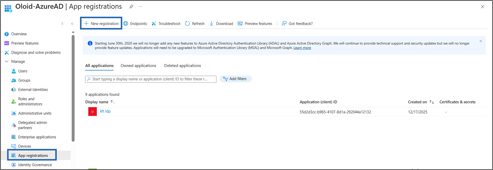

   The Register an application page is displayed.
3. Provide the following details:
   1. Enter **Name.**
   2. Enter **Redirect URI:** Select **Web** from the drop-down list and Use the **Authorization Endpoint** from [Step 1](#step-1-obtain-oloid-tenant-configuration) in the redirected URL field.

      <Note>
        **Note:** The **Authorization Endpoint** from theTenant Admin Portalis the **Redirect URL**.
      </Note>

   3. Click **Register**.

      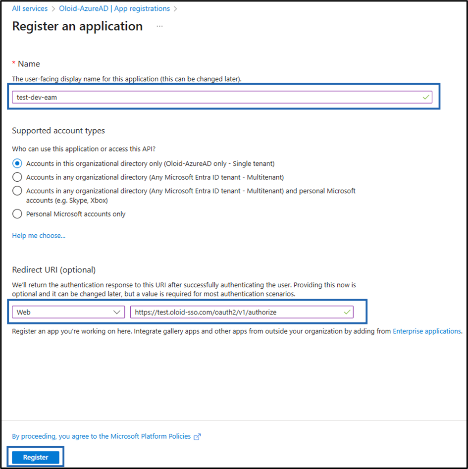

      The application is registered successfully.
      After registration, Copy the **Application ID** of the newly registered application.

      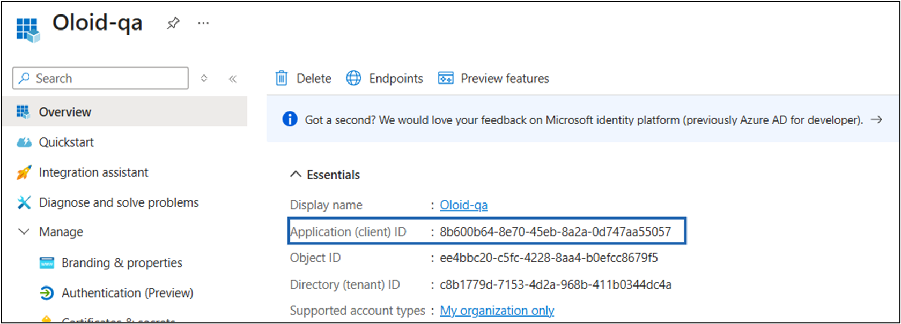

### Configure the Application

1. Navigate to the **newly registered app > Manage >** **Token Configuration** > Click **+ Add optional claim**.

   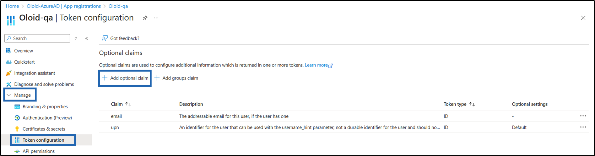

   The **Add optional claim** page is displayed.
2. Select **ID** as a Token type and do the following:
   1. Select **email.**
   2. Select **upn.**
   3. Click **Add**.

      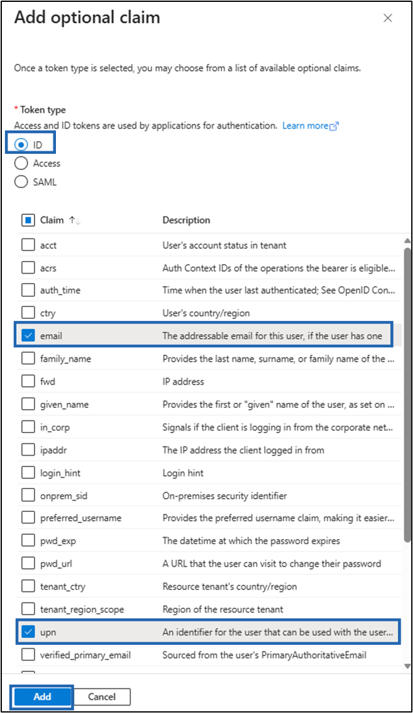

      The **Add optional claim** pop-up box is displayed.
3. Select **Turn on the Microsoft Graph** checkbox and click **Add** to save the claims.

   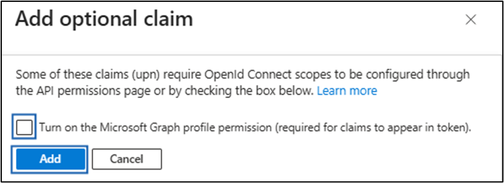

4. Go to **Manage** > **API permissions** > **Grant required permissions.**

   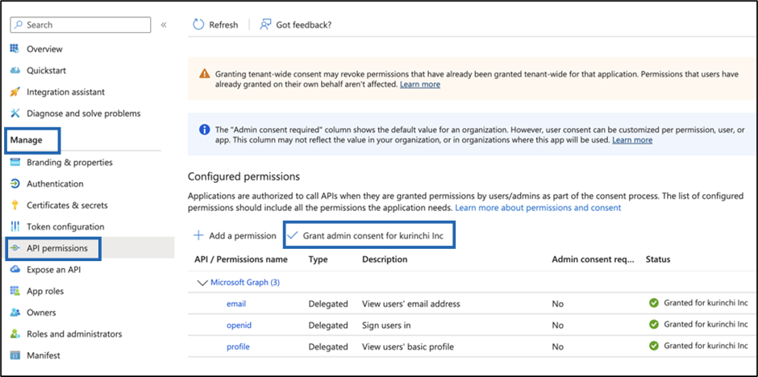

   The **Grant admin consent confirmation** pop-up box is displayed.
5. Click **Yes**.

   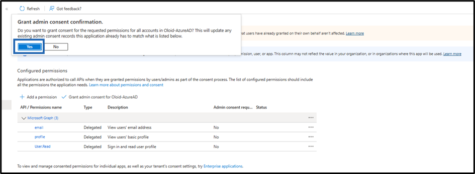

   The API permission is configured successfully.

   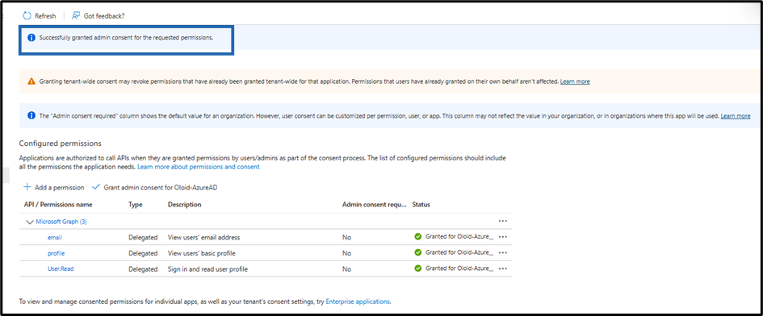

### Create Client Secret

1. Navigate to **newly registered app >** Click **Client Credentials.**

   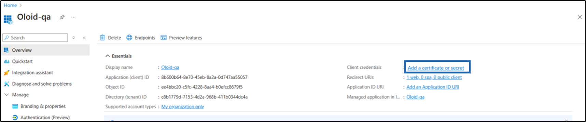

   The Certificates & secrets page is displayed.
2. Click **New client secret**.

   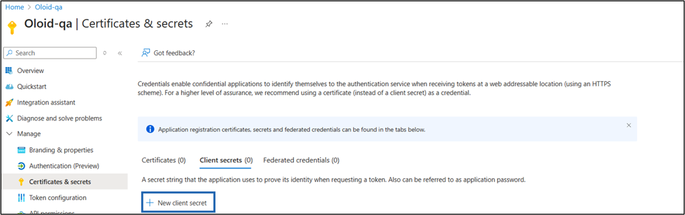

   The **Add a client secret** screen is displayed.
3. Do the following:
   1. Enter **Description**.
   2. Select the **secret expires** duration from the drop-down list.
   3. Click **Add**.

      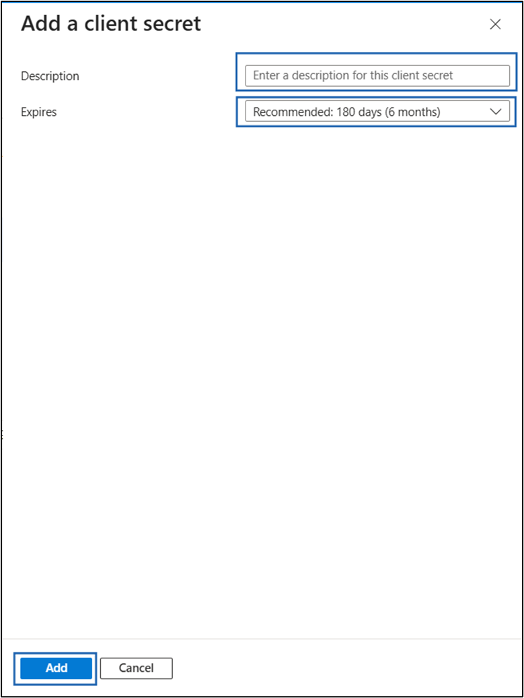

      The **Client Secret** is added successfully and listed on Client Secret tab.

      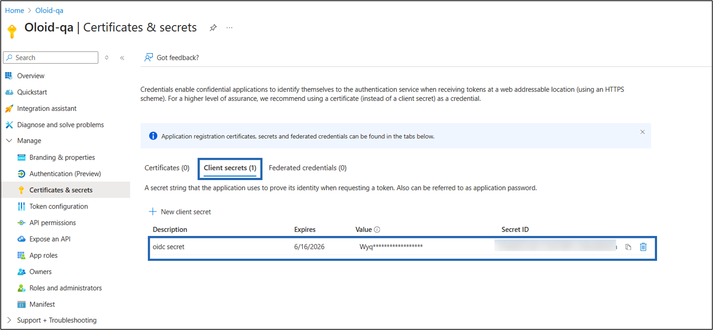

## Step 3: Configure External Authentication Method in Microsoft Entra ID

1. Navigate to **Application > Manage > Security.**

   

   The Security page is displayed.
2. Go to **Manage > Authentication Methods.**

   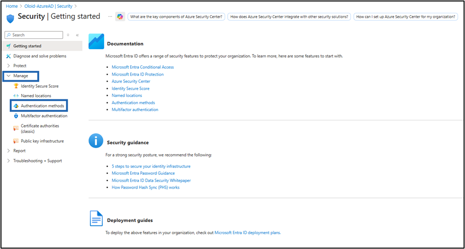

   The **Authentication methods** page is displayed.
3. Click **+Add external method (Preview)**.

   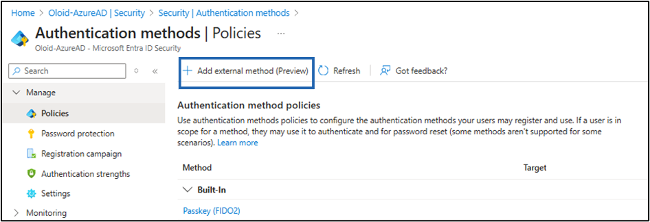

   The **Add external method (Preview)** screen is displayed.
4. Do the following:
   1. Enter **Name**.
   2. Enter **Client ID**.

      <Note>
        **Note:** Enter the **Oloid Client ID** in the **Client ID** field.
      </Note>

   3. Enter **Discovery Endpoint.**

      <Note>
        **Note:** Enter the **OpenID Configuration Endpoint** in the **Discovery Endpoint** field.
      </Note>

   4. Enter **App ID**.
   5. Click **Request Permission**.

      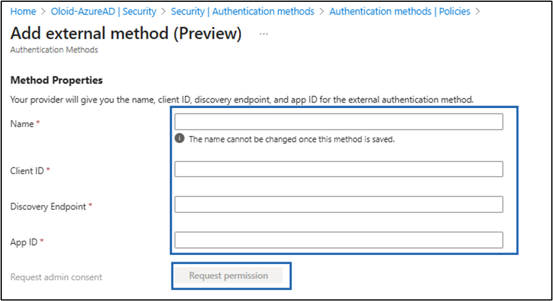

      <Note>
        **Note:** You can view the **Oloid Client ID** and **OpenID Configuration Endpoint** in the **Metadata** tab in the Tenant Admin Portal. To see the Metadata tab, go to **Tenant Admin Portal > Auth Policies > Identity Provider > Select applicable OIDC (Entra ID) idP >** Oloid Metadata.
      </Note>

      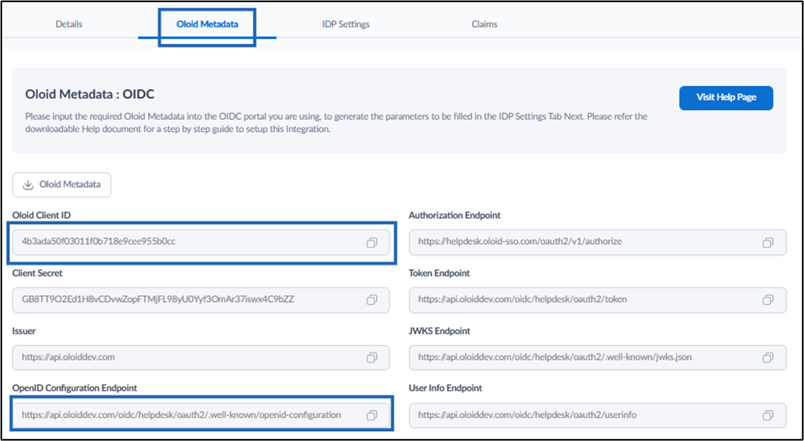

5. Accept the required permissions.

   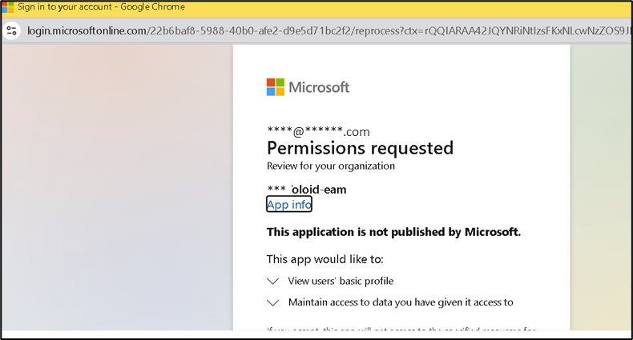

6. Click **Save** and enable the configuration.

   <Note>
     **Note:** Ensure that you select only the users who require Oloid as MFA. Do not apply this setting to all users.
   </Note>

   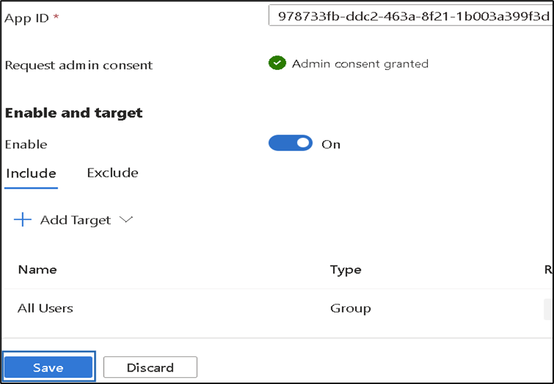

## Step 4: Provide Microsoft Entra ID Information to Oloid

Share the following details of your Microsoft Entra ID tenant with Oloid for final configuration:

| Configuration Detail | Value |
| --- | --- |
| **Tenant ID** | Obtain from Microsoft Entra ID. |
| **Application ID** | Found under [Register an Application (Step 2)](#register-an-application). |
| **OIDC Endpoint** | Found under Azure App **Endpoints** section. |
| **Redirect URL** | Enter the Redirect URL [(Step 2)](#step-2-register-and-configure-an-application-in-microsoft-entra-id). |
| **Callback URL** | Optional |
| **Secret** | Found under [Create Client Secret (Step 2).](#create-client-secret) |

The Tenant ID can be obtained from the following screen:

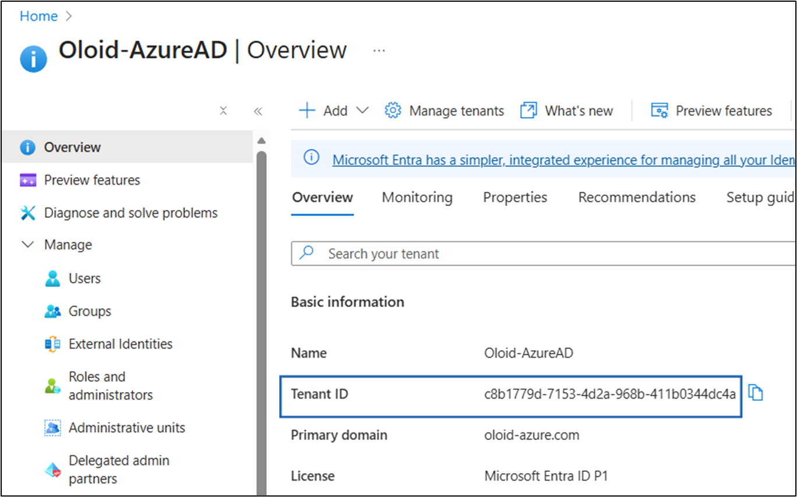

### Instructions to Obtain Endpoints

1. Navigate to **App Registrations** > Select the registered application > **Endpoints**.

   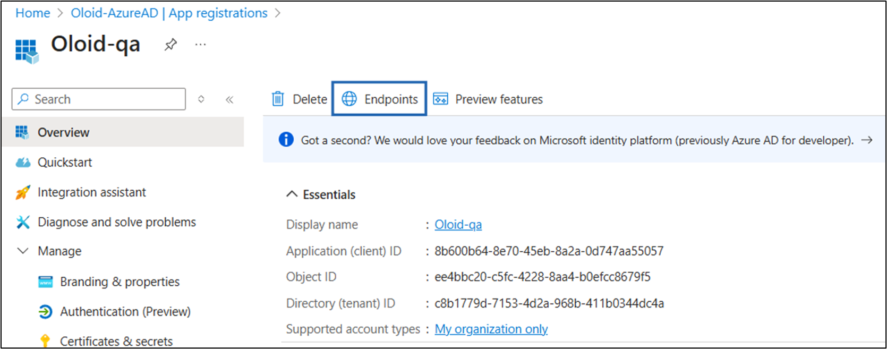

   The endpoints list is displayed.
2. Copy the **OpenID Connect Meta data document URL**.

   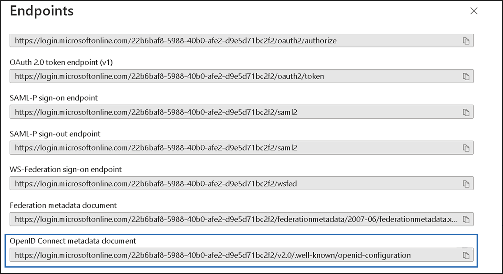

   <Note>
     **Note:** Use OpenID Connect Meta data document URL in the Authorize URL field. To see the Authorize URL field, go to **Tenant Admin Portal > Auth Policies > Identity Provider > Select OIDC tab > IDP Settings.**
   </Note>

   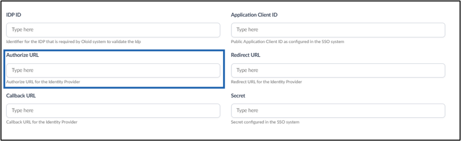

## Step 5: Apply Conditional Access Policies (Optional)

<Note>
  **Note:** Perform this step only if you need to protect a specific application by using Oloid as MFA or for selected user(s) group(s).
</Note>

1. Navigate to **Oloid-AzureAD > Security.**

   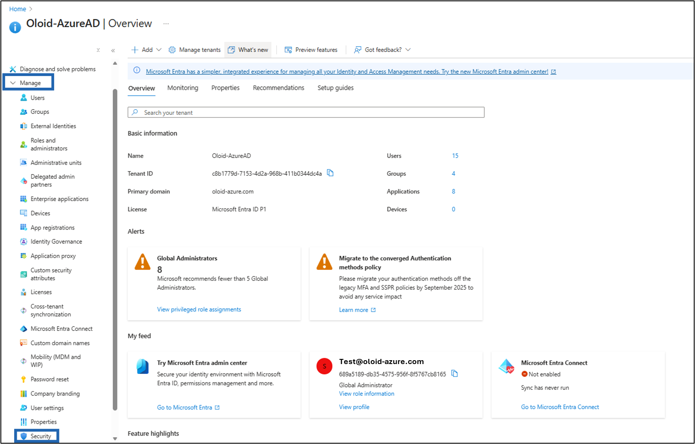

   The security page is displayed.
2. Go to **Protect > Conditional Access.**

   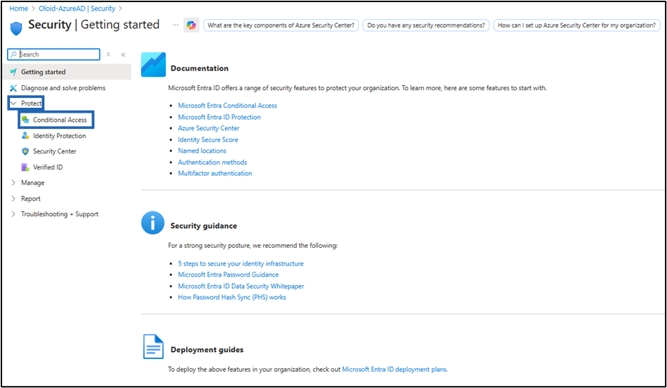

   The **Conditional Access** page is displayed.
3. Click **Policy Snapshot**.

   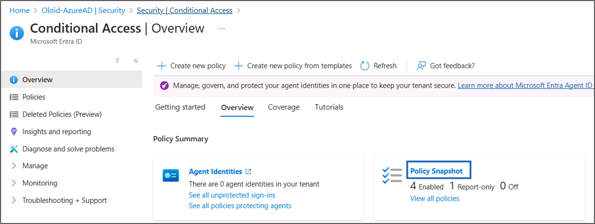

   The **Policies** page is displayed.
4. Click **+New Policy**.

   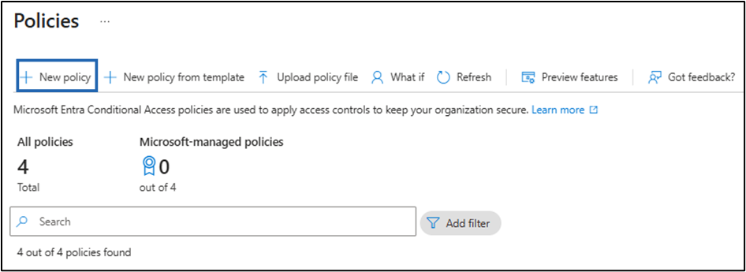

5. Click **users or agents > Select Users and groups >** select **Users and Groups > Select the Preferred Group** from the list e.g. oloid.

   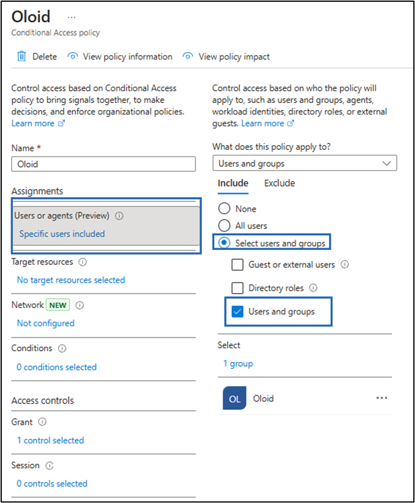

6. On **Target Resources**, select an application e.g. Service Now.

   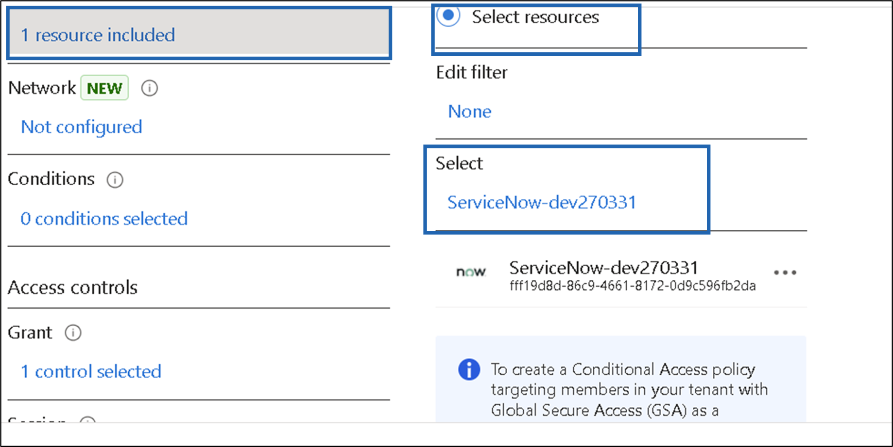

7. Click **Access Control** > Select **Grant access** > Click **Select**.

   <Note>
     **Note:** Select **Require multifactor authentication** checkbox.
   </Note>

   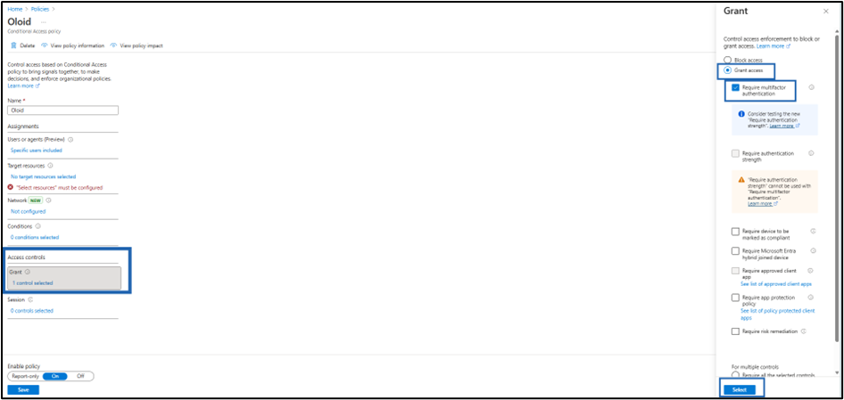

8. On Grant section, select **Require one of the selected controls**.

   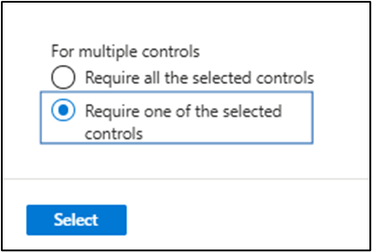

9. On **Enable Policy**, click **On > Save.**

   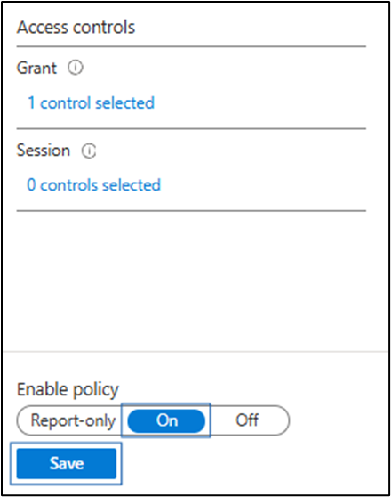

   The policy is configured successfully.

## Step 6: Test the Integration

Test the integration using an application managed by Microsoft Entra ID e.g. ServiceNow

1. Open the ServiceNow application URL: [https://&lt;&lt;servicenow_tenant>>.service-now.com](https://dev270331.service-now.com)
2. Log in with a user account that meets the following criteria:
   - Belongs to the **snow-users** group.
   - Has access to the ServiceNow application.
3. After entering the password, the user will be prompted for **Oloid EAM**.

   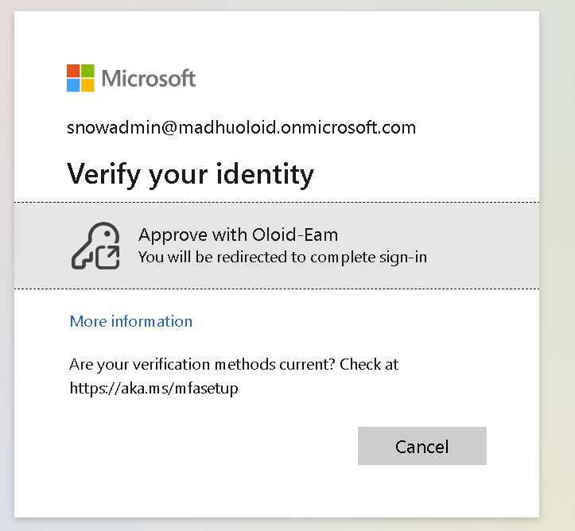

4. Authenticate using Oloid MFA (ensure the user’s Oloid account has the same email as the Microsoft Entra ID UPN).
5. Upon successful authentication, the user will be logged into ServiceNow.

   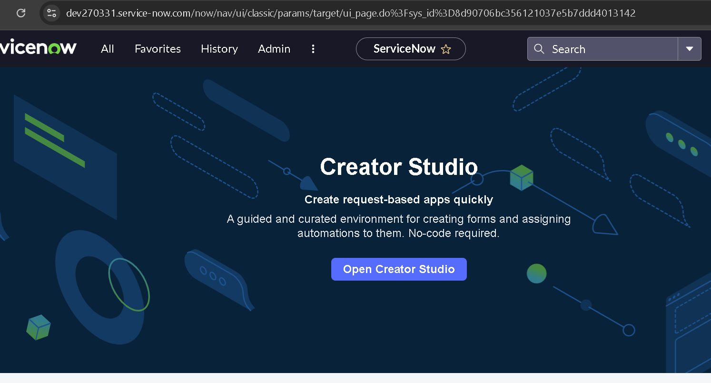
