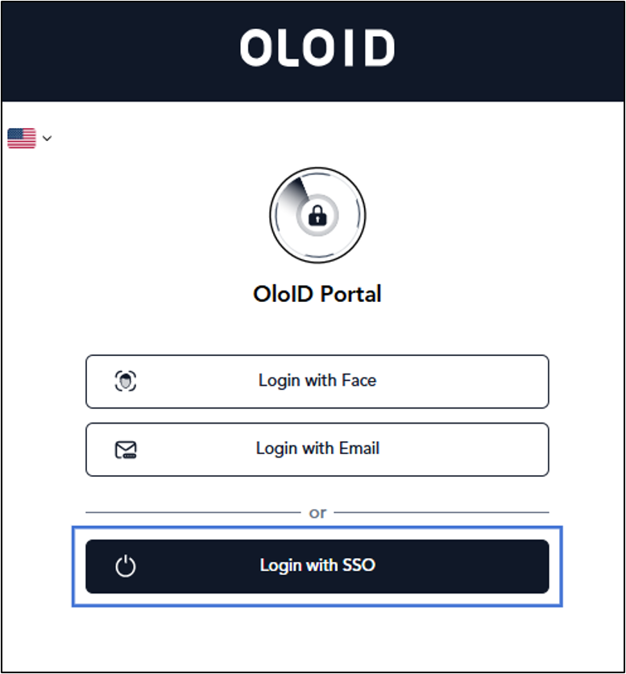
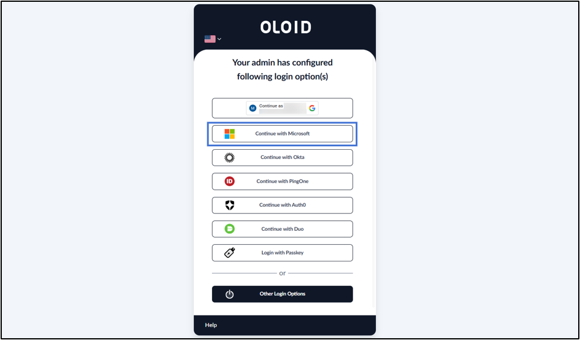
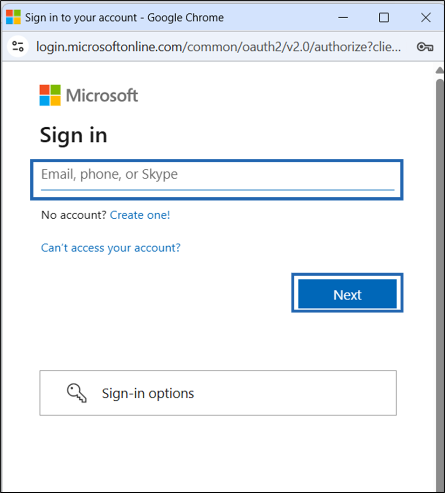
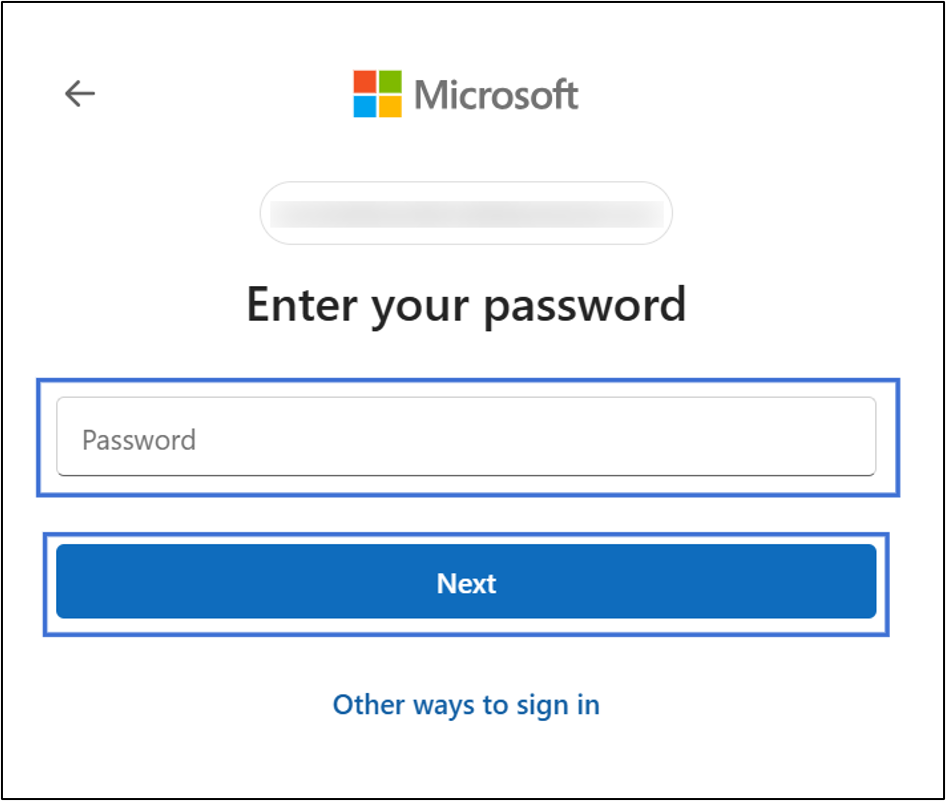
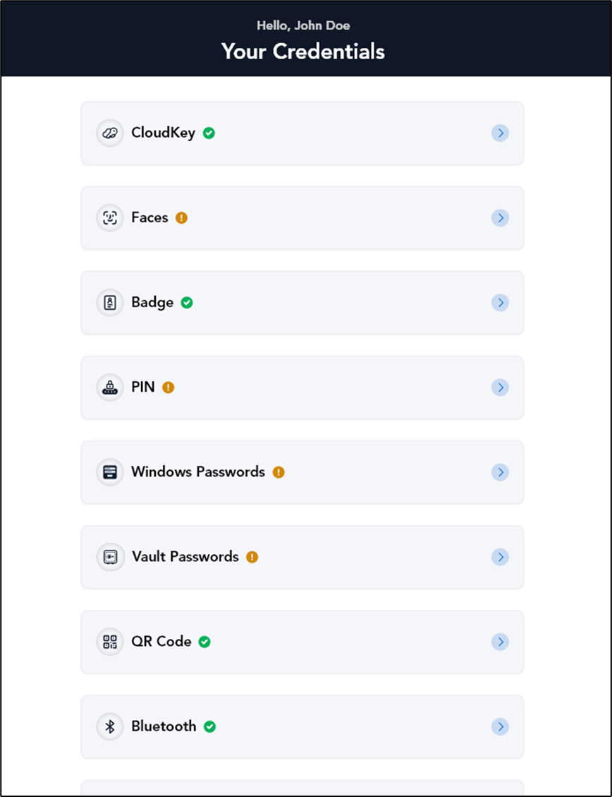

{/* Source: Intercom article 9531151 - https://oloid.help/en/articles/9531151-oloid-user-portal-how-to-log-in-to-oloid-user-portal-with-microsoft-sso */}
{/* Generated by intercom_to_mintlify.py - re-running overwrites this file. */}

## Introduction

This document provides step-by-step instructions for logging in to the Oloid User Portal using Microsoft Single Sign-On (SSO). Microsoft SSO allows users to securely access the Oloid User Portal.

<Note>
  **Note:** To enable **Microsoft SSO Login** for Oloid User Portal, contact [Oloid Support.](mailto:Support@oloid.ai)
</Note>

## Prerequisites

- You should be a user in the Tenant Admin Portal.
- The Microsoft credential (user email ID) must be added to the user details page.
- You must enable SSO options in Tenant Admin Portal. For more details, refer to [How to configure Oloid User Portal in Tenant Admin Portal](/platform/tenant-admin-portal/oloid-user-portal-how-to-configure-oloid-user-portal-in-tenant-admin)

## Steps to log into Oloid User Portal using Microsoft SSO Login

1. Launch your browser.
2. Enter the URL provided for you in the browser’s address bar > press **Enter** on your keyboard.
   The Oloid User Portal page is displayed.
3. Click **Login with SSO.**

   

   The configured login options are displayed.
4. Click **Continue with Microsoft** to log into Oloid User Portal with Microsoft SSO.

   

   The Sign in pop-up box is displayed.
5. Enter your **Microsoft ID** > click **Next**.

   

   **Enter your password** pop up box is displayed.

Enter **Password** in the Password field > Click **Next**.

You are logged in to the Oloid User Portal using Microsoft SSO successfully.

